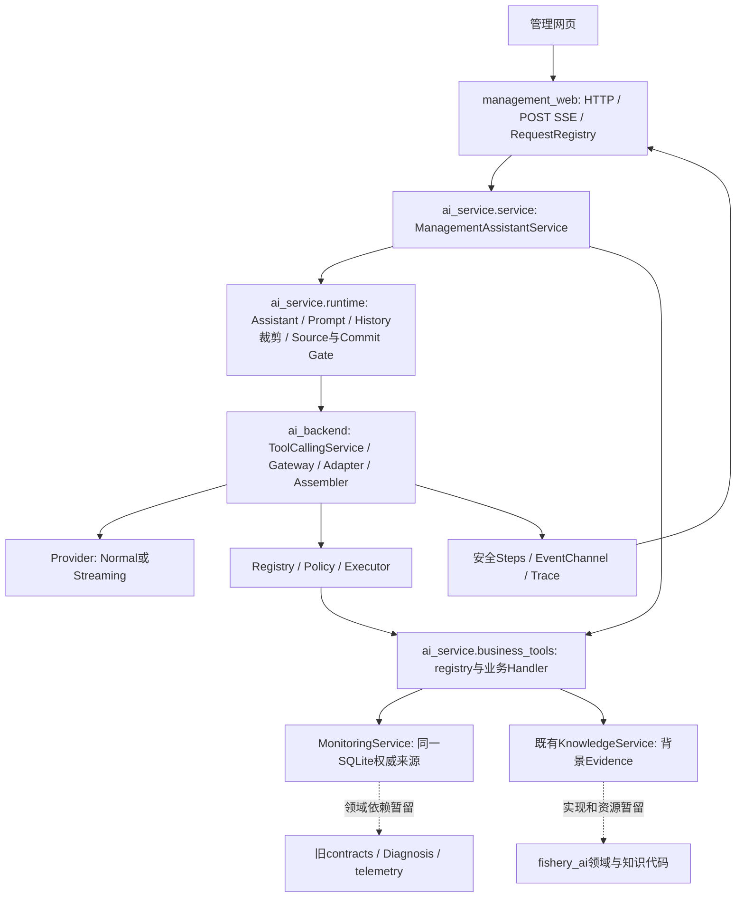

# AI Backend 与 Assistant 开发指南

本指南用于管理平台的代码定位、扩展与验证。当前依赖为 `management_web → ai_service → ai_backend`。旧 `src/fishery_ai/` 是独立实验平台，不是管理 LLM 执行的底层。以下路径以仓库根目录为起点；示例不构成权限或真实请求授权。

先读 [工程规则](../../AGENTS.md)、[结构地图](../STRUCTURE.md)；启动与数据接入见 [BUILD_RUN](../BUILD_RUN.md)，数据合同见 [INTEGRATION](../INTEGRATION.md)。迁移历史见 [R2C-1 记录](research/R2C1B_AI_BACKEND_FORK_MIGRATION_PLAN.md#15-r2c-1e-工程收尾与人工验收)。本指南不复制完整协议、Prompt 或发布 JSON。

## 1. 架构与职责

### 1.1 七个区域

| 区域 | 做什么 | 不在这里做什么 |
|---|---|---|
| `apps/management_web/` | 页面、HTTP/SSE、浏览器访问控制、请求注册/状态/Stop | 模型执行循环、业务阈值、Provider SDK 调用 |
| `apps/ai_service/` 顶层 | `ManagementAssistantService` 装配、设备/Policy 冻结、管理发布配置 | 第二套 Tool 循环、HTTP worker |
| `apps/ai_service/business_tools/` | 一个 Tool 一个模块：名称/Definition/validator/Handler/DTO；registry.py 显式统一装配 | 自动发现、独立权限或 Ledger、重复领域规则 |
| `apps/ai_service/runtime/` | 渔业 Assistant、Prompt、Preset/Policy、领域 Receipt/Ledger、Source/Commit Gate | 通用 Provider 传输、Flask、数据库存储 |
| `apps/ai_backend/` | 通用模型合同、Gateway/Adapter、Streaming Assembler、Tool 循环、执行上下文、安全事件/Trace | 渔业规则、Knowledge 实现、业务 Prompt、默认 Tool |
| `apps/monitoring/` | 权威监测事实、SQLite、历史、确定性 Findings/Events、设备绑定查询 | LLM 解释与模型路由 |
| Knowledge | 当前复用 `fishery_ai.knowledge.KnowledgeService` 与固定知识资源 | 当前现场观测、现场疾病确诊 |
| `src/fishery_ai/` | 独立 Prototype、原有 Analysis/Assistant 与技术实验 | 管理端的新旧 Runtime 自动切换或同步 |

`ai_service/runtime` 的名称容易误解：这里是“业务 Assistant 的运行合同”，不是第二个通用 LLM Runtime。目录暂不改名；新增 Gateway、Assembler、Handle、执行循环应放 Backend，业务来源与 Prompt 应留服务层。



箭头表示调用/数据依赖，不代表 Backend 导入业务模块。Handler 由服务层静态注入。Monitoring/Knowledge 的旧领域依赖尚未迁走，所以当前不能卸载整个 fishery_ai 包；管理 Turn 使用的新模型类型、Handle、ContextVar 与 Tool 循环始终来自 Backend。

当前监测规则仍为 PROTOTYPE；模拟观测、视觉疑似检测信号、确定性 Finding 与 LLM 解释应分别保留来源，不能升级成真实设备事实或疾病确诊。

### 1.2 一次当前水质查询如何执行

1. 页面 [assistant.js](../../management_web/static/assistant.js) 保存会话 draft/成功文本 pair；[services.js](../../management_web/static/services.js) 发起同源请求。`GET /api/ai/bootstrap` 给出 epoch、设备、可用模式、预算和 revision；`POST /api/ai/requests` 创建一个 Handle。
2. [app.py](../../management_web/app.py) 先做本机/Host/Origin/浏览器令牌/JSON 检查；[ai_adapter.py](../../management_web/ai_adapter.py) 的 `ManagementAssistant._prepare()` 限定 Web 字段，转交业务预检，再取得同一 Handle。
3. [service.py](../../ai_service/service.py) 的 `prepare_turn()` / `_configuration()` 校验 epoch、Preset、设备、Policy、Scope、revision 与本次联网确认，返回 [PreparedAssistantTurn](../../ai_service/contracts.py)。它冻结设备身份、Profile、Policy、Registry 和执行决策；此时不查询观测、不解析凭据、不联网。
4. `claim_turn()` 先 `handle.start()` 防止重放，设整 Turn 时限；`_execute_claimed_turn()` 在实际工作线程建立 `request_scope` / `turn_deadline_scope`，通过 `ProfileRegistry.snapshot()` 一次取得 `RuntimeSnapshot` / `CredentialSnapshot`。
5. 业务 `AssistantService._send()` 构建 System + 裁剪后的 History + 当前问题；`project_retained_history()` 应用 B 投影。`ToolCallingService.run_request()` 再从有效 Policy/Registry 加入允许的 definitions，调用 Gateway。当前实际 Adapter 为 `OpenAICompatibleAdapter`。
6. 只有模型返回合法 protocol Tool Call，Executor 才执行 `business_tools.current_water_quality.water_payload()` → `MonitoringService.capture_water(device_id)` → 领域分析 → `project_water_tool()`。同一设备使用与网页相同的 SQLite 和规则，不读取 Prototype Snapshot。
7. Result 以 `role=tool` 返回后，单轮模式要求 Final；多轮模式允许模型看到实际 Result 后再决定下一个 Tool 或提前 Final。每轮最多一个 Tool，最多 1/1/2 或 2/2/3，不自动 retry。
8. 业务 `ledger_from_execution()` 从真实 Steps 推导来源；`AssistantService._send()` 检查完整正文、finish reason、SourceRequirement、取消/Deadline、安全 Trace。失败没有成功 Final。后端安全结果通过 Web 返回，前端只把合法成功的 user/final assistant pair 加入下一轮 History。

冻结的是**设备与运行配置**，不是预先冻结一份旧水质读数。Tool 执行时才读取该设备的当前数据。页面与 Tool 的两次独立查询可能跨过新批次，核对时要比较 batch/time，不能只比较数值。

### 1.3 Normal 与 Streaming 的差别

| 环节 | Normal | Streaming |
|---|---|---|
| HTTP | `POST /api/ai/messages`，完成后返回 JSON；状态另行轮询 | `POST /api/ai/messages/stream`，fetch 读取 SSE；不使用自动重连的 EventSource |
| Web 执行 | 同步调用 `execute_turn()` | 预先 claim，再由 [management_web/streaming.py](../../management_web/streaming.py) 的 `stream_response()` 建 worker/事件投递 |
| 模型传输 | `ModelGateway.complete()` | `complete_tool_stream()`，由同一个 Adapter 组装完整响应后交原 Tool 循环 |
| 页面 | 等最终正文，Steps 可轮询 | `start/activity/preview_reset/preview/final/error/cancelled`；预览有界且临时 |
| 提交 | 完整成功结果才进入 History | 合法 Final 才提交；Tool 切换、失败、Stop、断流或截断撤销预览 |

两种模式共享成功 History、Policy、Ledger、Commit Gate 和同一套 Tool 执行机制。Streaming 的多次模型请求仍属于一个 Turn；SSE 分片不是 Tool 执行指令。前端 [assistant-events.js](../../management_web/static/assistant-events.js) 校验 request_id、epoch、连续序号、revision 与唯一终态，断线不重新请求模型。

## 2. 新增业务 Tool

### 2.1 先区分三种改动

| 任务 | 实际含义 | 不会自动发生的事 |
|---|---|---|
| A：启用已有 Tool | 对已装配且合同存在的 Tool，由用户授权 Policy | 不新增 Handler，不获得新的多轮/Streaming 范围 |
| B：新增 Definition + Handler | 定义 Schema、严格 validator、绑定只读业务服务，并补来源/展示/测试 | 不自动默认授权，不自动取得某 Preset 的资格 |
| C：纳入模型实验范围 | 维护者审核精确 Tool 集合、Identity、协议、Prompt、History、数据绑定与预算 | 不修改用户 Policy，不继承其他模型或旧组合的真实证据 |

当前管理默认请求 Registry 只有水质查询与 Knowledge。评分名称只为旧 Policy 合法存储兼容保留，没有评分 Handler。内置默认只授权水质；Knowledge 必须 opt-in。用户现有文件优先于默认值，不应为了联调覆盖它。

历史水质Tool已完成15个真实样本技术验证，获用户批准为local_experimental、默认关闭。默认请求Registry仍只有上述两项；单独formal/per-Turn Registry包含历史定义，只有服务器绑定的Qwen Normal历史查询操作暴露它。共享Policy仍拒绝历史名称；管理设置opt-in与`--assistant-history-trial`分别必需，不能从旧Tool Manager写入或扩大两工具Scope。操作见[BUILD_RUN](../BUILD_RUN.md#r2d-1g历史水质单工具本地试用)。

### 2.2 准确修改地图：历史候选与后续新 Tool

`get_water_quality_history` 已有默认关闭的独立本地试用范围。以下地图也适用于后续新Tool；不是要求每次都改全部文件。

普通聊天不选择技术性执行Profile。过渡期通过「历史查询」快捷操作，在下一条消息提交 `action="history_query"`，Web薄适配映射到服务器内部历史范围；成功后恢复普通提问，History保留。页面不能提交 `execution_profile` 或预算。历史在Streaming不可用时须由用户主动切Normal。三工具统一Normal候选见 [normal_selection.py](../../ai_service/normal_selection.py) 与 [固定Scope](../../ai_service/resources/assistant_normal_candidate.json)，始终candidate且产品禁止准入，不继承已有两工具/历史单工具的真实资格。后续新工具的“授权”“装配”“精确范围发布”仍分别校验。

| 顺序 | 当前文件 / 入口 | 需要考虑的改动 |
|---|---|---|
| 1 | [monitoring/service.py](../../monitoring/service.py) `query_water_history(device_id, *, lookback_minutes, metrics)` | 真实时间范围与统计已实现；旧 history(limit) 仍只返回最后 N 条，不作为该 Tool 的时间查询入口 |
| 2 | [历史模块](../../ai_service/business_tools/water_quality_history.py)；参考 [水质模块](../../ai_service/business_tools/current_water_quality.py)、[Knowledge 模块](../../ai_service/business_tools/fishery_knowledge.py) | Definition/Schema、strict validator、单次委托 Handler、有限结果元数据校验；不复制统计或检索逻辑 |
| 3 | [business_tools/registry.py](../../ai_service/business_tools/registry.py) `bind_tools(..., include_history=True)` | 默认两工具与单独历史候选分别装配；formal 与 per-Turn 必须一致。设备来自服务器冻结上下文，不来自模型参数 |
| 4 | [management_policy.py](../../ai_service/management_policy.py)、[runtime/policy.py](../../ai_service/runtime/policy.py) | 管理独立文件支持历史 opt-in；缺省只读继承共享选择。旧 KNOWN_TOOL_NAMES/共享文件保持不变，不能把历史名称写入旧 Tool Manager |
| 5 | [runtime/sources.py](../../ai_service/runtime/sources.py) | HISTORICAL_WATER_QUERY 与 HISTORICAL_WATER_OBSERVATIONS 已独立实现；未知 Tool 不自动获得来源 |
| 6 | [runtime/catalog.py](../../ai_service/runtime/catalog.py)、[runtime/activity.py](../../ai_service/runtime/activity.py) | 名称、短摘要、有限时间/状态/计数；不能把历史记录全文或参数放进 Activity |
| 7 | [service.py](../../ai_service/service.py) `local()`、`_configuration()` | `JsonlTraceSink(tool_names=...)` 的固定名单要同步；执行授权仍与实际装配求交 |
| 8 | [execution.py](../../ai_service/execution.py)、[streaming.py](../../ai_service/streaming.py)、[history_execution.py](../../ai_service/history_execution.py) 与资源 JSON | 历史Profile绑定独立Normal单工具Scope、local_experimental默认关闭；新工具仍从candidate开始，不得继承资格。检查数据绑定、预算与revision。Streaming仍有固定STREAMING_TOOLS限制，不能只往JSON加名称 |
| 9 | [release_contracts.py](../../ai_service/runtime/release_contracts.py)、[streaming_contracts.py](../../ai_service/runtime/streaming_contracts.py) | 通常只使用已有 hash/Scope 计算，不为加 Tool 放宽匹配器；不同语义的 Scope 扩展须另审 |
| 10 | [业务测试](../../ai_service/runtime/tests/test_foundation.py)、[HTTP测试](../../management_web/tests/test_knowledge.py)、[资格入口](../../ai_service/development/streaming_qualification.py) | 补新增 Tool 的离线单元/API/来源测试；现有管理资格仅三固定案例，不是任意新 Tool 的通用授权器 |

`business_tools/registry.py::bind_tools(..., formal=...)` 是唯一业务 Registry 装配入口：默认只重绑水质 Handler，Knowledge 保留 formal entry 和共享 KnowledgeService。历史候选同时重绑该设备的历史 Handler，formal / per-Turn 都必须显式 include_history=True。不能只改启动时 Registry，也不能把候选 formal 传给默认装配；Definition 始终来自同一个 formal owner。

`business_tools/__init__.py` 不 re-export 工具或工厂。旧 runtime/tools.py 与顶层 bindings.py 已移除，不提供 Alias/兼容入口；调用方直接导入工具 owner 或统一 registry。`WATER_QUALITY_SCORE` 和 `KNOWN_TOOL_NAMES` 位于 registry.py，评分只用于合法存储名称校验，没有 Definition/Handler。

### 2.3 离线候选装配示例

历史 Tool 的真实 Schema / validator 位于 [water_quality_history.py](../../ai_service/business_tools/water_quality_history.py)，不再使用旧指南的 limit 示例：时间范围必须是 lookback_minutes=10/30/60。metrics 可省略；模型 JSON 中指定时必须为不重复的已知指标列表。归一化复用 Monitoring 的参数校验，bool、float、数值字符串和额外字段拒绝。

```python
from apps.ai_service.business_tools.registry import bind_tools, HISTORY_CANDIDATE_TOOL_NAMES
from apps.ai_service.business_tools.water_quality_history import WATER_QUALITY_HISTORY
from apps.ai_backend.tools.policy import ToolPolicy
from apps.ai_backend.observability import JsonlTraceSink

# 仅使用测试的 Monitoring / Knowledge、临时 SQLite 与临时 Trace 路径。
formal = bind_tools(monitoring, device_id, knowledge, include_history=True)
turn_registry = bind_tools(
    monitoring, device_id, knowledge, formal=formal, include_history=True,
)
policy = ToolPolicy("assistant", True, (WATER_QUALITY_HISTORY,))
traces = JsonlTraceSink(test_trace_path, tool_names=HISTORY_CANDIDATE_TOOL_NAMES)
```

这段只创建内存对象，不运行模型、不修改用户 Policy、不获得发布资格。正式 ManagementAssistantService 没有真实候选执行开关，普通请求仍使用两工具装配；候选 Registry 独立保存。真实候选实验须另行批准。

Schema 用于模型说明；Executor 校验有界 JSON/object 后调用 ToolDefinition.validate_arguments，不运行通用 JSON Schema 引擎。有参数 Handler 接收归一化 dict，再经服务器绑定的 device_id 调用 MonitoringService.query_water_history()，原样返回 Monitoring 的有界统计 DTO，不直接读库或重新诊断。

历史范围、统计、质量、边界覆盖和 720/12/24 KiB 预算见 [集成合同](../INTEGRATION.md)。result_metadata() 只校验用于 Receipt/Activity 的有限合同与一致性，不重算统计。持续低氧、恢复等仍为 NOT_EVALUATED。

### 2.4 来源、展示与实验授权

- `HISTORICAL_WATER_QUERY` 要求真实历史操作完成，合法 NO_DATA / PARTIAL 也可满足；`HISTORICAL_WATER_OBSERVATIONS` 另行认证实际可靠指标。历史不能满足 `CURRENT_OBSERVATION_QUERY`，也不能认证 `CURRENT_TOOL_OBSERVATION`。产品默认仍 AUTO，无自然语言路由。
- `NO_DATA` / `NO_MATCH` 不是同一种结果：前者是当前查询无快照或历史查询无完整匹配窗口，后者是检索完成无命中。operation completed 与 payload exists 分开判断。当前 water Tool 的 `OK` 仍可能是 INVALID/PARTIAL/STALE，须读取质量与时间。
- Ledger 从本轮真实 ToolExecutionStep 产生；History、模型正文中的“我查询了”不能产生 Receipt。新 Tool 未被来源解析器认可时，不应为显示好看伪造来源。
- Catalog 是人类显示 metadata；真正发给模型的是 Registry 的 `ModelToolDefinition.description/parameters`。更新 Catalog 不会改变模型请求、注册或权限。
- 管理页「系统设置 → Assistant Tool 授权」通过独立 API 保存完整管理选择。未保存覆盖前只读继承共享选择；保存后旧 Prototype Tool Manager 继续只管理原共享文件。新名称只进入管理端已知名单，不扩展旧编辑器、不自动装配、不自动发布。
- 加入已开放的模型范围是独立审批：Tool 名称/顺序/description/Schema、绑定版本都参与精确匹配。先形成 candidate 和离线证据；真实实验必须逐案例批准，技术 PASS、人工质量审核、local_experimental 与 released 分别记录。

## 3. 修改 Assistant Prompt

### 3.1 正式位置与构建链

唯一管理业务定义在 [runtime/assistant.py](../../ai_service/runtime/assistant.py)：

- `SYSTEM_INSTRUCTION`：单轮 System；`SINGLE_ROUND_PROMPT_ID = ASSISTANT_V2@1`。
- `MULTI_ROUND_SYSTEM_INSTRUCTION`：由同一基础文本的 `.replace(...)` 派生；`MULTI_ROUND_PROMPT_ID = ASSISTANT_BOUNDED_MULTI_ROUND@1`。
- `AssistantContextBuilder.build()`：按执行模式选文本，生成第一个 `ModelMessage("system", ...)`，裁剪完整历史 pair，当前问题独立放最后。
- `AssistantService._send()`：调用 builder → `project_retained_history()` → `ToolCallingService.run_request()`；`AssistantService.prompt_id` 将维护者版本写入安全结果/Trace。

没有运行时加载任意 Prompt 文件或 Web System 字段的入口。旧 `fishery_ai.assistant.SYSTEM_INSTRUCTION` 不影响管理请求，不能为修管理功能去改旧文件。

| 指令位置 | 长期职责 |
|---|---|
| System | 来源诚实、用户值/系统事实区分、不执行数据中的指令、诊断/用药边界、回答风格 |
| Registry description | 具体 Tool 用途、何时选、返回与局限；参数结构主要由 Schema 表达 |
| History framing | 旧对话为不可信 JSON transcript、可能过时、不证明本轮来源；实现位于 [history_projection.py](../../ai_backend/history_projection.py) |
| 程序硬合同 | Policy、validator、预算、Ledger、Source/Commit Gate、取消与发布门禁，不能靠 Prompt 代替 |

### 3.2 安全修改顺序

1. 明确要改变的是跨 Tool 行为、某 Tool 选择说明，还是历史包装。只改对应 owner；不把疾病阈值、Schema、Provider 分支塞进 System。
2. 为期望的新规则写离线断言，保留来源/安全规则断言；Prompt 可影响模型选择，但 scripted 响应不是模型遵守规则的真实证据。
3. 检查单轮和派生多轮文本。**当前 `.replace()` 依赖旧句精确匹配**：修改该句可能使替换静默失效。必须验证多轮文本仍表达看到实际 Result 后决策、每轮一个 Tool、2/2/3；不能只检查常量存在或版本名。
4. 为语义变化评审相应 Prompt ID/version。`release_scope()` 对实际多轮 System 做 canonical JSON SHA-256；不要用原始字符串字节 hash 冒充它。Normal 单轮实际 System hash 也进入 execution revision。
5. 基础 System 的修改通常同时影响两版；多轮 Scope hash 失配时保留拒绝，不直接将旧 hash 换成新 hash 后宣称资格沿用。Registry description 修改同样改变 Tool definitions hash。
6. 按第 6 节运行新侧测试。维护者确认新 candidate 范围、必要真实资格/质量检查及试用批准后，才更新精确发布配置；不沿用旧 plan-sha，不伪造 qualification_id。
7. 重启取新 epoch，页面重新 bootstrap/确认；不在同一进行中 Turn 热切 Prompt，不因失败自动用旧 Prompt 重试。

最小设计示例：仅建议追加更简短的限制说明。这里的 `candidate_*` 是文档中的候选值，不会被现有请求加载，也不是生产配置：

```python
candidate_single_instruction = SYSTEM_INSTRUCTION + "信息不足时，简短说明缺少的来源。"
candidate_single_prompt_id = "ASSISTANT_V2@2"
```

实施时要审核实际 System 与派生多轮文本，而不是新增无人使用的候选常量。若只修改单轮路径，仍需检查共享基础文本没有意外改变多轮。Prompt ID 是版本标识，hash 是内容匹配，两者都不是模型能力证明。

验证不只看自然语言：还要断言未授权 Tool 不执行、非法参数不进 Handler、Tool imitation 不产生 Receipt、Requirement 不满足不提交、失败/取消/截断不进 History。当前 Web Requirement 默认 `AUTO`，它允许合法 no-tool；Source Gate 不是任意正文真实性的裁判，也不会按关键词强制执行查询。

## 4. 模型与执行参数在哪里修改

| 参数/合同 | 当前 owner | 修改边界 |
|---|---|---|
| Preset Identity、固定 capability、变体与超时 | [runtime/resources/presets.json](../../ai_service/runtime/resources/presets.json)、[presets.py](../../ai_service/runtime/presets.py) | 维护者发布合同；`service.PRESETS` 当前只列 Qwen/Ollama。Backend 支持 DeepSeek 编码不代表管理页已授权 |
| ProtocolSpec、请求字段编码 | [backend/protocol_specs.py](../../ai_backend/protocol_specs.py)、[providers.py](../../ai_backend/providers.py)、[Adapter](../../ai_backend/openai_compatible_adapter.py) | `max_tokens`/Thinking/Usage 等编码不授予 capability；固定 Preset 协议须匹配 |
| Thinking | `assistant_profile()` / Profile 的 ReasoningOptions | 管理 Assistant 固定 OFF；不能只加下拉就开放 ON + Tool |
| Normal/Streaming | `ExecutionDecision.model_transport`、Web 路由 | 前端选择下一条消息的受控路径，不能提交任意 mode/budget/Prompt。Streaming 不是把 `profile.default_response_mode` 改成 streaming；业务 guard 仍要求正式 Normal 基础 Profile |
| 输出 tokens | Profile `default_generation`、Backend `effective_options()`；Streaming 发布记录 `max_output_tokens` | Streaming 由 Service 设置 `RuntimeSnapshot.transport_output_token_limit`，Adapter 按 ProtocolSpec 编码；当前 Qwen 管理上限 512/请求。不要把它当成所有 Normal 请求的统一默认 |
| Tool / round / request budget | [tool_conversation.py](../../ai_backend/tool_conversation.py) `ToolTurnBudget`、`ToolExecutionMode` | 固定 1/1/2 或 2/2/3，每轮最多一个；选择业务执行模式不等于可随意修改预算 |
| 整 Turn Deadline / retry | Preset 超时、Service `claim_turn()` / `_execute_claimed_turn()`、[backend/execution.py](../../ai_backend/execution.py) | 覆盖所有模型/Tool与提交检查；当前 Qwen 120秒、retry=0。不是每轮重置一份120秒 |
| Normal 多轮发布 | [service/execution.py](../../ai_service/execution.py) 与 [assistant_execution.json](../../ai_service/resources/assistant_execution.json) | 管理独立 Scope、数据绑定、flag 与 revision，不处理取消 |
| Streaming 发布 | [service/streaming.py](../../ai_service/streaming.py) 与 [assistant_streaming.json](../../ai_service/resources/assistant_streaming.json) | 当前仅 Qwen 精确水质+Knowledge、local_experimental、默认关闭；不是 SSE worker |

两个 trial 启动参数只启用已匹配且批准的范围，不能将 candidate 变 released。Scope 描述维护者范围；revision 将当前配置、实际装配 definitions、完整用户选择、有效 Policy、设备与 epoch 等绑定到本次确认。模式、设备、Policy、预算或相关定义变化后，旧确认失效。不要为解除报错删除这些字段或放宽匹配。

当前管理发布 loader 仅接受 candidate / local_experimental，资格 ID/时间为空；不是把 JSON 的 status 改成 released 就能正式发布。Streaming resolver 还检查固定 Preset/Tool 组合、120 秒与 retry=0；参数变化造成拒绝时，应评审合同与资格影响，不顺手删除这些检查。

## 5. 必须保持的安全边界

| 边界 | 业务开发必须遵守 |
|---|---|
| Registry / Policy / Executor | 静态绑定、授权求交、JSON/object/validator、只读、结果大小与去重；不能通过 description 注册代码或执行用户传入的函数 |
| RequestHandle / Stop / Deadline | 一次 claim、同一取消 owner、实际 worker 的 ContextVar；取消不是 Provider 一定停止计算/计费的保证，不创建替代 Handle 重发 |
| History | 成功文本 pair、6 turns / 6 KiB 完整 pair 裁剪 → B 投影；空历史不插 transcript；不存 Tool protocol/Raw Result/Ledger，不增 Memory/DB |
| Receipt / Ledger / Source Gate | 每个真实 Tool Result 单独认证操作与可用来源；不合并不同时间观测，不信任模型/浏览器的执行声明；Requirement 内部设置，Web 不可指定 |
| Trace / Commit Gate | 安全 allowlist、Trace 失败/取消/超时/非完整 Final 不提交；真实执行过的 Ledger 可保留审计，但不代表 Turn 成功 |
| Streaming Preview | 只为临时显示；完整收流、正常终止、参数验证与清理后才执行 Tool；Final 通过门禁才能进入 History，断线不自动重连重跑 |
| CredentialSnapshot | 正式 Store 每 Turn 解析/冻结一次，PROCESS_ENV → 用户私有 PROJECT_ENV → MISSING；只存引用，禁止读取源码根 .env、复制/输出 Secret 或改 ACL |

扩展业务通常只应改 Service/业务合同、Monitoring/Knowledge、绑定与相应测试。修改 Assembler、取消状态机、权限/来源 Gate、凭据处理、预算或 SSE 协议属于执行合同变更，需独立评审和相关回归，不能夹在“加一个业务功能”中完成。

READ ONLY 是受审查的业务 Handler 合同；Executor 不会沙箱化任意 Python 函数。它保证授权、参数与预算门禁，新 Handler 本身仍必须检查无设备控制、数据库写入或其他未授权副作用。

## 6. 开发与测试检查清单

### 6.1 新增 Tool

- [ ] 现有 Monitoring/Knowledge API 可复用；需要新领域判断时先建立唯一业务服务。
- [ ] Schema 与 validator 一致；空/额外参数、bool、编码、复杂度、超限安全拒绝，Handler 未被执行。
- [ ] formal 与 per-turn Registry 一致，设备冻结；未授权/未装配 Tool 在执行前拒绝，默认不擅自授权。
- [ ] NO_DATA/部分/无效/过期/离线语义明确；历史/Knowledge 不冒充当前来源；来源解析只读实际 Result。
- [ ] Catalog、Activity、安全 Trace 名单同步，无 raw 参数、Result、query/正文泄露。
- [ ] Scope、绑定、revision 和确认失效正确；旧组合与新组合资格隔离。
- [ ] 用 Fake Provider 验证直答、Tool→Final、已有双 Tool、取消/失败/History；没有扩大一轮多个 Tool 或总预算。

优先运行以下已存在的入口，新增测试应加入相应新侧包：

```powershell
.\.venv\Scripts\python.exe -m unittest apps.ai_service.runtime.tests.test_foundation apps.ai_service.runtime.tests.test_integration apps.ai_service.tests.test_service
.\.venv\Scripts\python.exe -m unittest apps.ai_service.tests.test_business_tools
.\.venv\Scripts\python.exe -m unittest apps.management_web.tests.test_assistant apps.management_web.tests.test_knowledge apps.management_web.tests.test_multi_round
.\.venv\Scripts\python.exe scripts/dev/run_tests.py fast
```

### 6.2 修改 Prompt

- [ ] 单轮与派生多轮规则均检查，明确 System / Tool description / History 各自职责。
- [ ] ID、实际内容 hash 与 Scope 影响已核对，失配保留拒绝，旧资格/报告不改写。
- [ ] 来源/Policy/参数/预算/取消等硬合同断言保持，no-tool 概念题仍合法。
- [ ] 不以 Mock 语言输出证明模型选择可靠性；真实验证/质量审核须单独授权。

```powershell
.\.venv\Scripts\python.exe -m unittest apps.ai_service.runtime.tests.test_foundation apps.ai_service.runtime.tests.test_integration apps.ai_service.tests.test_execution apps.ai_service.tests.test_streaming_config
.\.venv\Scripts\python.exe -m unittest apps.management_web.tests.test_multi_round apps.management_web.tests.test_streaming
.\.venv\Scripts\python.exe scripts/dev/run_tests.py backend
```

历史迁移差分测试/fixtures 记录当时 Prompt、协议与 DTO 指纹。经批准的语义变更可能使它们失配，应解释差异、补新版本合同测试并评审旧断言适用范围；不要机械覆盖黄金文件或把新旧真实资格标成相同。

### 6.3 修改 Provider 参数

- [ ] 区分 Preset 合同、协议编码、执行预算与试用范围；不靠改一个 JSON 绕过能力门禁。
- [ ] Token 字段/Thinking/stream_options 的实际 SDK 编码有 Fake 覆盖；严格类型、超限拒绝。
- [ ] Scope/revision/epoch 与旧确认失效覆盖；不增加 retry、failover、自动 Normal 重跑。
- [ ] Streaming 覆盖分片、完整性、Usage、资源关闭、Stop/Timeout/断流/截断和预览撤销。

```powershell
.\.venv\Scripts\python.exe -m unittest apps.ai_backend.tests.test_protocol_specs apps.ai_backend.tests.test_assembler apps.ai_backend.tests.test_execution
.\.venv\Scripts\python.exe -m unittest apps.ai_service.tests.test_execution apps.ai_service.tests.test_streaming_config apps.management_web.tests.test_streaming
node --test apps/management_web/tests/*.test.mjs
```

范围较大或执行合同改变时运行 `python scripts/dev/run_tests.py product`（正式产品测试，含 Backend）；管理 HTTP/前端仍应显式跑上述 apps 测试，不能假设根 product 覆盖全部管理页面。只有 qualification 基础设施受影响时再运行 `python scripts/dev/run_tests.py qualification`；单跑管理资格可用 `python -m unittest apps.ai_service.tests.test_streaming_qualification apps.ai_service.tests.test_history_qualification`。全部保持离线 Fake，使用临时数据和虚构凭据。

现有无网络计划检查命令：

```powershell
.\.venv\Scripts\python.exe scripts/qualification/qualify_management_streaming.py --case current-water --dry-run
```

它只覆盖当前固定管理案例/Scope，不会开放 Web 或验证新 Tool。修改计划时重新审查 hash；实际模型请求必须等用户对本轮单案例明确批准。本指南不提供自动真实执行步骤。文档检查补充 Markdown 本地链接/锚点、代码示例语法、`git diff --check` 和敏感模式扫描。

## 7. 出错时的定位顺序与回滚

1. **先看预检**：epoch、设备、Preset、实际装配/Policy、can_send/mode_reason、Scope/revision、联网确认。此阶段拒绝不能记成 Provider 故障。
2. **再看模型请求 Step**：是否真正开始、协议调用数、finish_reason、安全错误。`TOOL_CALL_LIMIT` 可能是同轮多个调用，2/2/3 不允许同轮并行两个 Tool。
3. **参数与执行**：检查安全 argument_diagnostic 的阶段/拒因，再看 Handler 是否开始、status/耗时。不要为定位复制原始 arguments、query、Result、Prompt 或凭据。
4. **来源与提交**：区分 operation completed、payload exists、Requirement、Trace、取消/Deadline 和 Final；保留已有 Ledger 审计不等于允许失败 Turn 进入 History。
5. **最后查前端**：request_id/epoch/seq、终态、预览撤销、成功 pair。服务端已完成但 Final 投递失败时，客户端不自动补 History，更不能重发原问题制造第二次费用。

回滚先 Stop、停止本人进程，保存当前改动与安全证据。仅关闭实验时去掉 trial 参数重启，保留独立 Backend/Normal；代码变更按已审阅的完整提交范围回退并重新 bootstrap/确认。不单独替换一侧 Handle/Adapter，不 reset 整个工作树，不删除 SQLite/用户 Policy/凭据/资格报告，不在失败后自动切回旧 Runtime。

## 8. 已知维护问题

- `ai_service/runtime` 名称与 Backend 的“Runtime”容易混淆，当前通过职责说明解决，暂无改名计划。
- 单/多轮 System 的字符串替换耦合、共享 Policy 编辑边界、新 Tool 的来源类型，需要在相关扩展任务中明确处理，本轮不重构。
- Monitoring/Knowledge 仍引用旧领域包；Backend 本身禁止反向导入这些业务。独立领域迁移另立任务。
- 精确资格与历史差分测试各有版本基线；技术 PASS、基本网页人工验收、回答质量审核和产品发布是不同证据，不自动互相继承。

## 管理端 Tool 授权与历史候选

[management_policy.py](../../ai_service/management_policy.py) 是管理 Assistant 的授权 owner；`runtime/policy.py` 保留共享旧格式与缺省选择。不存在管理覆盖文件时只读继承，不创建目录/文件；首次明确保存时才独立持有完整选择。设置入口、并发与撤销语义见 [运行说明](../BUILD_RUN.md#管理端-tool-授权与历史候选r2d-1d)，合同见 [集成说明](../INTEGRATION.md#历史-tool-授权与候选边界r2d-1d)。

新增 Tool 必须分别完成：业务 Definition/Handler 装配、用户 Policy 授权、维护者精确 Scope 发布。历史候选仅允许 Qwen OFF / Normal / 历史单工具 / 1/1/2；Web 仍没有真实执行开关；已建立独立的历史单案例资格 CLI，默认 Dry-run，需逐案例新批准，不能复用 Streaming 三案例授权。既有两工具 Scope 和定义不变；管理授权保存会有意更新联网确认 revision。

历史资格使用 [history_qualification.py](../../ai_service/development/history_qualification.py) 与 [操作说明](HISTORY_QUALIFICATION.md)：只复用正式单轮 Assistant、冻结设备/Policy 和同一 Tool 循环。计划绑定数据集 hash、Source/Monitoring 版本、Schema、Prompt/History 与 1/1/2；真实技术结果、人工回答审核和 Web 发布分别审批。
