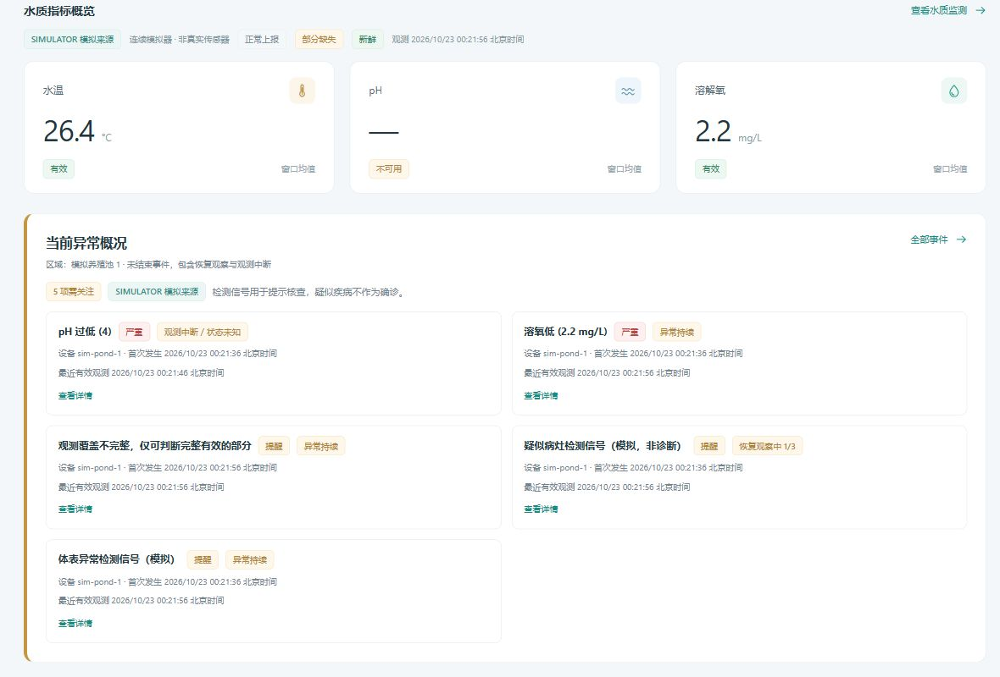

# EVT-1：视觉事件连续恢复与首页异常概况

范围：Prototype 的 `apps/` 本地实验。尚未同步 Management；连续三个可靠 CLEAR 是实验参数，不是疾病恢复标准。没有人工确认、派单或设备控制。

## 状态与证据

| 输入 | 结果 |
|---|---|
| 首个可靠 HIT | 创建 ACTIVE；同设备、通道、code 和规则的后续 HIT 更新同一 ID |
| 第一个、第二个连续可靠 CLEAR | 保持 ACTIVE，显示恢复观察中 1/3、2/3 |
| 第三个连续可靠 CLEAR | RESOLVED / closed，保存恢复时间及批次 |
| 恢复观察中再次 HIT | 计数归零，保持原事件 ID |
| RESOLVED 后再次 HIT | 创建新事件周期 |
| 缺测、无效、部分覆盖无信号、过期或离线 | 不提供 CLEAR，计数归零，未结束事件为 INDETERMINATE |
| 新 Session、窗口间断或重叠、Sequence 跳号、前一证据已过期 | 不跨中断累计；当前可靠 CLEAR 从 1/3 重新开始，HIT 保留原 ID |

规则层继续产生逐窗口 HIT/CLEAR；EventService 对四种视觉 code（病灶、体表、疑似死亡、摄食异常）增加恢复门槛。水质阈值及原有恢复方式不变。部分有效帧中出现信号仍可形成有限 HIT，但不足以证明完整观测连续性。

连续性要求：同一 Session、Sequence 恰好递增 1、当前窗口起点等于上一窗口终点、前后均完整有效且 fresh/online，前一观测在本次接收时仍未过期。新鲜度期限由 MonitoringService 当前配置提供，不在事件层复制水质阈值。

收到缺失视觉通道的有效批次时，current 保留原观测，但同事务撤回视觉事件连续性。事件保存缺测窗口的时间水位，迟到的更早视觉数据不能重新建立当前确定性。完全没有报文时，查询按新鲜度/离线门禁显示未知；后续窗口必须重新满足连续性。

## 持久化与兼容

复用 events.payload 中的 `visual_recovery`：policy_version、required_clear_windows、clear_count、Session、Sequence、窗口末尾、批次、新鲜度期限、最近完整有效观测、连续观测段起点及中断原因。首个/最近 HIT 的时间与批次仍使用原字段；恢复使用原 resolved_at / resolution_batch_id。不会用首次发生到当前的时间差声称未知期间一直异常。

Repository 原 BEGIN IMMEDIATE 事务同时保存 current、history、events、alerts 和恢复计数。异常整体回滚。重复/乱序不会推进恢复。读投影不写数据库、不增加 CLEAR；重启后从 payload 恢复进度，仅连续且仍有效的新证据可以继续累计。

没有 SQLite Schema 或 user_version 变化（仍为 1）；没有批量重算或清理旧记录。旧 payload 没有恢复元数据时，读兼容、首次新 CLEAR 从 1 开始。已关闭历史不追溯重新判定。

默认保留所有 alerts 关联的未结束事件，另保留最近 300 条未关联历史；总事件数可以超过 300。首批次可能因原 batch/history 限额被裁剪，事件自身保留引用。长期归档未实现。

## 页面语义

首页水质卡片后显示当前所选区域的未结束事件，包含 ACTIVE 和 INDETERMINATE，不按“最近创建”截取。展示等级、设备、首次发生、最近有效观测、恢复进度和原详情入口。恢复观察状态仍属于 ACTIVE 筛选。

无未结束事件时，仅在所选区域水质和视觉均完整、新鲜、在线且服务器未命中规则时显示“当前未见异常信号”；缺失或证据不足显示“状态未知”。保留 SIMULATOR 与非诊断说明。最近事件仍为底部通栏，筛选、详情和五秒只读轮询继续使用原接口。

视觉与水质 RESOLVED 均显示“规则条件已消退”；视觉详情说明“连续可靠观测未再检出该异常信号”，不代表疾病治愈或人工处理完成。等级变化、恢复待确认与明确监测中断的显示条件见 [EVT-2 文案收尾](EVENT_MANAGEMENT.md)。没有新增人工确认字段或接口。

## 固定 Seed 对比

真实 Simulator：suspected_disease / seed=42 / 10 秒窗口 / 600 秒；隔离 SQLite，按窗口末尾推进服务时钟，无 HTTP 或 Provider。

| code | 修复前周期 / 恢复 | 修复后周期 / 恢复 |
|---|---|---|
| SUSPECTED_LESION | 1 / 0 | 1 / 0 |
| SURFACE_ANOMALY | 1 / 0 | 1 / 0 |
| SUSPECTED_DEAD | 11 / 10 | 2 / 1 |
| 合计 | 13 / 10 | 4 / 1 |

保留的那次恢复来自连续三个可靠零检测窗口，符合本轮技术门槛；它没有验证生物学恢复。场景概率未调整，自定义模板 SIM-1 未实施。

## 离线验证与视觉预览

在 Prototype 根目录执行：

```powershell
.\.venv\Scripts\python.exe -B -m unittest discover -s apps\monitoring\tests -q
.\.venv\Scripts\python.exe -B -m unittest apps.simulator.tests.test_simulator apps.management_web.tests.test_app apps.management_web.tests.test_ai_boundary apps.management_web.tests.test_instance -q
node --test apps/management_web/tests/*.test.mjs
```

独立视觉验收（虚构数据、临时 SQLite、禁用 AI 和上报；十分钟自动退出）：

```powershell
.\.venv\Scripts\python.exe -I -B apps\management_web\tests\event_preview.py --port 8787
```

访问 `http://127.0.0.1:8787`，Ctrl+C 停止。端口占用时绑定失败，不接管其他进程。该预览不会读取正式实例、Settings、Policy 或 Credential。

专项覆盖连续 CLEAR、HIT 重置、缺测/无效/过期、Session/间断、重启、幂等/乱序、事务回滚、旧 payload、多设备/code、实际 300 条裁剪及 HTTP/首页投影。本轮 Monitoring 128、Simulator + 管理 HTTP/访问边界/实例 56 项 Python，全部 99 项管理 Node 通过。浏览器检查 1440、1024、900、390px；无页面横向溢出，最近事件与内容区等宽，控制台无警告/错误。

[桌面完整截图](assets/EVT1/desktop.jpg) · [390px 完整截图](assets/EVT1/mobile-390.jpg)



同步条件：Prototype 离线回归通过后，由用户人工验收，再选择性同步 Management 并独立回归。本轮未授权同步。
