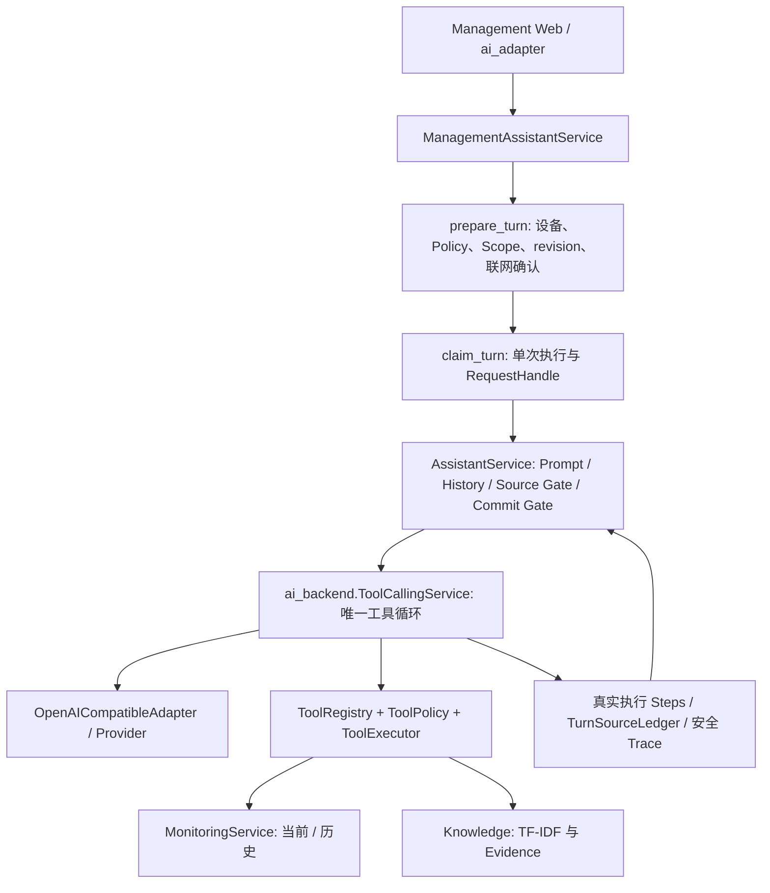

# BOT-3A：QQ Bot 与 AI Service / Agent 集成架构调查

后续：BOT-3B-1 已实现本报告中的离线服务边界、Monitoring-only、渠道权限及来源摘要；本研究保留实施前快照。当前实现与限制见 [BOT-3B-1](../BOT3B1_QQ_AI_BOUNDARY.md)，队列/真实交付尚未实现，QQ AI 仍关闭。

核验日期：2026-10-25。研究仓库：`D:\CodexProject\Fishery_AI_Prototype`，`main@fb140f0`，包含尚未提交的 BOT-2B 工作区实现。

**这是架构研究，不是 BOT-3B 实现或真实模型授权。** 本轮只读源码、核对腾讯官方公开资料、运行无数据库的 Fake/Mock 测试，并编写本文和文档索引；没有读取凭据、连接 QQ/Provider、打开业务数据库或修改 Runtime。BOT-2C 真实群查询通过为用户报告，本轮未重复联网验证。

## 1. 结论与建议

1. 复用 `ManagementAssistantService → AssistantService → ToolCallingService → Provider Adapter`，保持唯一工具循环、来源账本与提交门禁。不要绕过服务层直接调用 SDK，也不要使用旧 `src/fishery_ai/`。
2. 首版选 **同进程直接调用 AI Service + 独立、有界的 AI worker**。调用方式和任务调度是两个维度，可以组合；无需另建 HTTP 服务、Redis 或 Agent 框架。
3. 增加 QQ 专用的薄协调层，负责可信身份、设备与实例绑定、权限交集、队列、消息期限和送达；先不建立通用 Channel/Conversation 平台。
4. BOT-3B 首先做 Fake Provider、单轮对话、Normal 完整 Final、当前水质工具；多轮聊天记忆、历史工具、Knowledge 分阶段启用。**多轮聊天**与**一次回答内多轮 Tool Calling**是不同功能。
5. 目前存在真实装配缺口：Bot Monitoring facade 缺少 `devices()/bind()`，历史接口不接受工具使用的 `metrics`；AI Service 强制依赖 Knowledge，且没有渠道级权限输入。不能用假 Knowledge 身份、全局 Policy 改写或复制现有发布 Scope 绕过。
6. 当前 Source Gate 证明本轮来源操作，不证明自由文本逐句正确；上线前必须增加错误事实、过期数据、Prompt Injection 的专项质量验收。

下文标记：**代码已证实**＝当前源码或离线合同检查；**官方资料已证实**＝腾讯维护资料；**设计建议**＝尚未实施；**待实测**＝需要以后单独授权。

## 2. 当前 AI 架构：已存在什么



### 2.1 可复用 API 与准确边界

路径相对仓库根；行号为本轮源码快照，后续以函数名为准。

| 模块 / 位置 | 可复用能力 | 接入注意点 |
|---|---|---|
| [ai_service/service.py](../../../ai_service/service.py):37 `ManagementAssistantService` | 无 Flask 的业务装配；`bootstrap`、`prepare_turn`、`claim_turn`、`execute_turn` | 接受业务 DTO，不是 QQ 身份认证器；不能直接信任消息里的 device/revision/history |
| 同文件:208 `prepare_turn` | 校验 epoch、Preset、设备、Policy、revision、`confirm_network`，冻结 Prepared Turn；预检不查观测、不解析密钥 | 当前没有 channel authorization 参数；必须补最小的服务端权限装配点 |
| 同文件:239 `claim_turn` / :268 `_execute_claimed_turn` | 防重放、请求作用域、凭据快照、单次 Gateway、最终结果 | 实际执行线程内建立 ContextVar；不能在接收线程设置后假设 worker 自动继承 |
| [ai_service/contracts.py](../../../ai_service/contracts.py) | `PreparedAssistantTurn`、`AssistantBackend` 协议 | Prepared 是服务器内部对象，不能序列化后让 QQ 消息任意修改；Protocol 不是权限保护 |
| [ai_service/runtime/assistant.py](../../../ai_service/runtime/assistant.py):102 / :164 / :224 | `AssistantRequest`、ContextBuilder、AssistantService | 现有请求不按 conversation_id 自动存取历史，历史由调用方提供 |
| [ai_backend/tool_conversation.py](../../../ai_backend/tool_conversation.py) | `ToolCallingService`、Normal/Streaming 共享执行与预算 | 不复制循环；单轮 1 Tool / 1 Tool round / 2 model requests，有界多轮 2/2/3，每轮最多一个工具 |
| [ai_backend/model_gateway.py](../../../ai_backend/model_gateway.py)、[openai_compatible_adapter.py](../../../ai_backend/openai_compatible_adapter.py) | Profile/Runtime 快照、Provider 请求、取消、SDK 资源关闭 | 正常 Assistant 走 RequestHandle；Preset 为固定身份，不接受群消息提供 URL/model/API Key |
| [ai_backend/execution.py](../../../ai_backend/execution.py):17 / :172 | `RequestHandle`、`request_scope`、`RequestRegistry` | Registry 默认最多 8 个非终态 Handle，TTL 300s；不是有序任务队列，也没有 QQ owner 校验 |
| [ai_service/business_tools/registry.py](../../../ai_service/business_tools/registry.py) | 唯一 `bind_tools`；将 device_id 冻结在 Handler 内 | 已注册当前水质、Knowledge，历史通过显式装配进入；没有异常事件 Tool |
| [current_water_quality.py](../../../ai_service/business_tools/current_water_quality.py) | `water_payload` → `capture_water` → 单次事实投影 | 参数为空对象，不允许模型选择设备；OK 不代表 fresh/valid |
| [water_quality_history.py](../../../ai_service/business_tools/water_quality_history.py) | 10/30/60 分钟、可选指标、有界历史 DTO | 限制由 Monitoring 统一计算；不能用历史末值证明当前状态 |
| [fishery_knowledge.py](../../../ai_service/business_tools/fishery_knowledge.py)、[knowledge/service.py](../../../knowledge/service.py):97 | 严格 query、TF-IDF、Evidence ID/来源/版本 | 每次最多 3 段背景 Evidence、每段最多 800 字符；不是现场观测、不是写工具 |
| [ai_service/runtime/sources.py](../../../ai_service/runtime/sources.py)、[history_projection.py](../../../ai_backend/history_projection.py) | 来源 Receipt/Ledger、未受信任历史投影 | History 和模型声称“查过”不能生成来源凭证；AUTO 不要求调用任何工具 |
| [ai_backend/observability.py](../../../ai_backend/observability.py) | 白名单 Trace，不记录问题、回答、原始参数或事实正文 | 生产装配须批准独立 Trace 路径；Trace 失败不能伪装成功 |

当前实际服务只放行 Qwen/Ollama 两个 Preset（`service.PRESETS`）；底层 Assistant 支持的集合更大，并不意味着渠道可自行扩展。Qwen 固定模板的连接/读取/总超时为 5/30/120s、重试为 0。可调输出预算的 1–4096 范围只在相应既有合同匹配后生效，不是 QQ 的默认额度或模型授权。

### 2.2 历史和知识的实际机制

- `AssistantRequest` 问题最多 2048 UTF-8 字节；输入最多 64 个成功问答 pair，总历史最多 16 KiB，每条 user/assistant 文本各最多 16 KiB。
- ContextBuilder 实际仅保留最近 **6 对、6 KiB**，整对裁剪；之后 `UNTRUSTED_TRANSCRIPT_V1` 把历史封装为 JSON 数据。6 KiB 是保留 pair 的预算，封装本身另有字节开销，不能等同模型 token 数。
- 当前网页在前端保存成功 pair；Service 的 conversation_id 只是请求标识，不是持久会话仓库。Bot 不能直接继承网页历史或共用全局 history 数组。
- KnowledgeContentService 从记录 revision 构建不可变检索快照；Evidence 保留 ID、来源及内容版本。知识条目可能含不可信指令，必须当作数据；检索成功也不能证明设备当前状态。
- [KnowledgeRepository](../../../knowledge/repository.py) 的 `require_existing=True` 后续连接是 `mode=rw`；它不是 BOT-2B Monitoring 的数据库级只读模式。未来开放 Knowledge 必须另审数据授权、只读装配与索引读取成本，本轮不打开知识库。

## 3. QQ 当前实现与集成缺口

### 3.1 已有机制

| 位置 | 代码已证实的行为 | AI 接入后需要补什么 |
|---|---|---|
| [qq_bot/gateway.py](../../../qq_bot/gateway.py):74 / :93 / :141 | Gateway 接收/心跳与业务 worker 分开；原消息队列容量 4、业务 worker 1 个 | 不在该 worker 长时间等待模型；AI 队列前先完成权限与时效检查 |
| 同文件:230 / 末尾 `run.finally` | 有界连接重试；退出 `stop.set()` 后对 worker 无超时 join | 当前前提是短查询；AI 必须先取消 Handle/关闭 I/O、回收自己的 worker，不能改 daemon 掩盖泄漏 |
| [qq_bot/adapter.py](../../../qq_bot/adapter.py):48 / :61 | App、群、成员、时间、设备/能力、去重、限流；进程内锁覆盖同步 `queries.execute` | 准入应快速返回，锁不能覆盖 LLM 推理；去重记录要跟踪 job 生命周期 |
| 同文件 | 会话 key 为 App/群/成员/设备，但只存计数和时间 | 没有聊天记忆；新增显式、服务器拥有的会话存储 |
| [qq_bot/service.py](../../../qq_bot/service.py) | 固定只读命令；AI_DISABLED；指定实例 Knowledge 拒绝 | 不把未知命令自动当自然语言触发付费调用 |
| [qq_bot/monitoring_source.py](../../../qq_bot/monitoring_source.py) | 显式实例、设备白名单、只读当前/历史/事件查询 | 没有 `devices()/bind()`；历史 wrapper 也不接受 Tool 的 `metrics` 参数 |
| [qq_bot/transport.py](../../../qq_bot/transport.py):229 | 原消息时间小于 300s；单条纯文本，固定 msg_seq=1，内容最多 1800 字符 | 首版继续一次 Final；不能直接添加“正在思考”再发送同一个 seq |
| [qq_bot/adapter.py](../../../qq_bot/adapter.py) / `service.plain` | 正文 `plain` 上限 1600 字符，另有固定前缀及可能的省略号；替换 @、过滤控制符 | AI 文本需要完整句和来源限制说明的预算，不能随手截断后仍宣称完整 Final |

**心跳结论要区分：** 在现有独立业务 worker 中同步调用模型不会直接把 LLM 放到心跳线程，但会阻塞所有业务查询、产生队头等待，并破坏退出假设。若 4 个排队任务各等待一个 120s 模型任务，末项仅排队就可能超过五分钟；“已有队列”不等于适合 AI 的队列。

### 3.2 不能直接接线的五处阻碍

1. `ManagementAssistantService.__init__` 调用 `monitoring.devices()`，配置时又调用 `monitoring.bind(device_id)`；BOT-2B facade 目前缺这两个方法。不得通过访问其私有 `_service` 长期维持耦合。
2. 历史 Tool 归一化后传 `lookback_minutes` 和 `metrics`；Bot wrapper 只接受前者。需要薄的只读服务适配，不能复制历史统计。
3. Service 的 Knowledge 是强依赖；即使群禁止 Knowledge，现有 Registry 仍会装配 Knowledge Definition。不能伪造已发布的 Knowledge source/version 来凑 Scope，也不能偷偷打开默认知识库。
4. `prepare_turn` 直接取管理 Policy；没有渠道权限交集参数。其 claim 阶段检查的是既有 Policy/budget revision，不知道 QQ 成员权限、群移除和实例重新绑定。不能只在消息入口做一次检查，之后永远信任任务。
5. `execute_turn` 当前返回 `AssistantResult.to_dict()`，没有完整 Source Ledger；公开 Activity 只含有限质量/时刻信息，不包含所有来源、接收时刻和连接证据。未来确定性来源说明需要服务端的最小内部 SourceSummary，不能从模型正文反推，也不能回答后再读另一份快照冒充模型当时用到的数据。

此外，`ManagementAssistantService.local()` 默认推导工作区 Policy/Trace 与凭据身份，不能不带明确装配就拿来初始化 QQ；也不能把现有 Web HTTP Bootstrap 里的浏览器或维护 Token 当作渠道凭据。

## 4. 架构选择

### 4.1 进程、HTTP、worker 比较

| 方向 | 性能 / 复杂度 | 隔离与部署 | 本阶段结论 |
|---|---|---|---|
| 同进程直接调用 Service | 少一跳，直接复用 Prepared Turn 和 Handle；改动最小 | 同进程资源/故障域；需要明确任务取消和每请求状态 | **推荐作为调用方式** |
| 内部 HTTP 调用 | 多一套序列化、网络超时和请求状态协议；跨进程更方便 | 必须单独做服务间身份、设备/权限委托和取消；不能借本机放行 | 当前不选；现有 Web 接口面向浏览器，不是可直接暴露给 Bot 的内部 API |
| worker / queue | 解决接收与推理解耦、背压和期限，不改变 Agent 本身 | 同进程线程成本低；独立进程可隔离 CPU/崩溃，但须 IPC/取消协议 | **推荐一个同进程 AI worker 与有界队列**，不引入消息中间件 |

直接调用与 worker 不是互斥方案。未来有多机部署、多个渠道共享算力或严格故障隔离需求时，再考虑内部 HTTP/独立 worker 进程。

### 4.2 直接复用 Runtime vs 通用 Channel 平台

| 方案 | 优点 | 当前代价 | 建议 |
|---|---|---|---|
| A：QQ 专用薄协调 → AI Service → 原 Runtime | 保留已有业务门禁，测试边界小，不复制 Agent | 仍需 QQ 身份、会话和时限适配；绝不是 QQ 直接调用 Provider | **首版采用** |
| B：统一 Channel Adapter → Conversation Service → 原 Runtime | 第二个渠道出现后可以共用会话与调度规则 | 现在就定义通用身份、送达、租户、消息编辑、恢复协议，容易过度设计 | 暂不建立；把 QQ 协调层保持独立，积累真实第二渠道需求后提取 |

先有一个实际消费者再抽象。可提前使用小型不可变内部 DTO，不创建插件注册、通用网关、第二套 HistoryBuilder 或通用 Agent。

### 4.3 推荐调用链（设计建议）

```text
QQ Gateway 收包/心跳（保持原线程）
 → Adapter 快速鉴权、消息时效、去重与限流
   ├─ 固定命令 → 原只读查询 → 原被动回复
   └─ 显式 /问AI + 本机 AI 开关 + 独立渠道 AI 授权
      → QQ AI Coordinator：冻结 App/群/成员/实例/设备/权限 revision
      → 有界 AI queue：等待期限 / 会话单飞 / 全局预算
      → worker：再次检查权限/期限 → 取该会话历史
      → AI Service.prepare_channel_turn（未来最小服务端入口）
      → 原 prepare/claim/execute 主链 → 原 Runtime / Registry / Executor
      → Backend 成功 Final + Source/Commit Gate
      → QQ Delivery：再次校验有效窗口/群权限，调用原 QQAPI.reply 一次
      → 仅送达被确认后，把实际展示的成功 pair 加入该会话
```

`prepare_channel_turn` 是建议名称，**当前不存在**。未来可用同等内部授权参数实现，不需要复制 prepare/claim/execute。通用 Backend 不导入 QQ；QQ 不获取原始模型凭据或自行解析工具调用。

## 5. 身份、多用户与多轮会话

### 5.1 身份与会话键（设计建议）

基础 key：`(channel='qq', app_id, instance_id, binding_revision, group_openid, member_openid, device_id)`。

- App/群/成员来自经现有 Gateway 校验的事件；设备和实例来自本机批准配置，不来自昵称、消息文字或模型参数。
- 同群每成员独立上下文；同成员跨群、跨设备、跨实例均隔离。第一版不做全群共享历史。
- conversation_id 使用随机内部 ID，原始 OpenID 仅留在必要的内存映射内；不把原始组合键拼进 Provider 请求、Trace 或日志。
- epoch 还需记录 Preset、有效 Policy、渠道权限、知识绑定版本和历史合同版本。关键绑定/权限变化后取消旧任务并重建会话，不能自动带旧设备事实进入新设备。
- 现有 GroupAccess 的成员共享群 capabilities，并无完整个人角色系统。若未来存在成员级 AI/工具额度，必须显式配置并求交；不能从“群主”“老师”或昵称推断权限。

### 5.2 首版记忆边界（设计建议）

BOT-3B 首次实现先使用 `history=[]`，以单次问答验证权限、取消和送达；这不妨碍调用已有 Agent。后续小阶段才增加进程内 ConversationStore：

| 项目 | 建议首始限制，未实施 |
|---|---|
| 会话数 | 最多 128 个，闲置 15 分钟过期；容量满时只淘汰无在途任务的闲置会话，否则拒绝 |
| 会话历史 | 最多 6 个完整成功 pair、6 KiB；最终仍交原 ContextBuilder/投影检查 |
| 同一会话 | 最多一个排队或执行中的 AI Turn；明确 BUSY，不并发分叉后乱序覆盖 |
| 历史内容 | 仅该成员的问题和成功送达的回答；不存其他群消息、工具原文、API Key、control_token 或失败 Preview |
| 用户重置 | 明确命令只清自己的会话，同时取消自己的旧任务；不能操作监测事件 |
| 重启 | 清空聊天记忆与待执行任务；不从 Trace 重建、不自动重放旧问题，不承诺跨进程 exactly-once |

进程内重连继续复用原消息去重；重启后的 AI 成本去重需要明确策略。首版不恢复旧任务，拒绝启动前的过期/旧 AI 消息，可能牺牲迟到消息；若以后要求持久去重，再单独设计仅保存摘要/状态的有界本地账本，不动 Monitoring Schema。

QQ 群回复本身对群成员可见；“每成员上下文隔离”不等于私聊隐私。启用前应说明提问和批准的业务证据可能传给所选 Provider，且回答会出现在群内。

## 6. Tool Calling 授权与来源可信度

### 6.1 程序执行权限，Prompt 只补充语义

有效工具集合应为：

```text
已注册 Handler
 ∩ 管理 Policy 选择
 ∩ 渠道 AI 工具白名单
 ∩ 群 capabilities 对应能力
 ∩ 获准成员的范围
 ∩ 当前执行模式/发布 Scope
```

交集必须在 AI Service 的内部装配入口计算，既用于模型可见 Definition，也用于 Executor 的不可变 ToolPolicy。不能在群消息里接收 `selected_tools`，不能仅隐藏 UI，不修改全局 Policy JSON 为某个群临时授权。

| 能力 | 现状 | BOT-3B 建议 |
|---|---|---|
| 当前水质 | 已有 Tool，device_id 为服务器绑定的参数 | 第一阶段可开放，继续使用只读 Monitoring 实例与批准设备 |
| 历史水质 | 已有 Tool，但候选/试用 Scope 有独立门禁，wrapper 尚不匹配 metrics | 在接口适配及相应 Scope 验证后再开放；不因 BOT-2C 固定命令成功而自动获得 AI 资格 |
| Knowledge | 已有检索 Tool，指定实例 Bot 当前关闭 | 额外批准知识实例、群/成员权限、数据披露和只读装配后另启；不读默认库 |
| 异常事件 | 固定命令可查周期，AI Registry 没有事件 Tool | 首版保留固定命令；不得将其伪装成已有水质工具结果。新 Tool 的定义、DTO、来源认证、Scope 需单独阶段 |
| ACK / 人工结束 / 删除 / 规则 / 设备控制 | 未注册 AI Handler | 始终不装配；模型生成同名调用也由 Registry/Policy 拒绝 |

`get_current_water_quality` 只接受 `{}`；历史 Tool 只接受范围和指标，禁止 device/path/SQL/URL。设备由 `partial(handler, device_id=...)` 注入。若问题要求其他池塘，工具仍只能看到绑定设备；回答必须说明当前绑定范围，不能悄悄当作查询了其他设备。

**单独 AI 授权必需：** 当前 access capabilities 只有 current/history/knowledge/events，加入 `ai_chat` 会被当前校验拒绝。这说明已有只读查询授权不是付费推理授权。BOT-3B 应提供版本化、默认关闭的 AI 授权及预算配置；显式 `/问AI` 才表示本次调用意图，普通 @消息和未知命令不自动联网。

### 6.2 所需的最小服务层扩展

- 只读 Monitoring 适配公开 `devices/bind/capture_water/query_water_history(metrics=...)`，委托原 Service，保留白名单、路径检查和只读连接；不复制 SQL、阈值或统计。
- 服务层显式支持 Monitoring-only 装配：Knowledge 缺席时不注册检索 Definition/Handler，Scope 如实表达未绑定；不能传假 source/version 来冒用已批准的多工具范围。
- 提供服务器内部的授权上下文，冻结实际交集、device、instance binding revision 和 Policy revision；不得把它开放成消息/HTTP 的任意覆盖字段。
- 入队、执行前、发送前核对 QQ 授权 generation。撤销、退群、实例改绑时取消关联 Handle 并禁止发送；既有 Service 的 claim 检查不能替代 QQ owner 校验。
- 对渠道提供最小内部 SourceSummary，由同一 Turn 实际 Steps/Receipt 生成来源、设备、观测/接收/评估时刻、质量/连接等必要事实。缺字段明确 unknown；不导出整份原始 Tool Result、私有请求或 SDK 对象，也不改变现有 Web DTO。该返回合同当前尚不存在。
- 本轮不实施这些扩展。若后续决定完全不改 Service 装配，那么当前 Monitoring-only 集成就是阻塞项，不能用 Adapter 临时绕过。

### 6.3 数据合同和幻觉边界

| 数据 | 必须保留的区分 |
|---|---|
| 来源 | 当前绑定仍为 SIMULATOR；“真实 QQ 接通”不等于“真实传感器已接入” |
| 时间 | observed_at 为观测窗口时间；received_at 在当前 Tool DTO 的 canonical reading 中名为 retrieved_at，另有 last_reported_at；evaluated_at 是查询评估时刻 |
| 质量 | valid / partial / invalid / missing；缺失不补零，单指标有效不能让所有指标变正常 |
| 新鲜度 / 连接 | fresh / stale / unknown 与 online / offline / never_received 是不同维度；旧值不是实时采样 |
| 规则 / LLM | Findings、事件恢复属于确定性规则；LLM 的解释或建议不能写回事件或冒充规则结论 |
| Knowledge / History | 项目背景 Evidence、旧对话均不能证明当前设备状态或本轮检索完成 |

现有 `SourceRequirement.AUTO` 允许不使用工具的完成结果。当前问题若必须依据系统观测，未来服务端应选择 `CURRENT_OBSERVATION_QUERY`；历史和知识分别使用已有对应 requirement。不得由模型或消息声明“来源已满足”。自然语言分类并非可靠授权器；第一阶段可限定为“当前绑定设备水质问答”，统一要求本轮当前查询，其他话题回固定帮助。

`CURRENT_OBSERVATION_QUERY` 只证明操作完成，NO_DATA/旧数据也可能满足。Receipt 的 CURRENT_TOOL_OBSERVATION 同样不是“新鲜正常”证明。**Source Gate 不逐句校验模型正文，因此不能宣称它已经杜绝幻觉或 Prompt Injection。**

首版建议从本轮可信 DTO/Receipt 生成独立来源与时效说明；无数据、过期、离线时程序先确定“无法确认当前状态”，不得仅依赖模型自述正常。DTO 之外的数值、未取得来源和临床结论须在专项测试中拒绝；不以正则自称能验证所有自由文本。做不到可靠核验时收窄回答范围，保留固定命令作对照。

用户问题、历史和检索文本不能覆盖 System、Policy 或绑定；不允许它们注入可执行角色、Tool Result、函数名或工具参数覆盖。Tool 结果不能包含凭据、任意文件、日志、Trace 或其他设备记录；保留现有输入字节、结果体积、SQLite 查询预算。

## 7. 异步执行、回复期限与提交

### 7.1 腾讯官方资料核验

核验日期为 2026-10-25。官方 wiki 地址本轮无法直接读取，改读腾讯维护的 `tencent-connect/bot-docs` 同路径源码；该文件未显示页面更新日期，不能把抓取日期或仓库状态当作平台发布日。

- 群聊被动回复窗口为五分钟，每条用户消息最多回复五次；接口携带原消息 ID，`msg_id + msg_seq` 共同用于重复检测。见腾讯[发送消息源码](https://github.com/tencent-connect/bot-docs/blob/main/docs/develop/api-v2/server-inter/message/send-receive/send.md)。
- 同一来源 seq 重复发送会失败；接口超时可能实际送达但没有同步确认。官方建议发消息 HTTP timeout 至少五秒。见同一[官方请求字段与说明](https://raw.githubusercontent.com/tencent-connect/bot-docs/main/docs/develop/api-v2/server-inter/message/send-receive/send.md)。
- 文件顶部明确写明主动推送于 2025-04-21 起不再提供，并链接[官方公告](https://q.qq.com/miniapp#/news/detail/974e66a946a5e54c441ca983585a7aab)。下方仍残留旧主动配额表，不能据此承诺主动兜底；账号实际错误、内容审核和送达边界留待单独联调。

以上是公开文档证据，不代表本轮连接账号实测。首版只用一次被动 Final，`msg_seq=1`，不会用完平台允许的多次回复额度，也不依赖主动能力。

### 7.2 初始资源建议（均未实施）

| 项目 | 建议初始值 / 规则 |
|---|---|
| AI 并行 | 全局 1 个 worker；额外最多 2 个排队任务；单会话一个任务 |
| 队列等待 | 最多 10s；过期任务取消，凭据与模型请求均不得开始 |
| 总任务期限 | 从准入开始最多 90s，并取 QQ 原消息窗口减 15s 安全余量的更早值；排队耗时包括在内 |
| Backend | 不改变已批准 Preset/Scope；在既有 RequestHandle 上收紧总 deadline，不因多次请求重置 |
| 工具循环 | 第一版固定 SINGLE_ROUND 1/1/2；有界多轮 2/2/3 必须独立启用和 Scope 匹配 |
| 用户额度 | 原 Bot 限流继续生效；AI 另加建议每成员 2 次/分钟、每群 6 次/分钟，并有运营者总成本上限 |
| 输出 | 一次完整短 Final，建议整条控制在 1600 字符内（比当前正文加前缀更保守），预留来源/时效说明空间 |
| 停机 | 停止准入→取消待办与在途 Handle→关闭 Backend 自有 I/O→等待有限清理→关闭 Bot 连接；不杀外部进程 |

90s、队列大小和限流是待验收参数，不是 QQ 平台配额或现有实现。先用 Fake Provider 量测，再决定是否调整；不在群消息里接受这些值。实际模型和输出 token 数沿用有效执行合同，不能把 QQ 字符限制当作 token 限额。

排队项保存有效原消息时间、接收时的 monotonic deadline 和冻结身份；不因重连、出队或新问题续期。执行前、模型/工具步骤前及发送前检查。`Future.cancel()` 不能终止已运行线程，必须调用同一个 Handle 的 cancel/abort I/O；取消只能确认本地资源处理，远端计算是否停止仍是 unknown。

### 7.3 两个成功门槛

1. Backend 门槛：成功完整 Final、Source/Commit Gate、安全 Trace 成功；失败/取消/截断/Preview 不进入历史。
2. 渠道门槛：原消息仍有效、用户/群授权仍在、未重复发送，且 `QQAPI.reply` 获得有效平台消息 ID。

模型执行成功不等于群消息已送达。只有两者都通过后才能提交会话 pair。worker 只产出完成结果，由统一 Delivery owner 调用既有 QQAPI；不得绕过 stop、退群撤销或原消息关联。

`QQ_DELIVERY_UNKNOWN` 不自动重发、不重新调用模型、不把缓存回答塞进后续消息的被动窗口。保留安全结果状态，结束该任务并避免未知结果污染会话；用户重新发起时才构成新授权。当前去重仅进程内，不宣称端到端 exactly-once。

超长回答不能直接 `plain(...,1600)` 后把未送达全文存入 History。建议按完整句/段落形成展示文本，保留所有限制说明；无法安全收缩时返回固定“回答过长，请缩小问题范围”，不再花一次模型请求改写，不提交成功问答。若采用缩短后的展示文本，历史必须记录用户实际收到的版本。

QQ 不采用逐 token Streaming、Preview、长进度刷新或自动分多条；它们会改变当前 seq、次数、取消和部分送达语义，留待独立阶段。

## 8. 错误处理与运行安全

| 故障 | 终止 / 用户反馈建议 | 恢复与历史 |
|---|---|---|
| 未启用 AI / 未授权成员或群 | 在任何业务、凭据或模型访问前拒绝；未知身份不泄露业务内容 | 不建立 AI 会话 |
| 缺 LLM Key / Provider 不可用 | 安全代码和简短“服务未就绪”；不展示 SDK 异常或建议把 Key 发到群里 | 不重试、不切换其他 Provider、不提交历史 |
| 模型超时 / 用户取消 / Stop | 相同 Handle 取消、SDK 关闭，窗口仍有效时一次简短失败提示 | 释放本任务资源；不提交部分答案 |
| Tool 失败 / DB 不可用 | Tool ERROR 不能变 NO_DATA 或“正常”；必要来源未取得时拒绝成功 Final | 不回退默认实例、Demo 或历史聊天 |
| 过期 / 缺测 / 离线 | 不是系统故障；保留数据限制，程序提供明确“无法确认当前状态” | 不刷新时间、不写规则恢复状态 |
| 群移除 / 权限撤销 | 取消任务、停止发送，不以 Provider 已开始为继续披露理由 | 清理该授权范围的记忆与待办 |
| Gateway 短断线 | 心跳/重连仍由原 Transport；保守取消尚未送达 AI 任务，不缓存在恢复后自动发 | 后续新提问重新授权；不能保证远端费用已停止 |
| 会话过期 / 损坏 / epoch 不匹配 | 丢弃该内存上下文并提示重新提问，不偷偷用其他会话补齐 | 不从 Trace 或 QQ 全群历史重建 |
| 排队满 / 并发超限 | 固定 BUSY；仍需先鉴权、去重和回复窗口检查 | 不开始模型请求 |
| 送达失败 / 超频 / 内容审核 | 记录安全码，不重发不再生成；未知送达状态单独标记 | 不提交成功 pair |
| Trace 写失败 | 沿用 Commit Gate 失败，不以空 Trace Sink 冒充审计成功 | 不提供成功 Final |

日志仅记录随机关联 ID、阶段、时长、队列深度、工具名/安全错误码、数值 usage 等有界字段。原始 AppSecret、LLM Key、Token、Header、QQ 私信/群消息全文、OpenID、模型回答和业务明细均不进入普通日志。现有 `gateway.audit` 的字段白名单也不能被任意扩展为 kwargs 日志。

现有 Trace 不记录正文，是可复用基础，不代表自动脱敏所有新增字段。原始 QQ 身份映射只在进程内；不把昵称、OpenID 或消息正文加入 control_token/conversation_id/Provider metadata。生产 Trace、AI 配置、会话/去重持久化路径如需新增，必须在后续任务中明确授权。

## 9. BOT-3B 最小实施顺序

### B1：先补可独立测试的服务边界

- 确定并审批 AI 能力授权、数据披露、模型/成本开关；保持默认 AI_DISABLED。
- 给只读 Monitoring source 提供完整、公开的读服务适配，兼容 `devices/bind` 和历史 `metrics`；实例仍显式批准，不自动选 BOT-2C 或工作区库。
- 在 AI Service 中增加最小渠道授权装配点和 Monitoring-only 能力组合；不修改通用 Agent 工具循环，不复制 Prompt、Definition、统计或来源算法。
- 禁用 Knowledge 和异常事件 AI Tool；Fake Provider + 内存合成 Monitoring 即可验证端到端 Tool Calling。已有当前水质 Definition/Handler 继续是唯一 owner。

### B2：单轮 Normal 与有界调度

- QQ 显式 AI 命令快速准入，有界队列、每会话单飞、同一个 RequestHandle；普通固定命令保持短路径。
- 服务器提供空 History、冻结设备、当前查询来源要求；保留现有网络确认、revision、Source/Commit Gate。
- Fake Gateway + Fake Provider 验证一次 Final、错误反馈、超时/取消、退群和送达未知；不连接账号、不读真实业务库。
- 默认 1/1/2，输出预算遵守原合同。真实 Provider、真实 QQ 和具体实例分别审批；已有 QQ 网络许可不自动授权模型调用。

### B3：再增加记忆和更多只读来源

- 单轮完成并人工验收后，增加进程内成员会话历史、TTL、清空与重启策略。
- 历史工具经接口/Scope 验证后启用；多轮 Tool Calling 单独验证资格。
- Knowledge 作为额外数据授权和只读装配任务；异常事件工具作为独立 Definition/Receipt/Scope 任务。
- 第二渠道实际出现后，才评估提取共享 ConversationService；多机与持久化队列另议。

### 预计最小修改位置（未来，尚未实施）

| 范围 | 建议职责 |
|---|---|
| `apps/qq_bot/ai_coordinator.py`（拟新增） | QQ 授权上下文、准入/队列、Handle owner、送达门槛；不含 Agent 循环 |
| `apps/qq_bot/adapter.py`、`gateway.py` | 快速 AI admission、取消/退群/退出、统一结果发送；不扩充 Provider 调用逻辑 |
| `apps/qq_bot/cli.py`、`configuration.py` / 独立 AI 配置模块 | 显式默认关闭、版本化 AI 许可、成本/模型/实例配置，保持原非 AI 模式 |
| `apps/qq_bot/monitoring_source.py` | 薄的只读 Service 适配，补齐公开读接口 |
| `apps/ai_service/service.py`、`contracts.py`、必要 Registry/绑定合同 | 服务器内部渠道权限与 Monitoring-only 装配；复用已有执行链 |
| `apps/qq_bot/conversations.py`（后续按实际需要新增） | 只存成员自己的成功展示 pair、TTL/容量/epoch |
| 对应 Bot / AI Service 测试及文档 | Fake/Mock、无真实凭据或实例；不改 Monitoring Schema |

如后续实现发现 Scope 合同需要扩展，应先保留新组合为 candidate；不能借已发布的三工具身份或把更换后的 Binding 仍标成旧 qualification。

## 10. 验证矩阵与验收门槛

以下为 BOT-3B 需要新增或组合的测试；不是当前 QQ AI 已通过的声明。

| 场景 | 必须断言 |
|---|---|
| 单用户当前水质问答 | 只读 Tool 取得本轮来源、一次完整 Final、一条确认送达的回复 |
| 同群双成员 / 同成员跨群 | History、队列单飞、owner 和结果完全隔离 |
| 跨设备 / 实例改绑 | Prompt 或 Tool 参数无法改变绑定；旧任务取消、旧 History 不继承 |
| 未授权成员 / AI 未启用 | 零模型请求、零 Tool 读取，不能靠昵称或群主身份放行 |
| Policy/成员权限撤销 | 排队、执行及发送阶段均拒绝过期授权，不修改全局 Policy |
| Knowledge 未批准 | 模型看不到 Definition，伪造调用被 Executor 拒绝，没有访问知识库 |
| 注入 device/path/SQL/URL | 参数校验在 Handler 之前失败，原批准设备不变 |
| System / History / Evidence 注入 | 不新增工具、来源或权限；来源账本仅由实际 Steps 产生 |
| Tool 成功、NO_DATA、NO_MATCH、ERROR | 完成操作与取得可靠证据严格区分，不吞错误成正常 |
| partial/invalid/missing/stale/offline | 回复保留来源与时间限制；无证据不得输出实时正常结论 |
| 模型编造读数、谎称已查询 | AUTO 与受要求来源的差异可见；业务问题采用适当来源门槛，不能宣称已有逐句事实校验 |
| 多工具 / 重复调用 / 非法参数 | 遵守 1/1/2 或获批 2/2/3，失败同样消耗预算，无自动 regenerate |
| 队列满 / 慢模型 / 多用户突发 | 有界内存、快速 BUSY，固定命令与心跳仍可运行 |
| 队列过期 / 临近 QQ 期限 | 在昂贵请求开始前拒绝，期限不因出队或重连续期 |
| 超时 / 停止 / 退群 | 同一个 Handle 取消，SDK 与自有 worker 退出；远端停止状态诚实保留 unknown |
| QQ HTTP 超时 / 送达未知 | 不重发、不再次推理、不提交成功聊天历史 |
| Backend 成功但 QQ 失败 | 两阶段门槛正确，成功 Final 不等于成功送达 |
| 超长回答 / 来源说明被截断 | 形成安全完整展示结果或明确拒绝；不把不可见全文写入 History |
| 长对话 / 内存满 / TTL | 完整 pair 裁剪、6 对/6 KiB；不跨用户淘汰在途状态 |
| Bot 重启 / 同进程重连 | 不恢复别人的历史、不自动重放旧 AI 请求，不宣称持久 exactly-once |
| Trace/日志扫描 | 无 Key/Token/OpenID/全文/业务正文；错误码来自白名单 |
| 原固定命令与 BOT-2B | 不启用 AI 时行为不变、库内容/Schema 不变、Knowledge 仍禁用 |

离线验收先用 Fake Provider、内存/新合成监测夹具、Mock QQ HTTP 与本机模拟 Gateway。真实群是否满足端到端时延、账号内容审核、模型回答质量和授权撤销体验，必须另做人工验收；不以 Fake 延迟当作真实模型性能。

## 11. 本轮证据、风险和未验证项

### 11.1 实际执行

- `apps.ai_backend.tests.test_execution` 与 `apps.qq_bot.tests.test_transport`：**40 项通过**。运行时将 `sqlite3.connect` 改为立即失败，确认 **数据库连接为 0**；只使用测试代码中的 Fake SDK / MockTransport 与虚构凭据，未读取用户密钥。
- 另有 **8 项纯内存合同检查通过**：Bot facade 缺设备读接口、历史 metrics 不兼容、6 对历史裁剪、未受信任历史不能生成来源、QUERY requirement 不保证新鲜度、模型 device 参数拒绝、Knowledge Policy 拒绝、现有 access 不接受 ai_chat。
- 后两类检查只验证现有模块和阻碍；没有验证一个尚不存在的 QQ AI 集成，也没有重复运行完整管理回归。

现有两组测试可用本项目 Python 离线运行：

```powershell
Set-Location -LiteralPath 'D:\CodexProject\Fishery_AI_Prototype'
.\.venv\Scripts\python.exe -X utf8 -B -m unittest apps.ai_backend.tests.test_execution apps.qq_bot.tests.test_transport
```

本轮额外的 SQLite 禁连断言与 8 项研究检查为一次性内存检查，没有新增测试源码文件。文档链接及差分检查另行验证。

### 11.2 优先风险与技术债务

1. **程序授权缺口优先于自然语言体验。** Bot 身份还没有进入 AI Service 的不可变 Policy；现有只读命令成功不能代替 AI 权限验收。
2. **Knowledge 是目前的装配强依赖。** Monitoring-only 需要诚实的新能力组合，不能伪造旧数据绑定。直接把 Bot facade 传给 Service 也会因接口不匹配失败。
3. **Source Gate 不是事实判官。** 即使本轮查到数据，模型仍可能误述过期/缺失或编造其他值；需收窄范围、确定性来源说明与质量评估。
4. **模型完成与 QQ 送达是两次提交。** 仅复用网页成功 History 会把用户没收到的回答加入上下文；跨进程 exactly-once 当前无保证。
5. **同步 worker/退出假设需要调整。** 保留现有队列就接模型会造成队头等待；daemon、无限重试或简单 Future.cancel 都不是取消协议。
6. **发布、成本与渠道许可独立。** 当前模型与三工具本地实验资格不自动覆盖新 Policy/Binding/渠道；QQ 许可也不是付费模型许可。
7. **能力长期演进点有限。** 先把 QQ 身份、会话与交付独立，出现第二渠道再提取接口；未来多用户登录、租户权限、持久队列和备份不是当前 Bot 已有能力。

未验证：真实 Provider Key 可用性、模型延迟/费用和群内回答质量；QQ 账号实时时效/审核/长断网后的 AI 任务行为；业务实例与 Knowledge 授权/只读兼容性；尚未实现的多用户 AI 会话隔离和新队列。全部留待后续任务明确批准，不在本轮自动接入。
