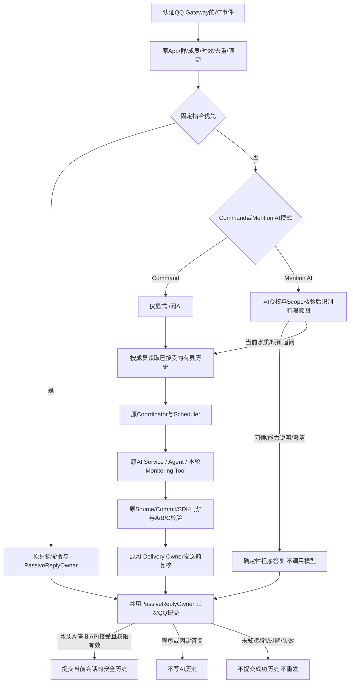

# BOT-3D-2A：QQ自然语言触发与会话记忆设计

2026-10-26，Fishery_AI_Prototype，`main / 3dcc2ac`。开始时工作树为空。本轮完成源码调查、13项隔离探针与相关离线回归，只新增设计文档及索引；**没有实施BOT-3D-2B，没有启用Mention AI或会话记忆**。

后续状态：用户批准三项设计方向后，已完成 [BOT-3D-2B Fake-only 实现与回归](../../patches/2026-10-31-stages/BOT3D2B_MENTION_CONVERSATIONS.md)。本文保留2A调查时的设计与停止条件，不表示当前缺少离线实现；真实逐Turn许可仍留2C，普通QQ入口未开放Mention AI。

## 1. 结论与实施边界

现有Agent已经支持历史问答对和不可信历史投影，继续使用它即可，不需要第二套Agent、HTTP服务、Redis或新的工具循环。QQ会话记忆与`BOUNDED_MULTI_ROUND`工具循环是两回事：用户连续聊天可以继续采用每个Turn的`SINGLE_ROUND / 1 Tool / 1 Round / 最多2次模型请求`。

本轮按任务中的停止条件停在2A。直接实现2B需要先确定三个有实质影响的合同：

1. **渠道历史授权**：当前Service在校验和执行准入两处明确拒绝非空history，Scope也绑定`history=false`。不能删除这些检查后直接复用旧资格；需新增仅服务端可构造的有界历史上下文及对应候选合同。
2. **交付后历史提交**：现有接受回调只保留任务ID、时间和文本哈希；实际安全答复和任务结果会被丢弃。必须在丢弃前增加可核验的安全文本/主题交接，并处理撤权、取消、清空与交付之间的竞态，不能从哈希或原始模型JSON还原用户看到的消息。
3. **逐Turn真实批准**：现有真实试用只允许一个AI Turn，第一次交付后第二个AI问题仍会报`TRIAL_ALREADY_USED`。真正的两轮人工验收不能复用同一批准，也不能自动把2次模型请求增加为12次。

这些调整不要求重写Agent，但已超出只加一个RAM列表的低风险改动。下面给出可审核的最小设计和2B分步计划；**所有新类型名、字段与配置片段均为建议，当前程序未支持**。

## 2. 现状与可复用接口

| 源码位置 | 已证实的行为 | 对2B的含义 |
|---|---|---|
| [gateway.py](../../../qq_bot/gateway.py) `normalize / _dispatch / _work` | 仅处理`GROUP_AT_MESSAGE_CREATE`，去掉自有旧Mention前缀；丢弃平台token等元数据；worker把消息交给Router | 可以复用认证Gateway和队列；正文里的`@`不是平台Mention证明 |
| [contracts.py](../../../qq_bot/contracts.py) `decode` | 严格事件类型、成员/群ID、时间、消息长度；单条正文最多2048 UTF-8字节 | 不增加普通群消息监听，也不放宽原包大小与时间门禁 |
| [adapter.py](../../../qq_bot/adapter.py) `QQAdapter._receive` | 先核验App/群/成员，再处理时效、原消息指纹、去重与限流；`_sessions`只有计数 | 原计数会话不是聊天记忆，不能把它当成已交付历史 |
| [ai_routing.py](../../../qq_bot/ai_routing.py) `OfflineQQAIRouter._receive / _fixed` | 仅显式`/问AI`进Scheduler；固定指令复用同一PassiveReplyOwner | 自然语言路由需显式模式和授权，不应给原始消息拼接`/问AI`以绕过入口 |
| [ai_coordinator.py](../../../qq_bot/ai_coordinator.py) `prepare / _permission / reconfigure` | 冻结设备、授权revision、总期限；单飞key包含App/群/成员/实例/绑定/设备；generation变化会撤销任务 | 该单飞key未包含完整授权代次/Scope，不能直接当作记忆key |
| [service.py](../../../ai_service/service.py) `prepare_channel_turn` :307、`validate_channel_turn` :329、`claim_turn` :346 | 创建空history并拒绝非空history；当前来源要求固定为`CURRENT_OBSERVATION_QUERY` | 问候不能冒充当前水质问答；新历史需受控内部合同，旧路径仍保持拒绝 |
| [assistant.py](../../../ai_service/runtime/assistant.py) `AssistantHistoryTurn / AssistantRequest / AssistantContextBuilder` | 接受成对历史；请求历史总量最多16KiB；构建上下文时最多6对、6KiB，并整对丢弃旧项 | 在调用AssistantRequest前就要完成有界投影，不能把6条完整长答复全部传入后等Builder裁剪 |
| [history_projection.py](../../../ai_backend/history_projection.py) | 默认`UNTRUSTED_TRANSCRIPT_V1`，历史作为JSON数据放入user消息；不产生Tool Receipt | 直接复用，不能把旧assistant内容恢复为system、tool或当前事实 |
| [sources.py](../../../ai_service/runtime/sources.py) 与Assistant Commit Gate | 本轮执行步骤生成Ledger/Receipt；历史声称“查过”不能满足当前来源要求 | 每次当前水质追问仍必须执行本轮当前水质Tool |
| [ai_scheduler.py](../../../qq_bot/ai_scheduler.py) `_finish / take_acceptances` | 最多1执行+2等待；接受信息仅含task_id、accepted_at、text_sha256、client标志；随后discard计划并清空result | 现有hook不能直接提交对话对，也不是会话仓库 |
| [ai_delivery.py](../../../qq_bot/ai_delivery.py) `DeliveryOwner / PassiveReplyOwner` | 清洗完整安全文本、前置授权复核、一次提交、Receipt与检查点；QQ API接受和客户端显示分开 | 在此交接最终实际发送的安全文本，不能保存`result.model_text` |
| [ai_configuration.py](../../../qq_bot/ai_configuration.py)、[channel_scope.py](../../../ai_service/channel_scope.py)、[channel_trial.py](../../../ai_service/channel_trial.py) | AI配置v1严格拒绝额外字段；candidate禁止history；试用max_turns=1，2请求/512输出tokens/90s | 配置、Prompt、历史合同与批准流程需要版本化；不能只修改JSON开关 |

`conversation_id`目前只是请求标识，不会自动加载服务端历史。Web由自身调用方提供历史，不能把Web上下文借给QQ成员。

## 3. 建议调用链

下图为**未来设计，尚未实现**：



实际入口仍为原Gateway/Router；不新增第二个Gateway worker或Agent。固定命令、程序答复与模型答复共同使用原消息的单次回复所有权。

## 4. Mention模式与有限意图

### 4.1 模式和平台来源

保留Command为默认值。未来配置v2才增加`trigger_mode=command|mention_ai`，旧v1配置等价于command且无记忆；不存在自动升级或默认开启。Mention模式还必须满足AI独立授权、有效Scope、固定实例/设备、群和成员交集。配置开关本身不是调用许可。

Mention依据是**认证Gateway收到的AT事件及其服务端上下文**，不是正文正则、昵称或客户端传来的`mentioned=true`。如内部路由新增来源上下文，必须绑定App、事件类型、原msg_id及当前Gateway；不能从群消息JSON扩展字段生成可信身份。普通`GROUP_MESSAGE_CREATE`即使正文含`<@机器人>`也不进入AI。本轮只验证现有代码边界，不用构造JSON的测试替代真实平台Mention身份核验。

准入先处理原始消息指纹，再产生服务器意图，避免改写正文造成重复消息在固定/AI入口间得到不同指纹。无效固定指令参数仍走原参数错误；未知`/xxx`不自动当成付费AI问题。

### 4.2 第一版意图和答复类型

| 意图 | 例子 | 建议执行/输出 |
|---|---|---|
| 固定指令 | `/帮助`、`/当前水质`、`/历史水质 10`、`/当前异常` | 原业务实现及权限优先，不隐式写入AI记忆 |
| 问候/能力说明 | `你好`、`你能做什么` | 有效Mention模式与AI授权下返回明确的程序模板，例如“你好，我是鱼类监测AI助手”；0模型请求、0Monitoring查询，不伪造A部分或SourceSummary |
| 当前水质 | `现在水质怎么样`、`当前溶解氧如何` | 原当前Tool每轮重新查询，继续`qq-water-explanation@1`和A/B/C |
| 有明确引用的追问 | 上轮讨论水质后的`那溶解氧呢`、`pH呢` | 记忆仅解析主题/指标；本轮仍查询当前事实，不能沿用旧数值 |
| 引用不明确 | 没有有效会话的`那它呢` | 程序请求澄清，不猜设备、不调用模型碰运气 |
| 超出能力 | 要求知识检索、历史AI分析、ACK/删除、控制设备、切换Provider | 明确当前能力限制；固定历史查询可提示其现有指令，但不新增AI Tool或代执行写操作 |

意图识别先使用小型、可测试的确定性规则/词表，不增加LLM分类请求。混合句涉及当前水质时优先按业务问题处理；无法确定时澄清。问候不是模型推理结果，不能冒称“Qwen分析了当前水质”。首版不实现开放领域聊天或心理/医疗等专业问答。

建议的程序答复类型与水质解释分开。程序答复走经AI模式授权复核的原单次回复Owner；不能把任意模型正文塞进程序答复通道。水质模型输出继续严格JSON引用和固定中文渲染，不因记忆开启放宽自由文本。

## 5. 会话身份、内容与上限

### 5.1 会话key

建议在QQ专用RAM Store中使用不可打印的内部key：

```text
qq + app_id + group_openid + member_openid + instance_id + device_id
   + source_binding_revision + access_ai_generation + policy_revision
   + ai_scope_sha256 + process_conversation_epoch
```

昵称、群主称号和聊天正文不参与授权。单次试用approval_id是本轮网络许可，不是永久身份；不得为了延续历史忽略真实授权generation变化。原始组合key/OpenID不写日志、不作为Provider的conversation_id；如需该标识，另发随机内部ID。

generation/绑定/Policy/Scope变化时旧历史不可读取；新授权不能通过“改回旧配置”复活被撤销的旧代次。清空只递增当前key的会话revision，不调用全局reconfigure清掉其他成员。

建议后续显式注册本机状态指令`/清空会话`：只作用于当前已授权成员在当前群/实例/设备下的RAM记录，无外部ID/路径参数、零模型请求；不是事件删除Tool。当前尚不支持该指令，不能靠把自然语言转成通用写操作实现它。

### 5.2 RAM记录和模型投影

每条成功历史建议保留：本轮内部ID、规范化问题/指标意图、**实际发送且Receipt哈希匹配的安全答复**、接受时间、主题、SourceSummary的观测时间和质量/新鲜度/连接标记、会话revision。Backend原始JSON、未核验自由文本、原始平台事件和其他成员消息均不入库；不依赖CredentialStore，不接触Key/Token。

用户原始正文可能混入密钥或其他隐私。第一版只保存经过有限意图投影的必要问题，例如“询问当前溶解氧”，不保存任意原句，也不声称通过简单正则能识别所有密钥。模型输入中的历史assistant内容采用**程序生成的主题/时效摘要**，明确标为已交付答复的投影，不冒充逐字引用；原完整安全答复只在受限RAM记录中保留。

这样可理解“上轮在谈水质”，但不会把历史读数再次当成现场观测。该记忆不支持完整逐字复述、任意跨主题长期交流或历史趋势分析。问候/能力提示和澄清不增加Monitoring历史，固定查询不自动进入AI上下文；这些边界应写入未来Scope。

### 5.3 建议初始预算（待实现）

| 项目 | 建议值与行为 |
|---|---|
| Turn数量 | 最多6个API接受的Monitoring AI Turn；按字节预算可能更少 |
| TTL | 从最后一次有效接受/历史提交起空闲15分钟；单调时钟，不修改Monitoring时间戳；失败/未知/问候不延长数据留存 |
| 会话数量 | 最多64个；惰性清理过期项，再淘汰不在执行中的闲置项；全部占用时返回容量错误，不无限扩张 |
| 每会话/全局RAM账本 | 每会话最多24KiB、全局最多1MiB的UTF-8序列化数据，连同Turn数/字段长度共同限界；这是内容预算，不冒称Python实际RSS恰为1MiB |
| 进入模型的历史 | 先规范投影再保留完整后缀问答对，目标最多4KiB；必须低于现有6KiB Builder和16KiB请求总历史门禁 |
| 请求整体 | 继续受现有32KiB SDK请求体上限、512输出tokens/请求、2请求/Turn和90s限制；超限拒绝，不增加模型请求去摘要或补答 |

实测边界：6条各1600个中文字符的合成答复，历史JSON为**29,329字节**，在构造AssistantRequest时就被拒绝；6条各500字的合成答复可构造，但Builder只保留**3对 / 4,750字节**。因此“最多6对”不能解读为无条件把6份完整A/B/C全部发给模型。

Store在读/准入/提交时检查TTL，不增加高频后台线程。任务期间如旧会话过期、清空或权限变化，原Scheduler watchdog的validate_plan链须同时复核快照，取消任务并传到RequestHandle/I/O；不只在最终提交时检查。旧revision不能提交，不得通过静默刷新历史时间让过期上下文继续有效。Bot退出清空RAM，重启不从trace、检查点或磁盘恢复聊天。

## 6. 与原Agent History的接入

未来增加服务端内部`ConversationSnapshot`一类小DTO：含会话key摘要、revision、Scope、投影合同、已裁剪问答对和过期时间。它只由授权后的QQ Store生成，不作为Web/QQ正文可提交字段。

`prepare_channel_turn`与校验/claim需增加**新的候选分支**：验证快照来自当前服务端Store、generation/绑定/Policy/Scope匹配、字节预算匹配且未过期。旧空history分支及真实单轮合同仍原样拒绝未授权历史。不能仅删除`prepared.request.history`的拒绝条件。

组装时仍使用原`AssistantHistoryTurn → AssistantRequest → AssistantContextBuilder → UNTRUSTED_TRANSCRIPT_V1 → ToolCallingService`。不新增历史权威来源或工具循环。当前水质意图始终显式要求`CURRENT_OBSERVATION_QUERY`；历史中“已经调用工具”不生成Ledger/Receipt，本轮Tool失败不得用旧答复顶替。每Turn重新capture不等于重新采样：上游尚未上报新窗口时，连续两轮可以具有相同observed_at，不能为演示新鲜度改时间。

QQ水质Prompt需独立候选版本：允许旧历史帮助解析主题，同时明确旧读数不是当前事实；现有`QQ_CURRENT_EXPLANATION@1`明确不用历史，不能不改Scope就改变其语义。输出六字段合同可继续复用`qq-water-explanation@1`，无需为问候破坏它或允许自由正文。

## 7. 成功交付后提交记忆

建议在DeliveryOwner拿到明确接受Receipt后、Scheduler丢弃plan/result前生成内部`DeliveredTurn`，携带原意图、实际安全发送文本、对应SourceSummary和Receipt。验证`text_sha256`匹配发送文本，不能用`ChannelAssistantResult.model_text`替代。

历史提交须满足：Backend/Source/Commit已通过、SDK资源已关闭、Receipt为DELIVERED且API接受、任务未取消/过期、当前权限/Scope/绑定与会话revision仍有效。将检查和当前key的CAS追加置于同一短临界区，保持原同会话单飞，不在锁内做网络请求。

实现时沿用现有锁关系：Scheduler在cv外调用Delivery；提交可以按`Coordinator → Store`短锁序执行，不能反向回调Scheduler并获取cv。清空/撤权先改变相应代次，再在释放锁后取消匹配任务；不要全局锁住不同成员的模型执行。

| 结果 | 历史处理 |
|---|---|
| Backend完成但未交付 | 不提交 |
| 明确API接受且所有代次仍有效 | 幂等提交一次，记录accepted_at；client_display_confirmed仍false |
| 送达未知、失败、取消、过期或撤权 | 不提交成功Turn，不重发、不重新推理 |
| API接受后、提交前发生清空/撤权 | 保留真实交付事实，但旧revision不入新会话；已提交到QQ的消息无法据此撤回 |
| 内存追加失败 | 交付事实不改；记录单独的history_commit失败，提升该key的revision并清空其待提交历史，后续从空上下文继续；其他成员不变，不补发、不重新推理 |

原`receipt_sink`服务于交付检查点，失败被标为`TRIAL_DELIVERY_CHECKPOINT_FAILED`，不能拿它同时承担历史事务后继续沿用同一个错误码。设计独立的历史提交结果，但不新建第二套消息Owner。报告保存失败、历史提交失败、API接受和客户端显示是四种独立状态。

## 8. Scope、费用与真实资格

本轮未改变任何运行合同或资源文件，当前指纹保持：

- Monitoring-only v3 candidate：`2d89b74fe451f793c09e21fff90dc624d9fd2ee34a02c393284f2e61066350be`。
- FAST：`6ad00ee864c60c6e729980e7b7795cf2e8e4fba571770c675cbae2ea7d23f252`。

旧试用仅覆盖原本的显式命令、空history、当前水质及单次Turn，不授权Mention或会话记忆。本轮不修改批准、资格、历史Provider回执或used标记。普通QQ CLI继续AI_DISABLED。

2B需要独立候选Scope，绑定触发模式、意图/程序答复合同、历史投影/上限、TTL/隔离及提交规则、QQ专用Prompt、同轮来源、原SDK资源合同与预算。实现前不能生成“已完成新指纹”、qualification_id、local_experimental或released记录；具体hash只能根据最终源码计算。

**保持一次性批准的推荐方式**：未来每个真实AI Turn使用新的独立批准和原有2请求/512tokens/90s预算；会话记忆不代表持续付费许可。真实两轮实验需要两份逐Turn批准，并在同一Bot进程中维持RAM Store。每个批准还绑定当次会话revision/历史投影摘要和披露范围；新批准必须重新核查当前权限。

当前CLI一次运行只装配一个QwenTrialSession，该Session只绑定一个Handle，进程退出又清空RAM。因此还需另行设计服务端的逐Turn许可接力：允许同一稳定业务授权代次下的新一次性许可，但不得在有在途请求时修改共享`service._channel_trial`或复活旧许可。这里是本轮停止2B的实际批准/装配阻碍，不是建议扩大原批准的`max_turns`。

2B先做Fake-only候选和内存对话，不增加真实入口。真实多Turn许可接力单独验收；不得为了演示记忆预填“已经交付”的伪造历史、取消一次性消费或假定主动作答权限可用。

## 9. 2B最小开发顺序与预计文件

| 顺序 | 最小内容 | 预计文件 |
|---|---|---|
| 1 | 纯意图/模式判定、原始Mention来源、固定指令优先；无真实入口 | `qq_bot/intent.py`（新）、`gateway.py / ai_routing.py / ai_configuration.py`、对应测试 |
| 2 | RAM Store、完整pair预算/主题投影、TTL、per-key revision及clear；先独立单测 | `qq_bot/conversations.py`（新）、对应测试 |
| 3 | 内部快照校验和独立Fake候选，水质继续本轮强制Tool | `ai_coordinator.py`、`ai_service/channel.py / service.py / channel_presentation.py / channel_scope.py`；不重写Backend History/工具循环 |
| 4 | 安全发送文本交接、API接受后CAS提交、清理和失败状态分离 | `ai_delivery.py / ai_scheduler.py`及报告投影测试 |
| 5 | Fake Gateway + Provider多Turn、Web兼容与完整回归；再由人验收 | Bot/Service/Web测试、独立设计/操作文档 |

只在实际依赖需要时新增这两个QQ专用文件，不建立通用Channel框架。各步先写断言再改实现；不顺带接入Knowledge、历史AI Tool、事件写操作、主动通知或多工具循环。

## 10. 验证矩阵与本轮证据

| 验证主题 | 本轮已有证据 | 2B必须补充 |
|---|---|---|
| Mention与固定优先 | 非AT事件即使含@也拒绝；原命令/未授权路径有测试 | 开/关模式、真实平台来源上下文、伪造来源/旧Mention前缀、无效固定参数不转模型 |
| 问候/能力外问题 | 现有水质解释拒绝问候自由文本；当前自然语言不能启动模型 | 程序问候零模型/零查询，混合句优先、未知引用澄清、越权能力拒绝 |
| 记忆隔离 | 原群/成员/设备隔离和撤权回归；当前单飞key不等于记忆key | 跨群/成员/App/设备/实例/Scope/generation隔离、ABA、每成员clear、重启无记忆 |
| 预算/TTL | 实测请求16KiB/构建6KiB及整对裁剪；现有队列/期限测试 | 6Turn/字节淘汰、64会话/全局容量、全部活跃拒绝、排队/执行中到期及清空 |
| 来源与注入 | 历史JSON不创建system/tool消息，旧工具声明无法满足Source Gate | 连续水质追问各有新capture；旧值、stale、partial、missing不冒充当前正常；主题/摘要注入 |
| 交付与提交 | 现有API接受/未知/取消/幂等回归；接受hook不含文本 | 精确安全文本哈希、仅接受后追加、取消/撤权/clear竞态、CAS重复/失败不重发、报告与记忆错误分离 |
| 批准/资源/Web | 原第二AI消息仍TRIAL_ALREADY_USED；SDK/Source/Commit及Web定向回归 | 新候选默认拒绝真实执行，旧批准不授权历史，新Scope变化失效、SDK失败零历史、Normal/Streaming完整兼容 |

本轮探针位于`outputs/test-tmp/bot3d2a-20261026T064426Z-358ca03b/probe_current_boundaries.py`，仅验证**现有合同和阻碍**，没有实现待开发的Store或意图识别器。TEMP/TMP均指向本仓`outputs/test-tmp`，SQLite与消息为新建合成夹具，网络和凭据使用原Fake防线。

| 本轮执行 | 结果 |
|---|---|
| 13项现有边界探针 | 全通过，0.883s；历史上限、JSON投影、Service两处拒绝、Mention、配置v1、单Turn、代次key、Source Gate、接受hook |
| Bot/History/资格/Web定向回归 | 217项通过，47.278s；包括Gateway、Coordinator、Scheduler、原结构化解释、单Turn限制、Service/Normal/Streaming及Web边界 |
| 源码/Scope/文档 | 446份已跟踪文件前后摘要仅3份文档变化；业务源码与两个Scope不变；138处本地链接目标存在；`git diff --check`通过 |
| 完整901 Python / 116 Node基线 | 为用户提供的上一轮基线；本轮文档任务不冒称重新完整执行 |

本轮没有访问真实QQ/Qwen、Key/AppSecret、已有业务实例或其记录；没有修改Management、数据库、Settings、Policy、资格或任何业务源码。实际修改仅本设计及文档索引，Git提交保持不变。

可在Prototype根复现本轮探针，先限定临时产物目录：

```powershell
$env:TEMP = Join-Path $PWD 'outputs/test-tmp'
$env:TMP = $env:TEMP
.\.venv\Scripts\python.exe -X utf8 -B -m unittest discover -s outputs/test-tmp/bot3d2a-20261026T064426Z-358ca03b -p probe_current_boundaries.py -v
```

该探针是本轮非敏感测试记录，不是正式回归入口或Mention启动器；用unittest发现方式重跑不会执行脚本的日志写入main，也不会覆盖原日志。定向回归模块及结果在同目录`targeted.log`，不进Git。本轮不修改正式测试数量，也没有将未实现的隔离/TTL/记忆提交写成已通过的功能测试。

## 11. 后续人工验收前置条件

先审核渠道历史授权、交付后提交和逐Turn批准接力三项设计，再授权2B离线实现。通过Fake多成员/多群测试及完整回归后，计算新候选Scope并单独批准真实实验；旧v3/FAST资格不能直接沿用。

真实验收应在同一受控Bot进程、明确批准的SIMULATOR实例/设备/测试群/成员中进行：先@问候确认零模型，再分别批准“现在水质如何”和“那溶解氧呢”两个AI Turn，每Turn最多2次模型请求；检查各有本轮SourceSummary、API接受后历史数量递增，Source时间不来自旧聊天。随后独立确认清空、过期、跨成员、撤权、送达未知与退出报告；客户端显示仍由人工观察。

目前不存在可运行的Mention AI/记忆启动参数，不提供伪装可执行的`--mention-ai`或多轮审批命令。本轮不要求用户再次联网验证，也不自动创建任何批准。下一步是设计审核与2B离线开发授权。
