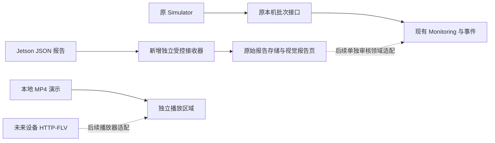

# 设备报告适配方案：保留现有运行模式

状态：2026-10-30 原始设计。2026-10-31 已完成第一阶段接收、去重、独立存储与只读展示，以及 water-only 联调模式；当前操作见 [设备联调](../DEVICE_INTEGRATION.md)。后续真实视觉领域映射仍待审核，未连接真实设备或修改现有 Monitoring Schema。依据组员提供的 `TEXT_PACKAGE_API.md` v1.0 与当前 Prototype 源码。先在 Prototype 验证，人工审核后再选择性同步 Management。

## 1. 建议结论

组员报文可以作为**独立视觉报告**接收，但不能原样发送到当前 Simulator 接口。先新增默认关闭的独立接收 Adapter，完整保存与展示报告；保留原 Simulator、水质、事件、AI 和启动方式。下一步再审核真实视觉的领域映射。

报文没有水温、pH、溶解氧。演示可以继续运行原水质 Simulator，但必须分别标注「SIMULATOR 水质」和「设备视觉检测」，不能将两者拼成一份真实设备观测。未运行模拟器且没有传感器时，水质为缺测。

## 2. 当前接口为什么不能直接接

| 项目 | 组员报告 | 当前系统 |
|---|---|---|
| 入口 | 建议 POST `/api/fish/reports` | POST `/api/ingestion/batches`，仅本机 + Simulator Token |
| 大小 | 最大16 KiB | 批次限制8 KiB |
| 标识 | report_id、device_id | batch_id、session_id、sequence、device_id |
| 数据 | 跟踪数、异常目标/帧次数、中文报告 | 严格的 water/visual 窗口统计合同 |
| 来源 | 真实板端视觉推理 | 领域来源目前仅接受 simulator |
| 未执行任务 | behavior/measurement 为 null | 不能把 null 补成正常行为或0异常 |
| 上报 | 默认仅异常，约60秒 | 默认30秒过期、90秒离线，可靠连续窗口参与恢复 |

源码依据：[原 HTTP 门禁](../../../management_web/app.py)、[批次与来源合同](../../../monitoring/contracts.py)、[服务装配与新鲜度](../../../monitoring/service.py)、[规则证据条件](../../../monitoring/rules.py)。不能只改字段名、放开原接口或伪装 simulator 来绕过这些差异。

## 3. 第一阶段：新增独立接收器，暂不改事件判断

候选入口为 `POST http://<接收电脑的局域网IP>:<明确端口>/api/fish/reports`，具体端口在实施时与现有监听端口核对。电脑换网络后 IP 可能变化，应给组员提供当次可达地址；127.0.0.1 不能给另一台设备使用。接收器仅在显式启动时监听指定局域网接口，不暴露原管理 Web 的 Settings、AI 和维护接口。

- 本机配置批准 device_id 与令牌映射，真实接入建议强制 `X-Device-Token`；客户端提交的来源声明不自动成为可信来源。令牌不进入报文正文、页面或日志。跨不可信网络需 HTTPS/受控隧道，不直接公网暴露明文 HTTP。
- 保持组员 JSON v1 格式。严格校验 JSON、字段类型、有限数值、时间、数组及文本上限，拒绝重复字段；16 KiB 限制只用于新入口，不改变原批次限制。
- 在同一日常数据根下安排独立报告存储（例如 `apps/data/device-reports/`），不再创建另一套默认日常实例。保存原内容与摘要、接收时间、验证/映射状态；不改现有 Monitoring SQLite Schema，不向正式实例自动写入。
- 幂等键为 `(device_id, report_id)`。同键同内容返回成功且不重复入库；同键不同内容拒绝并保留冲突诊断，不能覆盖原记录。内容摘要规则固定并版本化。
- **可靠持久化成功之后才返回2xx**。不能先确认、后异步落盘；落盘失败返回可重试错误。重传不重复触发分析或事件。409 内容冲突需双方明确为不可重试并留档。
- 按组员约定处理400/401/403/413、408/429/5xx；新增设备速率和存储预算，错误不返回内部路径或原始敏感正文。报告保留与清理策略另行确认，不自动删除历史。
- `report_text` 作为设备提供的非可信文本转义显示，绝不直接当作系统指令、现场事实 Receipt 或付费 LLM 自动触发器。结构化字段优先，文本不能反向补造指标。

建议新增模块 `apps/device_reports/`，最小职责为 contracts、repository、service、HTTP/CLI；这是有实际消费者的独立 Adapter，不是新的 Agent 或事件框架。

## 4. 与组员确认的最小事项

1. 接收地址、令牌和专用设备标识；视频地址单独配置，不从报文自动访问 URL。
2. 建议开启 **interval 每窗口都发**。仅异常上报时，沉默无法区分正常、离线和任务未执行，绝不能自动恢复事件。需要单独的正常证据或心跳。
3. 示例 `12:49:11 → 12:49:50` 相差39秒，但 duration_s=38；请按实际时间修正。声明60秒窗口时，启动/停机短窗口应标明真实长度，不能虚填60。
4. 明确 `targets` 是去重目标数，`count` 是检出帧次数；不要互换。`unique_tracks` 不代表鱼池存量；avg_per_frame 才是平均每帧可见数。
5. 为各分析任务补充可验证的执行状态与覆盖数：总视频处理3帧不等于健康任务也处理3帧；示例文本写健康仅1帧，应结构化记录。未执行、失败与可靠未检出必须可区分。
6. 后续领域接入建议提供 session_id、窗口 sequence、模型版本与任务版本，确保重启、乱序、补发与连续恢复可判断。具体扩展应协商版本，第一阶段不凭接收时间伪造这些字段。

## 5. 第二阶段：领域投影，单独审核实施

- 增加显式硬件视觉来源身份与每任务质量/覆盖，不改模拟源含义。原有 simulator 模式及阈值保留。
- `body_ulceration` 可研究映射为「疑似病灶检测信号」，不能按中文名字强行视为确诊；需核对模型类别及计数单位。无法无损映射的字段保留原结构并明确未评估。
- 每设备/通道按批准的上报周期设计新鲜度和离线规则，不把现有30秒/90秒直接套到60秒设备。仅异常模式不得推断在线或恢复。
- 补发保留原 window.end 和 sent_at；服务器另记 received_at。旧包可保存历史，不能刷新为当前、覆盖更新窗口或参与连续 CLEAR。
- CLEAR 必须来自真实执行、质量可靠且连续的同 Session 窗口。缺测、任务未运行、离线和重启不能自动产生恢复；旧事件连续性不可靠时保持待核实。
- 当前 AI Tool 仍只读水质。新增真实视觉 AI 能力、来源 Receipt、Scope 或必要 Schema 迁移均是后续独立任务，不能把报告文本直接塞进已授权水质 Tool。

这里涉及真实来源、质量与规则合同扩展，第一阶段独立报告接收不依赖它。若需要 Schema 迁移，先提供迁移、备份与兼容方案再审批，不操作真实库。

## 6. 视频分离

本轮已实现的是显式本地 MP4 的同源 HTTP 播放，不是实时 RTSP/HTTP-FLV 推流，也不执行检测。原视频页和统计继续独立。

组员提供的 `http://<板子IP>:9002/osd.flv` 是另一条数据通道。后续需要单独验证浏览器播放器、编码与网络；如使用代理，只允许本机配置的设备端点，防止任意 URL 访问。视频断线不证明统计正常，视频播放也不把录制时间当当前观测。接收端不承担视频与报告逐帧同步承诺。

## 7. 最小实施与验收顺序

1. 本轮：保留原流程，完成本地 MP4 演示与此设计；不启动设备接收服务。
2. 待批准：用组员示例与合成 JSON 开发独立接收、持久化、幂等和报告页；本机离线验收后再开专用局域网接收端。
3. 待批准：真实视觉领域映射、来源/连续性及事件测试；必要时明确迁移计划。最后再接 HTTP-FLV。

测试至少覆盖：合法报告、缺字段/错误类型/超限/鉴权拒绝；同包重传、同ID改内容、并发与落盘失败；旧包补发与乱序；无水质与模拟水质并存；未执行分析不假正常；仅异常模式的沉默；新Session与缺测不假恢复；原 Simulator/事件/AI/Web 回归。测试仅用新建合成数据，不连接真实设备、Provider或QQ。

对现有运行的保证目标：新功能默认关闭；旧CLI/JSON/数据库及用户数据不迁移；适配器停止后原系统继续运行；错误报告不污染当前状态。真实接入前仍需组员确认第4节及人工验收。
