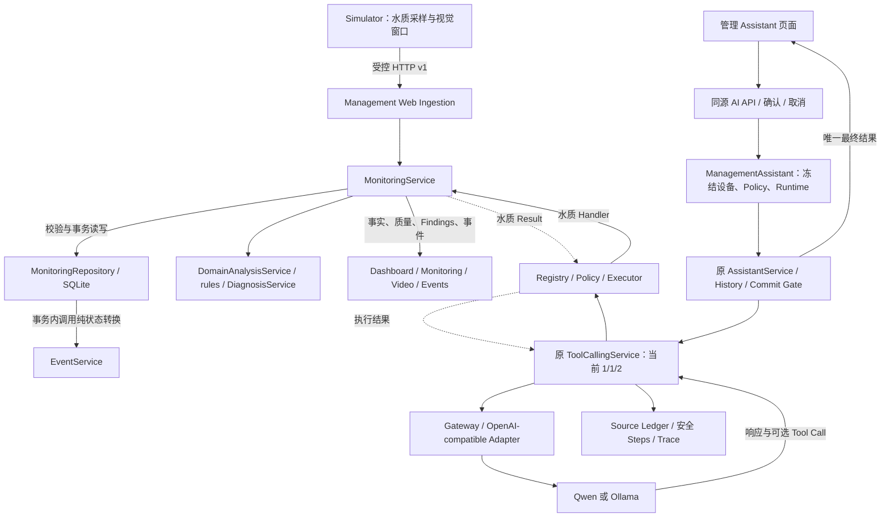

# R2B-3：管理平台与 AI 集成只读审查

日期：2026-10-15。依据当前磁盘源码、测试定义及 `outputs/management_web/assistant-traces.jsonl` 的安全字段；R2B-0 报告仅作设计背景。本轮未运行测试、Provider、Ollama 或 NPU，未读取凭据、对话正文或数据库原始观测。

**结论：数据与执行边界基本成立，适合继续小范围开发；应先补参数拒绝的安全诊断，再处理 R2B-3 遗留问题。当前不能确认失败调用的具体参数，不能直接认定为设备绑定错误或 Qwen 不支持 Tool。**

审查开始时已有 13 个 tracked 文件修改、5 个 untracked 文件，均属于前一轮 R2B-3；本报告审查的是这些未提交实现，没有覆盖或清理它们。

## 1. INVALID_TOOL_ARGUMENTS：已知原因与证据边界

### 1.1 实际安全记录

以下是同一文件中按 request_id 去重的三个 Turn，均在 Assistant 记录中标为 Qwen Preset `dashscope-qwen38-flash-r1`、Prompt `ASSISTANT_V2@1`。时间为北京时间；未读取问题或回答正文。

| Turn / 开始时间 | 已开始的模型请求 | 首轮 outcome / finish_reason | 水质 Tool | 后续模型 / 最终状态 | History 收到 / 发送 |
|---|---:|---|---|---|---:|
| `95de7d77…` / 09:56:28 | 2 | tool_calls / tool_calls | Handler 已执行，OK | Request #2 stop，completed | 0 / 0 |
| `3c36dbb2…` / 09:57:24 | 1 | tool_calls / tool_calls | Handler **未执行**，ERROR | 无 Request #2，INVALID_TOOL_ARGUMENTS | 1 / 1 |
| `833e6943…` / 09:57:44 | 2 | tool_calls / tool_calls | Handler 已执行，OK | Request #2 stop，completed | 1 / 1 |

失败 request_id：`3c36dbb297424e798ced411bdc10783f`；trace_id：`540f7bdaf90c427a90ef72c04c4d058e`。

每个 Turn 各有一条 `read_only_tool_conversation` 和 `assistant_turn`，不是六次独立运行。模型请求计数来自 Steps，**不是底层 HTTP 抓包或 transport attempts 计数**。Usage 标为 provider：三轮的累计 input/output tokens 分别为 7374/76、841/27、7759/157；成功轮包含两次请求，不能直接用差值推算 Tool Result 的精确 token 成本。

这能证明：失败轮已经形成可识别的水质 Tool Call，执行前校验将其拒绝；本次 Tool 未读取 Monitoring 观测、没有调用第二次模型、没有成功提交。前后成功记录说明链路不是完全不可用。两次有 History 的结果一成一败，不能据此认定 History 是根因。

Trace 没有参数长度、参数成员数、校验子原因、源码 build 指纹、原始 Provider Tool Call 或 Provider 返回 model，所以无法还原具体错误字段、确认原始/归一化参数一致性，也无法评价回答质量。Preset 标签不等同于独立验证 Provider 返回的模型身份。

### 1.2 错误在哪里产生

正常请求的实际顺序如下：

```text
ModelResponse.tool_calls
 → ToolCallingService：单轮调用数 / round 门禁
 → ToolExecutor.execute：调用预算 / ID 防重放
 → Registry.lookup：名称 allowlist
 → ToolPolicy.allows：权限
 → 参数 UTF-8 大小 / JSON object 检查
 → ToolDefinition.prepare：具体参数合同
 → handler_started = true
 → Monitoring Handler
```

关键位置：

- [ToolExecutor.execute](../../../../src/fishery_ai/tools/executor.py#L36)：第 50–65 行附近先查 Registry/Policy，再检查参数不超过 **4096 UTF-8 bytes**、JSON 可解析且为 object，并调用 Definition；这部分的 ValueError、TypeError、RecursionError、UnicodeError、AttributeError 统一映射为 `INVALID_TOOL_ARGUMENTS`。
- [ToolDefinition.prepare](../../../../src/fishery_ai/tools/contracts.py#L76)：没有专用 validator 的无参数 Tool，只接受空 object `{}`；任何额外成员都拒绝。这里不是运行通用 JSON Schema 引擎，而是执行与空参数 Schema 对应的确定性合同。
- [ToolCallingService.run_request](../../../../src/fishery_ai/tool_conversation.py#L381)：只有 Executor 真正开始 Handler 时才标记 `handler_started`；Tool ERROR 安全终止，不发送 Request #2、不重试。

还有同名错误的 **Streaming assembler** 分支，但管理应用当前使用 Normal，没有进入它，不能用该分支解释本次失败。

Normal 的 [Adapter._response](../../../../src/fishery_ai/openai_compatible_adapter.py#L302) 会先构造 [ModelToolCall](../../../../src/fishery_ai/model_gateway.py#L398)。后者已要求 arguments 是可解析的 JSON object；通常 malformed JSON、非 object 在此就变为 `INVALID_TOOL_CALL`。因此，**按当前源码的正常链路，优先怀疑非空参数 object，其次检查参数字节上限/编码类限制；不能只看到 INVALID_TOOL_ARGUMENTS 就断言是 JSON 语法错误。**

如果收到的是可编码、未超限的 `{}`，当前 Definition 必须允许执行。现有记录不足以在上述拒绝分支中选定唯一分支。该定位也以执行进程与当前源码一致为前提，Trace 没有 build 指纹可回溯这一点。

| 可疑阶段 | 当前判断 |
|---|---|
| 模型未请求 Tool | 排除：首轮 outcome=tool_calls，且已有 Tool Step |
| 名称或权限拒绝 | 当前源码中分别对应 UNKNOWN_TOOL / TOOL_NOT_ALLOWED；不能解释这次错误码 |
| 执行前参数合同 | **可以定位到这一层**；具体子原因缺失 |
| Monitoring / SQLite / 诊断执行失败 | 排除本次路径：handler_started=false；此类异常通常是 TOOL_EXECUTION_ERROR |
| 同轮多调用 / 再次请求 Tool | 对应 TOOL_CALL_LIMIT / TOOL_ROUND_LIMIT，不是本次错误 |

### 1.3 Schema 与设备绑定是否冲突

正式 [Registry](../../../../src/fishery_ai/tools/registry.py#L49) 的水质 Schema 是：

```json
{"type":"object","properties":{},"additionalProperties":false}
```

[ManagementWaterRegistry](../../../management_web/ai_adapter.py#L30) 用 `replace(definition, handler=...)` 只替换 Handler，保留同一 Schema 与 validator；闭包绑定服务器已确认的 device_id。模型不需要、也不应通过参数选择设备。

所以二者**没有必然的合同不一致**。例如模型若传 `device_id`、`query` 或水质值，虽是合法 JSON，也应被拒绝；这些只是说明拒绝规则的示例，**不是已观察到的真实参数**。把未知参数忽略或增加任意设备参数会削弱既有边界，不是修复。

审查时现有用户 Policy 选择了水质查询和 Knowledge；管理 Adapter 明确与本应用可执行集合求交，只暴露水质查询。此为当前配置事实，不能反推过去失败时的完整 Policy；失败 Trace 与源码顺序则足以支持该调用通过了当时名称/权限门禁。Registry 的全局已知名称集合包含三个 Tool，也不等于管理模型实际收到三个定义。

Schema 是发送给模型的合同描述，不保证模型绝对遵守；当前编码没有启用一个可假定跨 Provider 有效的 strict-schema 保证，最终授权与参数检查仍由程序负责。

水质 Tool 只提供观测及规则结果，不能单凭这些值确认“低氧的具体成因”。解释一般可能性与确认当前现场原因是不同任务；不能为接纳一种问法而给该 Tool 随意增加 query 或诊断参数。上下文可能影响模型选择与参数生成，但这三个样本不足以确定具体影响机制。

### 1.4 推荐的最小处理顺序（尚未实施）

1. **先增加安全拒因，而不记录参数**：使用有限枚举区分 ARGUMENTS_TOO_LARGE、INVALID_ENCODING、MALFORMED_JSON、NOT_OBJECT、UNEXPECTED_ARGUMENTS、VALIDATOR_REJECTED；可附字节数、成员数和定义版本。不要记录字段原文、值、query、完整 Prompt、Raw Result 或凭据。区分 Model/Adapter 校验失败与 Executor 校验失败。
2. 为审计关联补充安全的设备上下文引用、观测批次/时间和执行合同版本；设备业务标识敏感时使用受控 opaque ID。现有成功 Trace 没有完整 device/batch 绑定证据，不能只靠日志证明某次网页与 Tool 是同一批次。
3. 补离线用例：`{}` 成功；虚构额外字段（包括即便恰好等于当前设备的 device_id）仍拒绝；超限/编码异常、malformed/非 object 的层次归类；失败时 Handler 和 Request #2 都不能发生，Ledger 无执行来源，不提交成功历史。
4. 若新证据确认模型添加了参数，再评估最小 Definition description 提示：“无参数，只传 {}；目标由应用绑定”。不改 Schema、不把坏参数自动改成 `{}`。共用 description 变化可能改变旧资格 Scope 的指纹，须评估回归与发布记录，不能自动继承旧资格。
5. UI 可将错误解释为“工具参数未通过校验，本次未读取监测数据”，保留安全错误码。只允许用户重新确认后的手动发送，不透明重试。

这不是批准下一次联网取证，也不应先增加预算、换 Provider 或打开多轮来掩盖本次错误。

## 2. 当前系统：各层分别做什么

| 模块 | 当前职责与存在理由 | 不能误认为已实现 |
|---|---|---|
| apps/simulator | 手写 Scenario、固定 Seed 的采样/帧生成、窗口统计、定时 HTTP 上报；独立模拟未来设备 | 真传感器、真实视频/NPU、疾病确诊 |
| apps/monitoring | 上报合同、SQLite、统一当前/历史读取、Domain Analysis、Event 生命周期；为网页和 AI 提供同一事实源 | 生产阈值、预测、跨通道因果融合、生产设备认证 |
| apps/management_web | 管理页面、HTTP 门禁、页面 DTO、Normal Assistant 薄装配 | 管理端 Multi-Round/Streaming、文件索引、账户权限 |
| src/fishery_ai | 已有 Assistant/Analysis、History、来源证明、Tool 执行、模型协议/Provider、凭据与安全 Trace | 整个 Prototype Web 已迁入管理平台 |

几个容易混淆的概念：

- **Contract / DTO**：各层约定的数据形状与意义，类似“表单格式”。Python Protocol/类型标注不会自动拦截运行时坏输入；Ingestion validator、Tool validator 才实际执行校验。
- **Service**：组织一次业务操作，例如“读取这个设备并评估当前状态”；不负责画网页，也不把 SQL 到处传播。
- **Repository**：保存与读取数据，负责事务、幂等、排序和保留期限。事务保证多个表一起成功或一起回滚。
- **Domain Analysis**：按可信证据执行确定性规则；同样输入与评估时间应有同样结果，不调用 LLM，也不等同于“AI 分析”。
- **Adapter**：把两个已有接口接起来，例如把 Monitoring 输出转成正式 Tool Result，或把统一模型请求翻译成 Provider 协议；不在这里复制业务规则或 Tool 循环。
- **Finding / Event / AI 回答**：Finding 是本次规则判断；Event 记录异常持续、解除或待确认的过程；AI 回答是解释文字，不能反过来充当观测或确定性结论。

### 架构图



图中的读写有方向之分：模型只能通过只读 Handler 查询 MS，不能调用 Ingestion 或直接改数据库。纯 Domain/Event 模块不反向依赖 Flask 或 Provider。静态检查未发现 `src/fishery_ai` 对 `apps` 的反向 import；未做运行时全模块循环依赖探测。

## 3. 两条真实实现的运行流程

### 3.1 一批模拟监测数据怎样到网页

1. [scenarios.py](../../../simulator/scenarios.py) 定义时间线；[Simulator.advance](../../../simulator/generator.py#L131) 让水质与视觉共享窗口时间。温度/pH/DO 是有效采样均值；可见数是有效帧均值（含零鱼帧）；体长是有效检测记录的加权均值；异常是独立信号计数，行为是有效帧比例。
2. [调度 run](../../../simulator/__main__.py#L40) 默认每 10 秒上报。monotonic 管间隔，UTC 管观测时间，发送前有界确认窗口已结束；阻塞后跳过错过窗口，不连发追赶批次。dry-run 只推进逻辑时间。
3. [HttpReporter.send](../../../simulator/transport.py#L37) 发 POST `/api/ingestion/batches`，不直接调用网页变量/Repository，不重试、不跟随重定向。
4. [Web Ingestion](../../../management_web/app.py#L79) 检查 loopback、Host、开发令牌、Origin/JSON/大小；[validate_batch](../../../monitoring/contracts.py#L276) 检查版本、设备、时间、类型、单位、数值和窗口，接收时间与 simulator 来源由服务器确定。
5. [MonitoringService.ingest](../../../monitoring/service.py#L91) 为有数据的通道求值；[Repository.ingest](../../../monitoring/repository.py#L66) 在锁和 `BEGIN IMMEDIATE` 中处理重复/乱序，保存 current/history/接触时间，并以 [EventService.transition](../../../monitoring/events.py#L33) 计算并持久化事件变更。外部 I/O 不放进数据库事务。
6. 网页每 5 秒 GET Bootstrap/监测 API，读同一 Service。查询时重新评估 freshness/connectivity；默认观测年龄超过 30 秒为 stale，最后有效通道接触超过 90 秒为 offline。缺失不补正常值，另一通道上报不能掩盖失联。
7. UI 统一使用 Asia/Shanghai 显示北京时间到秒；内部时间仍是带时区 UTC。视觉信号不升级为疾病诊断，规则始终 PROTOTYPE。

### 3.2 一次 Assistant 水质查询怎样运行

以下是代表性查询的代码链，不是对某条 Trace 原问题的还原：

```text
static/assistant.js：问题 + 成功文本 pair History + 设备/模型 + 本次确认
 → /api/ai/requests：RequestHandle
 → POST /api/ai/messages
 → ManagementAssistant.send
 → AssistantRequest + Preset / Policy / epoch / revision 校验
 → CredentialStore → CredentialSnapshot / RuntimeSnapshot（本轮冻结）
 → ManagementWaterRegistry（闭包绑定 device_id）
 → AssistantService → History 完整 pair 裁剪 → History Projection
 → ToolCallingService → Model Request #1
 → get_current_water_quality({})
 → ToolExecutor → water_payload
 → MonitoringService.snapshot → Repository.capture（水质 current + history 同一读事务）
 → DomainAnalysisService.evaluate → rules → DiagnosisService
 → Tool Result → role=tool → Request #2（tool_choice=none）
 → Ledger / Commit Gate / Trace → Final → 前端成功 History
```

实际使用的是 [snapshot()](../../../monitoring/service.py#L102)，**不是先 Reader.query 再单独 analysis()**：两者都经 `_assess → DomainAnalysisService.evaluate`，snapshot 让事实和判断引用同一个已捕获 row，避免双读混批。它仍是 DTO 捕获，不是旧 Prototype 的 CurrentSnapshotStore。

`create_app` 要求 AI Adapter 的 monitoring 就是 data_service 同一个对象；Handler 从该对象查询相同 SQLite。设备字符串按 Turn 冻结，但不冻结数据库：等待模型期间新上报可成为 Tool 执行时的新观测。页面与 Tool 在不同时间读取，可能批次不同，应按批次/时间解释，不能宣称整个页面与对话全程原子同步。

同源也不代表所有 DTO 字段逐字相同：监测 API 可保留带 partial 标签的有效样本均值，但当前指标卡 metricText 只展示 valid 数值，其他显示“—”；Tool 的 canonical Reading 也只保留完整有效指标，覆盖不足时相应值为 null，覆盖信息留在 analysis 中。已有全缺失窗口的 Monitoring quality 可为 missing，而 canonical Reading 因无可用指标标为 invalid；两者都不能冒充正常或 NO_DATA。应明确投影视角，后续统一转换入口，避免使用者误解。

模型也可以首轮直接 Final，此时不查询 Monitoring。NO_DATA 仍可交给第二轮解释；已有但 stale/invalid/partial 的窗口不冒充 NO_DATA，更不能解释为恢复。失败、取消、截断和 Trace 写入失败不作为成功回答进入 History。Stop 不能保证远端计算或计费已停止。

## 4. 架构质量与可替换性

### 4.1 已有优点

- 水质风险阈值仍复用 DiagnosisService；网页、Simulator 和 Adapter 没有另写一套低氧阈值。HTTP/Reading 的物理范围校验不是养殖风险规则。
- Domain Analysis 与 Event 状态转换已分开；“Finding 消失不等于恢复”已有显式判断。数据库 current、历史、事件在同一事务处理，不应拆成先提交数据再异步碰运气创建事件。
- Assistant 没复制 Gateway、History Projection、Executor 或模型循环；共享 Runtime 不反向依赖管理应用。
- Device、Runtime、Policy、取消 owner 与本次确认有明确边界；页面不传 Provider URL、Prompt、预算或 SourceRequirement。
- 原 Prototype Web 独立保留，新平台默认关闭 AI/设备写入，没有自动连模型或回退 Demo 正常值。

### 4.2 风险与最小改进

| 优先级 | 当前事实 / 风险 | 建议范围 |
|---|---|---|
| P0：下轮先做 | 参数拒绝只有总错误码，当前不能区分具体原因；成功 Trace 缺少完整设备/批次关联 | 按 §1.4 补有限诊断与离线测试，保持所有门禁 |
| P1：近期 | water_payload 的完整指标过滤、quality 汇总，与 analysis.reading_from_row 重复；不是第二套风险阈值，但未来可能漂移 | 提供共享“捕获事实 + canonical Reading + governed analysis”只读入口；Adapter 只做格式投影，不重新 diagnose |
| P1：近期 | Tool 调用 snapshot 会读取/构造页面趋势，实际 Tool 没用趋势；payload 同时带 HIT findings 和完整 analysis，其中 observation/rule 引用重复 | 从同一捕获结果生成有界 Tool DTO，保留质量/覆盖/时间/规则，减少重复字段；用离线尺寸/字段测试验证，不盲删来源元数据 |
| P1：近期 | 仅水质可执行，却为完整 Policy 校验创建 KnowledgeService 和完整 Registry | 分清静态 Definition 元数据与可执行绑定；沿用唯一 Schema 来源，不能为了去依赖而允许未知 Policy Tool |
| P1：开放多轮前 | 管理 revision 用 repr(profile)，而 ModelProfile.preset_protocol_spec 是 repr=False；当前也没使用原执行 Scope resolver | 复用版本化 execution/streaming scope 与指纹，纳入协议、Prompt、History、实际 Tool 定义、数据绑定版本；当前重启 epoch 的固定模式不等于已证实存在绕过 |
| P1：语义边界 | 产品 SourceRequirement 默认 AUTO；来源 Ledger 能证明实际执行，但 AUTO 允许无 Tool 成功 | 明确 successful_turn 不等于“本轮当前事实已认证”。需要强来源的未来显式用例应另设计 Requirement，不能从文本猜 Receipt 或偷偷加关键词路由 |
| P2：扩展时 | AI HTTP 用 isinstance(ManagementAssistant) 门禁，AIService Protocol 尚未覆盖 bootstrap/control；替换不是仅换一个 send 方法 | 出现第二个真实 Adapter 或 Streaming 路由时完善受控应用接口，保留同源/确认/源身份校验，不改成任意对象均可执行 |
| P2：UX | Activity revision 防止旧步骤覆盖，但轮询 phase/status 更新未同时受该 revision 门禁约束 | 补乱序 phase 测试；最终提交仍依赖最终 POST，不把进度文字当成功 |
| 部署前必须 | simulator 来源、Scope、展示文案多处固定；开发令牌/本机限制不是设备认证、用户授权或租户隔离 | 真实生产源必须先登记身份/来源和适用规则，不能仅把标签改成 sensor；部署前做权限与审计 |

成功 Trace 的两次请求累计 input tokens 为数千，支持关注请求成本；但未保存逐段 Prompt/Tool token 切分，不能把全部成本归因于 DTO。上述字段重复与趋势读取是源码可确认的优化点，非本次 INVALID_TOOL_ARGUMENTS 的原因。

### 4.3 是否还要拆 service / repository / Web / 页面

当前 Monitoring service 176 行、repository 157 行、analysis 50 行、events 117 行；Web app 240 行、前端 app 155 行、Assistant 153 行。部分文件长行较多，行数不代表低复杂度；但职责已基本分开，**不建议现在为长度继续机械拆分**。

- Service 保留设备范围、读取时点与用例协调；优先补上述共享只读结果入口。
- Repository 保留事务、幂等与事件变更 SQL。Event 的纯状态机已经抽出，无需再拆成互相调用的 SQL 小类。
- Web app 当前可维护；后续增加 Streaming 时可提取受控 AI 路由模块，避免 SSE、连接生命周期挤进原业务路由。
- Assistant 页面已独立；以后可分离纯 Session 状态与渲染函数，优先补具体竞态测试，不引入前端框架重建页面。
- 静态路径检查未发现新引入的反向依赖；这里不是“全仓库永远没有循环”的证明。

### 4.4 能替换哪些部分

| 替换对象 | 现有边界 | 尚须满足的条件 |
|---|---|---|
| Simulator → 真实设备/NPU | HTTP v1 窗口 DTO、服务端验证 | 真源身份、单位/标定、时钟、检测证据与协议版本；疾病信号仍非诊断 |
| SQLite → 其他数据库 | Repository 读写入口 | row/JSON 形状与 history_limit 目前仍被 Service 使用；新实现必须保留 capture 一致性、事务、幂等与事件语义，非换连接串即可 |
| LLM / Provider | Preset、RuntimeSnapshot、Gateway、ProtocolSpec | 精确身份/能力/Tool/Transport 资格与私有凭据；管理首版只开放 Qwen/Ollama Normal |
| RAG | KnowledgeService.search 与 Knowledge Tool Handler | 原资料页仍是 Demo；新文件管理/索引/检索应各自设计，不能混成一个上传按钮 |
| Web 页面 | JSON API 与独立应用服务 | AI 生命周期接口尚有具体类耦合；先定义稳定 DTO/控制合同，无需复制 Runtime |

Monitoring 当前借用 fishery_ai 的纯 Domain/Reading/时间逻辑，是有意复用；可移植性会受旧包类型影响。等真实第二消费者/部署边界出现再提取共享领域包，不需要现在搬动整个 Runtime。

## 5. 推荐后续阶段与 Roadmap 调整

| 顺序 | 工作 | 前置条件 | 可复用与预计范围 |
|---|---|---|---|
| 1 / P0 | 收口 R2B-3 错误诊断与 Normal 验收 | 本报告人工确认；任何新真实请求另行授权 | Executor/Trace 诊断、薄 Adapter、针对性 Python/前端测试；小范围，无 Schema 放宽 |
| 2 / P1 | 完善管理 Assistant 与统一 Tool Read DTO | 同源、质量、取消/Trace/History 稳定 | Monitoring 共享捕获入口、Adapter、轻量 Activity/错误文案；局部接口整理，不改模型循环 |
| 3 / P1 | 绑定现有项目 Knowledge Tool（按需） | 明确它是背景资料，不是当前事实；Policy opt-in | 复用现有 Registry/validator/KnowledgeService；不要求先重做 RAG，不绑定旧水质/评分 Handler |
| 4 / P1 | Normal Bounded Multi-Round | 有实际第二 Tool 消费者，精确管理应用 Scope / Prompt / History / 数据绑定资格与预算确认 | AssistantExecutionConfig/resolve_execution_profile、原 2/2/3 Runtime、Steps；中等，先离线再单独授权验证，不继承旧网页开关 |
| 5 / P2 | Streaming 接入 | Normal 多轮、整 Turn Deadline/Stop、确切 Streaming Scope 已收口 | 原 assembler、Gateway Streaming、AssistantEventChannel/POST SSE、安全预览、Commit Gate；中等，独立做，不与多轮一次开放 |
| 6 / P2 | 固定上下文 Analysis | 冻结 Facts + governed Findings + rule/source/window 合同，NO_DATA 明确 | 复用现有 Context/检索/Prompt/解析/Gateway，但需受控应用入口，范围中等；可按业务价值早于 Streaming |
| 7 / P2 | 视觉查询 Tool / 历史查询 Tool | 各自独立的 Schema/validator/Receipt、设备绑定和查询上限 | Monitoring.cameras/analysis('visual')、history；分开实现。历史只证区间、覆盖与缺口，不生成当前观测 Receipt；视觉不输出确诊 |
| 8 / 研究 | 新 RAG / Knowledge 质量 | 固定检索集、相关性与来源评价、文件/索引生命周期 | 保持 search 接口，替换检索 Adapter；中等至较大，先 Benchmark，不以无关 RAG 改动修参数错误 |
| 并行规划，部署前完成 | 真设备、用户权限、部署与运维 | 明确设备/池/租户、来源登记、规则适用性、认证、TLS、备份/保留/迁移 | 复用 Ingestion/Repository/Domain；预计较大，可独立推进离线 Adapter 合同，不能直接公开当前开发 API |

固定 Analysis 的特别风险：旧 [Orchestrator.analyze](../../../../src/fishery_ai/application.py#L188) 在不传 reading 时会读取 scenario 默认值，并且传入 reading 后仍自行调用 diagnosis.diagnose。不能直接把它当成已适配新 Monitoring 的分析服务；必须避免默认 normal、重复绕过质量治理，以及把旧 RuleFinding 当完整管理 Finding。先明确接入合同，再决定最小受控复用入口。

**现有 Roadmap 建议微调，而非推翻：**在 Normal 人工验收之前插入安全拒因与共享读投影收口；把 Multi-Round、Streaming、固定 Analysis 列成独立门禁阶段；Knowledge 绑定与新 RAG 研究分开；把真实设备身份/权限列为任何外部部署的前置条件。无需等所有 AI 功能完成才开始设备与权限设计。

若问“下一轮只做什么”，建议只做 **§1.4 的诊断合同、离线拒绝路径测试与安全错误展示**，然后由用户决定是否允许一次受控真实取证。具体参数原因未明前，不应大改 Prompt、放宽 Schema 或全面重构平台。

## 6. 验证依据与本轮边界

读取了当前测试定义，未重跑，因此以下是**已有覆盖的定位，不是本轮测试通过宣告**：

- [管理 Assistant 测试](../../../management_web/tests/test_assistant.py)：同 SQLite/设备/时间/规则、NO_DATA、stale/offline/invalid/partial、设备冻结、额外参数拒绝、权限、预算、取消、Trace 失败、Receipt、History 后新批次查询。
- [业务服务测试](../../../monitoring/tests/test_business_services.py)：统一分析入口一致性、无重复求值、事务失败回滚、重复/乱序、设备/通道与评估时间。
- [规则治理测试](../../../monitoring/tests/test_rule_governance.py)：覆盖不足不判正常、可靠恢复/待确认、视觉疑似信号、规则版本与独立通道。
- [Simulator 测试](../../../simulator/tests/test_simulator.py)：统计、固定 Seed、10 秒调度、阻塞跳窗、UTC 完窗与清理。
- [Assistant 前端测试](../../../management_web/tests/assistant-ui.test.mjs)：确认、成功历史、安全文本、Stop/迟到响应、epoch、Activity、revision 和提交竞态；不证明真实模型选择或回答质量。

本轮只新增本报告与文档导航，检查 Markdown 链接和 diff；保留现有未提交代码与所有运行数据，不修代码、不改 Prompt/Schema/Policy/配置、不联网、不 commit/push。当前架构说明见 [INTEGRATION](../../INTEGRATION.md)，后续任务仍须人工批准。
