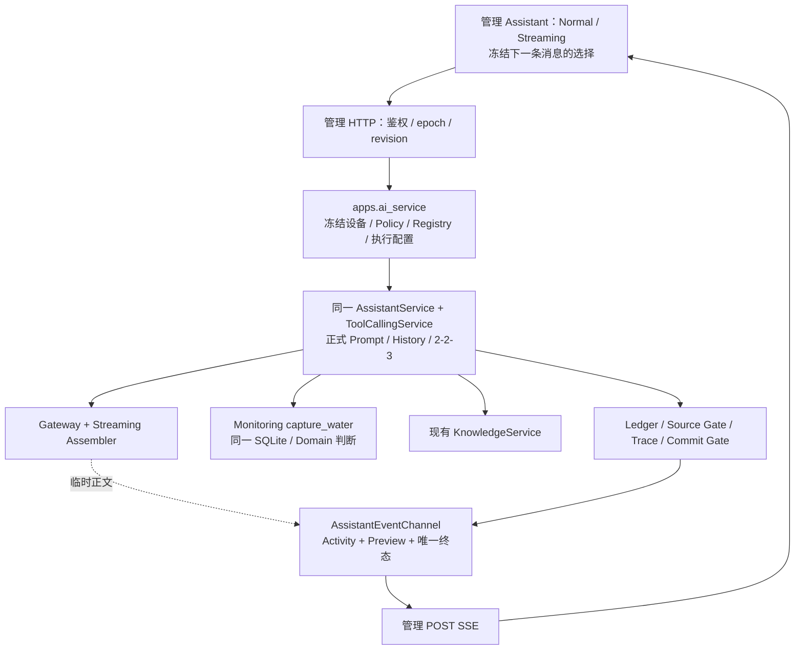

# R2B-5A：管理 Assistant Streaming 集成设计

R2B-5A 研究基线：当时为 **DESIGN ONLY**，仅新增本文，没有运行 Provider/NPU 或资格实验。

当前实施状态：**R2B-5C FRONTEND + BACKEND OFFLINE IMPLEMENTED / WEB TRIAL NOT OPEN**。双模式、POST SSE 与聊天交互已离线接通；独立开关默认关闭、Qwen 两工具仅 candidate。真实资格和试用授权仍未完成。

用户已确认 R2B-4 的 Qwen Normal 2/2/3 初步网页验收通过，Monitoring 与 Knowledge 来源区分正常。这是管理端 Normal 的人工证据，不能替代 Streaming 精确范围资格或回答质量验收。

## 1. 结论与现状缺口

推荐：**复用核心 Streaming Runtime 和 AssistantEventChannel，管理端只补业务装配、POST SSE 传输和页面事件消费**。不导入原 Prototype 的 Flask 应用，不迁移整份旧 app.js，不复制 Tool 循环。Normal 保持默认及回滚路径。

| 现有代码 | 已具备 / 应如何复用 |
|---|---|
| [assistant.py](../../../../src/fishery_ai/assistant.py)：AssistantService / AssistantResult | 正式多轮 Prompt、History 完整 pair 裁剪和 Projection、Ledger / Source Gate / Trace / Commit Gate；安全 to_dict 不含原始 Tool Result |
| [tool_conversation.py](../../../../src/fishery_ai/tool_conversation.py)：ToolCallingService.run_request | 同一执行循环按 ToolModelTransport 调用 complete 或 complete_tool_stream；复用 2/2/3、每轮一个 Tool、提前 Final、Result 回传和 Usage 聚合 |
| [openai_compatible_adapter.py](../../../../src/fishery_ai/openai_compatible_adapter.py)：_ToolCallStreamAssembler / complete_tool_stream / _bridge | 分片组装、结构/参数检查、取消和超时；SDK 流耗尽且 Stream/Client 清理成功后才返回可执行调用；只观察 content，参数/reasoning 不进入预览事件 |
| [assistant_streaming.py](../../../../src/fishery_ai/assistant_streaming.py) | streaming_scope / resolve_streaming_profile 是可复用纯计算；AssistantEventChannel 是有界临时通道。**不调用其 Prototype 配置 loader** |
| [execution.py](../../../../src/fishery_ai/execution.py)：RequestHandle / RequestRegistry | 一次 claim、防重复执行、同一取消 owner、整 Turn deadline、公开 Activity、预览钩子和提交锁 |
| [原 Web](../../../../src/fishery_ai/web.py)：assistant_chat_stream | POST SSE、请求内 worker、终态及断线清理的参考实现；路由鉴权和业务装配不能原样搬入管理应用 |
| [原前端](../../../../src/fishery_ai/resources/web/app.js)：readAssistantEvents / sendAssistant | 复用事件解析与防迟到规则的设计；旧函数直接依赖其全局 Session / DOM / CSRF，**不是可直接 import 的通用客户端** |
| [管理业务 service.py](../../../ai_service/service.py)、[execution.py](../../../ai_service/execution.py) | 已有冻结 PreparedAssistantTurn、管理独立 Normal Scope/revision；目前 execute_turn 固定普通 Transport，bootstrap 没有 Streaming profile |
| [管理 Web](../../../management_web/app.py)、[门面](../../../management_web/ai_adapter.py)、[页面](../../../management_web/static/assistant.js) | 目前只有 JSON 完整响应 + 500ms Activity 轮询；缺少流接口、临时正文、模式选择和 AbortController |

关键区别：**模型 HTTP Streaming、浏览器 POST SSE、Tool 多轮编排是三层**。Assembler 处理 Provider 分片，核心 Runtime 决定下一轮，管理 Web 只转发安全事件。

## 2. 推荐数据流与最小修改范围



| 文件范围（后续实施） | 最小职责 |
|---|---|
| apps/ai_service/execution.py | 管理独立 Streaming Scope、开关、不可变 Decision 与 revision；复用现有 data_bindings 和核心 scope 算法 |
| apps/ai_service/resources/assistant_streaming.json（建议新增） | 固定维护者路径，默认 enabled=false；首个 Qwen 两工具 candidate，不伪造 qualification_id / validated_at |
| apps/ai_service/contracts.py、service.py | PreparedAssistantTurn 增加内部 Transport / 成本上限；共用 claim、Runtime 装配和执行入口；不依赖 Flask/SSE 帧 |
| apps/management_web/ai_adapter.py、app.py | 受控 stream 入口、原 RequestRegistry、请求内 worker、事件序列化、响应关闭处理 |
| apps/management_web/__main__.py | 独立且默认关闭的 Streaming 试用开关；配置随 epoch 冻结 |
| static/services.js、assistant.js、少量 styles.css | POST 流读取、Normal/Streaming 选择、临时预览、同一 Steps/Tool 卡片、Stop 与终态提交 |
| 对应 apps 测试 | 临时 Monitoring/Policy + Fake SDK HTTP 闭环、前端事件行为及 Normal 回归 |

第一轮不计划修改 src/fishery_ai、Monitoring、Tool Schema/Handler、Prompt、History Projection 或现有 Normal 发布配置。不先建通用消息总线、另一套 SSE Runtime 或大型共享前端框架。

### AI Service 接入方式

1. `prepare_turn(value, *, internal_transport=...)` 可按内部枚举选择配置；Transport 来自已选择的 HTTP 端点，浏览器不能提交 mode/budget/deadline/Prompt。原 Normal body 保持兼容。
2. 预检冻结同一个 device_id、Preset、Policy、管理 Registry、ExecutionDecision、epoch、revision。水质绑定仍为 [water_payload（R2C-2B 后位置）](../../../ai_service/business_tools/current_water_quality.py) → MonitoringService.capture_water；不触碰 Prototype CurrentSnapshotStore。冻结的是设备，不是提前取得旧读数。
3. **一次 claim，启动前拒绝重放**：现有 execute_turn 内部调用 handle.start；不能再在 SSE 路由 start 一次。建议在 Service 中小幅提取共用的 claim 和已 claim 执行私有函数；Normal 顺序调用两者，Streaming 在响应头/worker 启动前 claim，worker 只调用同一执行函数。重复 POST 在任何第二个 worker/模型请求前失败。不要通过外部 `skip_validation` 参数跳过此边界。
4. 在 claim 时开始整 Turn deadline；worker 解析一次 CredentialSnapshot、创建一次 RuntimeSnapshot，设维护者成本上限，并在 worker 自身进入原 request_scope / turn_deadline_scope。ContextVar 不会自动跨线程传递，不能只在 HTTP 线程设置 scope。
5. 同一 ToolCallingService 选择 `execution_mode=BOUNDED_MULTI_ROUND`、`model_transport=STREAMING`；AssistantService 的执行模式保持一致。**Runtime.default_response_mode 继续为 normal**，符合 Assistant 现有校验；Streaming 发布 Scope 中的 response_mode=streaming 是传输范围声明，不能据此改坏正式 Profile。
6. Web 建立一个请求内 AssistantEventChannel，连接原 handle._event_channel；只负责事件观察，worker 不读取 Flask request，也不重新获取 Policy/设备或创建另一套取消机制。终态后 finally 解除通道引用。

## 3. 精确 Scope、预算与确认

首个建议候选：`dashscope-qwen38-flash-r1`，Thinking OFF，Streaming，实际授权集合**恰好**为 get_current_water_quality + search_fishery_knowledge，2 Calls / 2 Rounds / 3 Requests、retry=0；参考输出上限 512 tokens/请求，继承当前 Qwen 120 秒整 Turn deadline。

- 用核心 `streaming_scope(...)` 绑定 Preset/variant/contract、service/adapter/normalized URL/model、ProtocolSpec、正式 ASSISTANT_BOUNDED_MULTI_ROUND@1 指纹、History Projection/version、Tool definitions 指纹、STREAMING Transport 和 assembler_version。
- 外层继续绑定管理自己的水质/Knowledge 版本、知识源版本及 backend；不能因 Schema 相同就继承原 Snapshot 数据绑定的资格。
- 独立管理配置、固定路径、默认关闭；启动冻结，不热更新。准备阶段仅 candidate；离线测试可注入虚构临时实验配置，用户另行批准具体本地试用后才登记 local_experimental。Normal 开关/发布、旧 Prototype Streaming 配置和技术 PASS 均不自动授权它。
- revision 绑定以上范围、整份配置、完整用户 Policy、实际装配定义、设备、epoch、实际执行预算、输出上限、Timeout 和正式 Runtime 生成/凭据引用设置。Policy/配置变化使旧确认失效，联网前要求重新 Bootstrap 和确认；执行中按已冻结计划运行。
- Bootstrap 每个 Preset 提供独立 Normal / Streaming 安全 profile：available/can_send、revision、release_status、最大请求数和输出上限；不返回 Provider URL、Prompt、定义全文或凭据。浏览器只回传所选 profile 的 revision。
- 512 是维护者成本**上限**，不是一定产生 512 tokens。现有 Adapter 对 transport_output_token_limit 使用 `min(已有生成预算, 上限)`；离线测试须核对最终编码值，若生成默认值更小应如实报告，不在接入时偷偷提升。上限仍可能截断，必须拒绝半成品。
- Ollama 单独 candidate、独立资格/方言/本机版本/Deadline 评估，初版 Streaming 不开放；保留其 Normal。Normal 首轮多调用记录说明需检查每轮一个 Tool 的兼容性，不能继承 Qwen 结论。暂不纳入 DeepSeek、评分或三工具组合。

建议 Streaming 门禁独立决定其固定 2/2/3，不以“Normal 多轮已开启”当作 Streaming 资格。Normal 维持自己的 1/1/2 或显式 2/2/3 开关；关闭 Streaming 不改变它。

## 4. 最小 POST SSE 合同

建议新路由：`POST /api/ai/messages/stream`。复用 /api/ai/requests、/api/ai/request-state、/api/ai/cancel 和当前正文 envelope / revision；无 GET EventSource、无自动重连、无 Last-Event-ID 恢复执行。

请求继续受 loopback、Host、同源 Origin、X-Management-AI、JSON / 32 KiB、epoch、单次确认、Scope/revision 和 handle 控制令牌检查；控制令牌不得放 URL 或事件中。流启动前返回正常 HTTP JSON 安全错误；开始后用终态事件报错，不再试图改 HTTP 状态。响应 text/event-stream、Cache-Control:no-store、X-Accel-Buffering:no；原 CSP/connect-src self 和 Ingestion 8 KiB 限制不变。

复用 `event_schema_version=1`，公共字段：request_id、epoch、seq、kind；SSE `id` 对应 seq，data 为单行 JSON。seq 从 1 连续递增，keep-alive 注释不占号。

| kind | 安全 payload / 页面行为 |
|---|---|
| start | 实际 transport、max_model_requests=3、max_output_tokens、release_status；可加冻结设备标识/执行 revision，用于核对本次运行，不含控制令牌 |
| activity | 原公开 state/phase/error_code + Activity v2 累计 steps；Tool ATTEMPTING 与 handler_started 真正执行分开，保留快速步骤 |
| preview_reset | request_index；开始新模型请求或模型最终提出 Tool Call 时撤销上一段预览 |
| preview | request_index、累计 text、provisional=true、preview_truncated；不是增量字符串，不重复拼接，不进 History |
| final | 唯一安全 AssistantResult.to_dict + transport/执行摘要；只有全部提交条件通过后发送 |
| error / cancelled | 安全错误码、必要时失败 Result/Activity；清预览，保留实际已执行 Tool 卡片，不保存成功 pair |

沿用通道 512 条非终态事件、最多 128 次预览、每段最多 16 KiB UTF-8、约 50ms 节流和 1 秒 keep-alive；终态保留报告机会。不要把 SDK chunk、tool_calls arguments、完整 Ledger/Result、Prompt、reasoning 或 Credential 写入事件。Preview 已有当前凭据完整值/跨分片前缀遮蔽，但不是任意私密数据或幻觉的通用过滤器；UI 应始终标注临时未确认。

前端 parser 参考旧 readAssistantEvents，但适配管理 Session；用小型独立函数放 services.js 即可，不复制旧网页全局状态。验证 Content-Type、UTF-8/跨字节分片、CRLF/跨帧分片、单帧和总缓冲上限、schema/request_id/epoch/seq/kind，以及 start 声明。重复/旧 seq 忽略，跳号/未知事件/身份错配/非法 JSON 安全失败；EOF 不代表 Final。Activity 另外按 revision 去重，旧 request_index 预览不得覆盖新轮次。

## 5. UI、History 与取消交互

最小布局沿用当前管理样式：

```text
模型 [Qwen] 设备 [模拟池]  Thinking OFF  响应 [Normal | Streaming]
模式 / 实验状态（简短标识）
聊天记录 …
临时回答：正在生成，尚未确认（可被撤销）
输入框 + 本次最多 2/3 次模型请求确认 + 发送 / Stop
侧栏：本次运行 → 独立 Tool 卡片 → 可展开 Steps / Usage
```

- Normal 默认；切模式仅影响下一 Turn，清网络确认，**不清成功 History**、不 Apply、不查询模型。运行中锁模式/模型/设备/Clear，允许用户切出其他业务页；返回同一页面 Session 继续显示 pending 状态，不新建订阅/请求。
- Session 增加 selectedTransport、冻结 pendingTransport/profileRevision、临时 preview/requestIndex、事件 seq 和 AbortController；继续复用 turnSequence/generation、completed turns、display entries。不得建立 Streaming 独立 History 或 localStorage 恢复。
- Normal 继续 JSON + 原 Activity 轮询；Streaming 由 SSE 更新同一通用 Tool/Steps UI，不同时用轮询覆盖 SSE。轮询仅可查询状态/取消确认，不能凭 COMPLETED 重建遗失 Final 或提交聊天。
- 最终 History 写入统一入口：当前 pending Turn 身份匹配、未被取消/废弃、terminal=final、result successful_turn/status=completed、trace_recorded=true、Activity COMPLETED/request_id 匹配、transport 与冻结值相符、finish_reason=stop、正文非空、completed_at 合法。只追加一条 user/final assistant pair，不保存预览、Tool protocol、Ledger、Raw Result 或失败回答。
- 工具卡片保留水质与项目背景知识的不同来源摘要；不把中间模型文字当最终回答，不把历史声明当本轮 Receipt。现有 SourceRequirement 默认 AUTO 不变：开启流传输不会保证模型每次都选中预期 Tool，也不会证明回答内容一定正确。

| 情况 | 必须采取的处理 |
|---|---|
| Stop | 立即撤销预览，调用原 cancel API；Abort 只关闭浏览器流，不代替后端取消。按原 Handle 状态确认，运行中取消不提交成功回答，迟到 Final 不覆盖取消；若已提交再 Stop，诚实提示已完成，不能改写后端终态 |
| 断线 / 读流失败 / 无终态 EOF | 撤销预览、best-effort 取消同一 request、保留已观察到的安全 Activity；不自动重连、创建新 Handle、Normal 重跑或 resend |
| 刷新 / 关闭页面 | 页面 Session 清空；读流 Abort + best-effort 同源 keepalive 取消，服务端同时依赖响应关闭取消；浏览器卸载回调不保证送达，不承诺立即停算/停费 |
| Timeout / 截断 / Provider / Tool / Trace 错误 | 分别保留安全错误码和已执行步骤；不授予不存在的来源、不提交成功 History，不自动换模式或 Provider |
| epoch / revision 失配 | 联网前拒绝；Bootstrap 更新，清确认；epoch 变化清旧 History/Activity、保留 draft，不自动重发；单纯模式切换不触发 Session 重置 |
| 重复提交 / 迟到事件 | 同 Handle 只能 claim 一次；不同 request_id 是新的用户请求，不宣称有跨新 ID 的 exactly-once 保证。UI pending 防连点，epoch + turnSequence + request_id 防旧事件污染 |

响应迭代器 finally 和 response.call_on_close 都应绑定原 handle.cancel，覆盖首次迭代前断线；worker 异常/线程启动失败必须清通道、结束 Handle 并安全报告，不遗留无限心跳。Thread 只是一次请求的承载方式，不是持久任务系统。

**交付与提交是两个时刻**：后端 Commit Gate 成功之后、Final 到达浏览器之前仍可能断线。服务端记录可以已完成，但浏览器没有可验证 Final 时仍不写 History；取消不能倒转已完成状态，也不能保证远端计算/计费停止。UI 显示结果未收到/远端状态未知，不能称为事务式端到端恰好一次。

## 6. 实施阶段与验收门槛

| 阶段 | 实施内容 | 通过条件 |
|---|---|---|
| R2B-5B 后端离线接入 | 管理 Streaming Scope/flag/revision、共同 claim/执行入口、POST SSE、同一 Handle 的事件桥；默认关闭 | Fake SDK 从真实管理 HTTP 完成 Direct Final、water→Final、water→Knowledge→Final；不是只测 Stub Service |
| R2B-5C 前端离线接入 | Normal/Streaming、累计正文预览、原 Tool 卡片/Steps、严格 parser、Stop/断线/epoch | 同 Session 跨模式 History 连续；预览/失败不提交、迟到/重复/乱序安全；模型/设备保持隔离 |
| R2B-5D 回归与小范围真实验收准备 | 精确 Qwen 两工具管理资格计划、脱敏技术记录、人工核对方案 | 默认仍关闭；展示精确 Identity/Prompt/History/绑定版本/512 上限/实际请求数；等待逐案例授权 |
| 获批后真实验收 / 本地试用 | 低氧继续检索、正常提前 Final、当前 DO、概念直答、旧值后更新 Monitoring 再追问；Stop 单独核对 | 技术路径与人工回答来源同时审查；通过后另行登记明确实验范围，不自动 released，不扩大到 Ollama/评分/三工具 |

优先复用 [原 Web SSE 测试](../../../../tests/web/test_assistant_streaming_web.py)、[Assembler 测试](../../../../tests/providers/test_streaming_tool_assembler.py)、[Streaming 多轮测试](../../../../tests/tools/test_streaming_multi_round.py) 的 Fake SDK/断流模式，以及 [管理双 Tool 测试](../../../management_web/tests/test_multi_round.py) 的临时 SQLite/设备夹具。原测试是可借鉴的证据与夹具，不是管理 HTTP 已通过 Streaming 的证据。

必须覆盖：

- Result A 实际进入 Request #2，Tool B 由模型决定，第三次请求 tool_choice=none；同轮多个 calls 整批拒绝，不出现第三个 Tool/第四次请求。
- 冻结设备/批次来源、Monitoring 与网页同源；NO_DATA / PARTIAL / INVALID / STALE / OFFLINE 不退回 Demo，Knowledge OK/NO_MATCH 不授予当前观测来源。
- SDK 流/Client 清理完成前不执行 Tool；异常分片、无正常 finish、length、清理失败、各轮 Stop/Timeout、Trace 失败、worker 启动失败、断开在首次迭代前/模型中/Final 前的竞态。
- 参数、reasoning、原始 Result、凭据和私有路径不进事件；覆盖跨分片虚构 Secret、UTF-8、预览上限、事件超限、慢消费者和最后一段被节流时仍以 Final 为准。
- HTTP 门禁、Scope/定义/数据绑定/Policy/预算/revision/epoch 错配在联网前拒绝；浏览器不能直接指定预算/Prompt/Deadline；Stream 请求不能凭 Normal revision 获准。
- Normal 1/1/2 与 2/2/3、原型 Assistant/Analysis/Manual/普通文本 Streaming、Monitoring 历史图/设备/事件、History 裁剪/清空/切模型回归。

实施后运行 apps AI/Web targeted、Node/browser 测试及相关核心 Streaming/Assistant 回归，再做语法、Markdown 链接、diff 和敏感扫描；未改 qualification 基础设施时不运行无关历史实验或真实资格批次。

## 7. 风险、待决定项与回滚

1. **Scope 与审批**：Normal 人工通过不能授权管理 Streaming；首版 candidate，是否开放 local_experimental、真实案例与次数须另获批准。Ollama 调用稳定性/本机方言独立评估。
2. **响应生命周期**：claim 放置、跨线程 ContextVar、断线清理、已完成后 Stop 是主要集成风险；必须由 HTTP 端到端竞态测试锁定，不另写取消状态机。
3. **Deadline 限度**：整 Turn 使用同一剩余时间，不逐轮续期；现有本地 SQLite/Knowledge 是同步调用，检查点不是任意阻塞代码的强制杀线程能力。部署层缓冲/代理超时和进程退出仍需单独验收。
4. **内容可信度**：预览只显示模型 content，不能作为可信事实；数据来源与最终语言可信度仍需人工检查。512 tokens 不保证完整解释，Usage unavailable 不能计为零，不能凭技术成功宣布养殖建议正确。
5. **前端复用范围**：旧 parser 耦合 Prototype Session，不应直接 import 整份 app.js。先做管理专属小型事件消费者；只有出现真实重复维护成本时才另审共享模块提取。
6. **本机边界**：当前 token + loopback 不是生产账户权限，Flask worker 方案不是多进程分布式 SSE。暂不引入持久流、断点恢复、Memory、后台任务、并行 Tool 或 Agent。

回滚方案：关闭**管理独立 Streaming flag**、去掉未来试用启动参数并重启；新 epoch 撤销旧确认和页面 Session，Normal 使用既有配置（可继续其已启用的本地多轮），不改 Policy、数据库、凭据或 Prototype 发布文件。执行失败本身绝不自动触发回滚重跑。

**推荐下一步：先做默认关闭的管理 POST SSE 后端 + Fake SDK 三路径与断线/claim 测试，再接页面；本轮到设计为止。**


## R2B-5B 实施补记

- 管理独立 streaming.py / resources/assistant_streaming.json 复用核心 Scope resolver；默认 enabled=false，唯一 Qwen 两工具 candidate，512 上限、2/2/3、120 秒、retry=0，不加载 Prototype 发布文件。
- Service 共用 claim_turn 返回服务器内的一次性执行闭包；Normal execute_turn 直接使用，POST SSE 在 worker 前 claim，再在 worker 建立同一 Handle 的 ContextVar / deadline。凭据一次解析、Runtime 一次冻结；Tool 循环不复制。
- POST /api/ai/messages/stream 复用原门禁/控制 API，事件来自同一 AssistantEventChannel；包含累计安全 Activity、临时 Preview/Reset、唯一 Final/Error/Cancelled。关闭响应取消原 Handle；已完成状态不被迟到取消或投递故障改写。
- Fake SDK 的三路径确认真实 Monitoring Result 进入后续请求，两个 Ledger Receipt 独立；所有实际 Streaming 请求编码 stream=true、max_tokens=512，Runtime 默认响应仍为 normal。候选/关闭/Scope/Policy/revision 错配全部在模型 I/O 前拒绝。
- R2B-5B 当时未实现前端；现已由下节 R2B-5C 接通。后端技术测试不代表真实模型资格或回答质量。
- 当前边界与离线验证入口见 [INTEGRATION](../../INTEGRATION.md#r2b-5b管理-streaming-后端) 和 [BUILD_RUN](../../BUILD_RUN.md#r2b-5bstreaming-后端离线验证)。

## R2B-5C 实施补记

- 小型独立 SSE parser + 原 Workspace；Normal 仍用原 POST/状态轮询，Streaming 通过 POST 读流，无新执行循环或自动重连。候选默认关闭，原 Scope/Prompt/512 上限/2/2/3/120 秒不变。
- 严格序号与身份、start 确认、Activity 和 Final 检查；只忽略重复 seq 和较旧 Request 的 reset。失败/断流/非法事件撤销预览，无成功 pair；Stop 复用原控制句柄，Abort 清理原通道，已完成与投递丢失保持既有区别。
- 同一 DOM 回复在 Final 后转正。内部聊天滚动、稳定输入区、手动上滚暂停跟随、回到最新与键盘问题导航，不改变后端 History 或 Source/Ledger。
- 51 Node、88 管理 Web Python、13 AI Service、154 相关核心回归通过。新增 HTTP/Fake SDK→真实前端 parser/Workspace 三路径桥接；隔离浏览器完成双 Tool，1280/390px 无横向溢出。不是实际 LLM 或语言质量证据。
- 下一阶段：单独批准管理专属 Qwen 两工具案例、核对真实协议/清理/Stop/来源与人工回答质量，再决定实验发布；不自动开启 Streaming，不扩大到 Ollama/评分/三工具。

## R2B-5D 资格准备

管理候选 Scope 已与实际 Preset/协议/正式 Prompt/History/两工具 definitions 和 Monitoring/Knowledge 绑定核对。单案例 CLI 复用既有资格 Adapter、流式观察及正式管理 Service，固定 direct-final / current-water / low-oxygen，默认 Dry-run；不读取原型 Snapshot 或管理运行库。计划 hash + 单次明确确认后才可执行一个内部 candidate probe，Web 仍关闭，运行本身不发布任何资格。

脱敏报告保留 Provider/组装一致性、SDK 清理、Result 传递、Ledger/来源及产品 Commit Gate；不保存正文/参数/检索内容。可选 TTY 人工预览只标记 PREVIEWED_NOT_APPROVED。CLI 未覆盖真实 HTTP/SSE 和浏览器；详细案例、预算与审批/回滚见 [操作说明](../STREAMING_QUALIFICATION.md)。

## R2B-5E 本地实验开放

用户完成三个真实案例（Direct Final / 当前水质 / 低氧双 Tool）技术 PASS 后，另行明确批准 Qwen 精确两工具 local_experimental，回答质量留待后续。管理资源只更新发布状态，qualification_id/validated_at 为空、enabled=false；`--assistant-streaming-trial` 在启动 composition 时启用当前 epoch，不修改磁盘、Policy 或原型配置。Normal 默认，两个试用参数独立。精确门禁、512/2/2/3/120秒、Stop、Ledger、Commit Gate 和原 SSE/预览流程复用；未开放其他 Provider/Tool 组合，也不自动重跑或降级。R2C-1E 用户已另行报告独立 Backend 的基本真实网页验收通过，回答质量仍待专项研究；详见 [迁移收尾](R2C1B_AI_BACKEND_FORK_MIGRATION_PLAN.md#15-r2c-1e-工程收尾与人工验收)。操作和回滚以 [BUILD_RUN](../../BUILD_RUN.md#r2b-5eqwen-streaming-本地实验) 为准。
