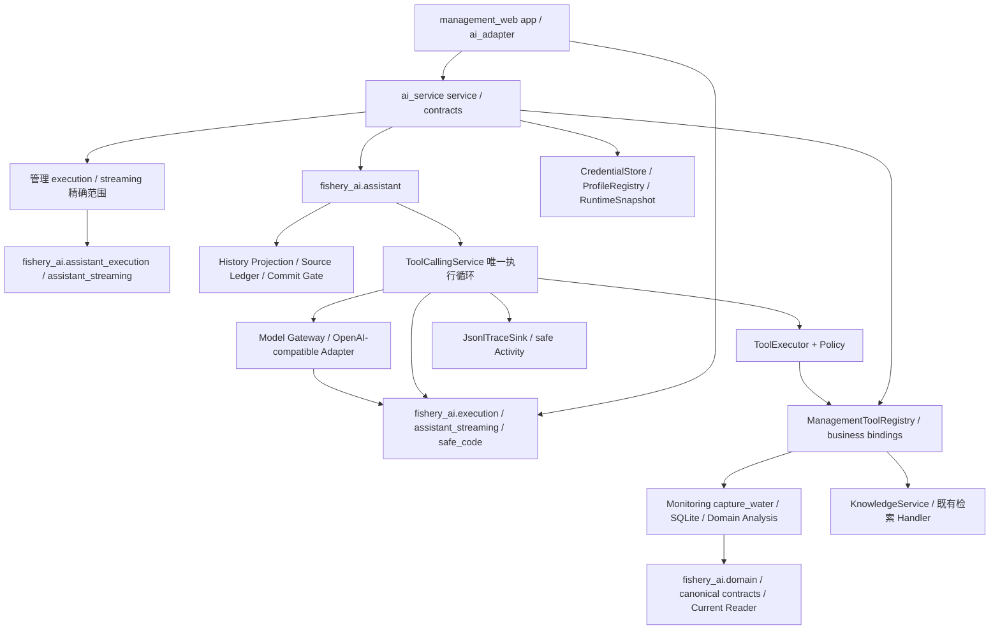
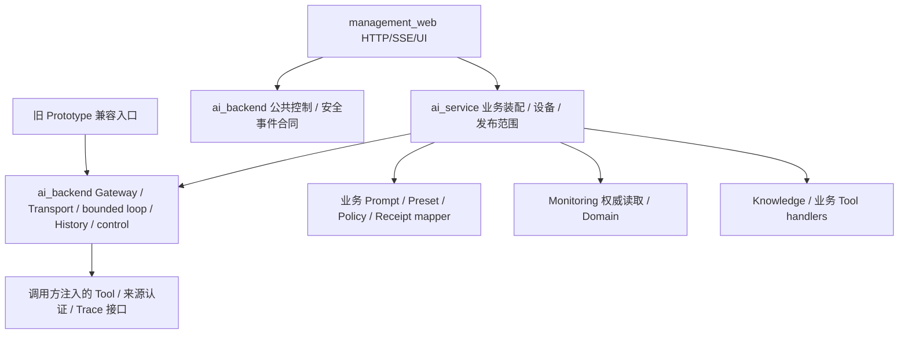

# R2C-1A：LLM Backend 审计与独立化准备

日期：2026-10-16。依据当前源码、AST 导入关系、固定资源与离线测试；开始时 Git 工作树干净。未读取凭据、真实对话/Tool payload 或 Monitoring 数据库，未调用 Provider/NPU。用户此前的真实网页初验不等同于本轮重新验证。

**结论：可以逐步消除管理 AI 对旧 Prototype Runtime 的直接依赖；当前尚未消除。** 本轮只迁移独立的参数诊断合同，未搬迁执行循环。主要障碍是通用传输合同与领域合同混装、执行控制与 Activity 的延迟互依，以及发布计算直接引用业务 Prompt；不是缺少第二个 Runtime。

## 1. 当前真实依赖

审计覆盖 `src/fishery_ai/`、管理 AI/Web 与 Monitoring；区分模块级导入、函数内延迟导入及 TYPE_CHECKING。源码可达关系不是实际执行记录：导入评分 Handler 不意味着管理端授权或执行评分。



主要引用位置：

| 调用者 | 直接复用及作用 |
|---|---|
| [ai_service/service.py](../../../ai_service/service.py) | AssistantRequest/Service/profile；Gateway/Adapter/Runtime；RequestHandle/作用域/deadline；凭据、Trace、History；Knowledge/Registry/Policy。不是独立模型执行器 |
| [原 bindings.py（现统一装配入口）](../../../ai_service/business_tools/registry.py) | 复用正式 Definition/Handler，将水质 Handler 绑定到 `capture_water(device_id)`；Knowledge 保留原服务；只装配两工具 |
| [execution.py](../../../ai_service/execution.py) / [streaming.py](../../../ai_service/streaming.py) | 复用核心精确 Scope 计算，管理层另绑定数据服务、Policy、设备、epoch 与配置 |
| [contracts.py](../../../ai_service/contracts.py) | PreparedAssistantTurn 持有旧 AssistantRequest、ModelProfile、ToolPolicy、Transport、Handle 等真实类型；不是序列化的第二套配置 |
| [Web ai_adapter.py](../../../management_web/ai_adapter.py) | 持有浏览器令牌和 RequestRegistry；委托业务 prepare/claim/execute，保留同一 Handle |
| [Web streaming.py](../../../management_web/streaming.py) | Flask Response、线程/断线生命周期；复用 AssistantEventChannel、安全错误及同一 Handle，不实现模型/Tool 循环 |
| [Web app.py](../../../management_web/app.py) / [CLI](../../../management_web/__main__.py) | 延迟导入旧异常类型与 safe_code，注册 HTTP 错误处理；CLI 使用原凭据错误合同 |

迁移前，以上生产路径的静态传递可达旧模块为37个（含函数内导入，不含仅 TYPE_CHECKING/qualification）：

- Assistant：`assistant`、`assistant_activity`、`assistant_execution`、`assistant_sources`、`assistant_streaming`。
- 模型传输：`model_gateway`、`model_options`、`openai_compatible_adapter`、`protocol_specs`、`providers`。
- 控制/记录：`execution`、`history_projection`、`observability`、`tool_argument_diagnostics`。
- 配置/安全：`presets`、`credentials`、`credential_paths`、`secure_files`、`evidence_resolver`、`official_capabilities`、`manual`、`contracts`。
- Tool：`tool_conversation`、`tools` 包入口、`tools.contracts`、`tools.executor`、`tools.policy`、`tools.registry`、`tools.catalog`、三个 `tools.handlers.*`。
- 领域：`domain`、`knowledge`、`water_quality_scoring`、`telemetry.current`、`telemetry.snapshot`。

管理 AI 不直接执行旧 `application.py` 的固定 Analysis，也不以旧 `web.py`、Scenario、MockRepository 或 Snapshot Store 作为其观测来源。上述 Telemetry/评分导入来自类型、Registry/Activity/Source 的耦合，不是 fallback。

Development 路径另行依赖 `fishery_ai.development.qualification` 的 Adapter、流式观察、报告与单案例装配；正常启动不加载 qualification。它们不作为新 Backend 的底层依赖。

## 2. 模块归属与迁移判断

| 当前实现 | 属性 / 推荐归属 | 最小迁移判断 |
|---|---|---|
| `tool_argument_diagnostics` | 通用有限诊断 → Backend | **本轮迁移**；仅标准库、无业务/资源依赖 |
| `model_options`、`providers.AuthSpec`、ProtocolSpec 编码 | 通用模型合同/协议与维护者配置混合 | 下一小步可提取纯合同；保留类型身份及 Provider 方言，不改编码或能力结论 |
| `model_gateway` | 消息/Tool 协议、ProfileRegistry、Snapshot、Mock 混装 | 先分离 Usage/RuntimeInfo/Mode、错误与配置依赖；不能整文件搬后再反向 import 旧包 |
| `openai_compatible_adapter` | 通用传输 + Normal/Streaming assembler + Manual | 等中立合同/执行上下文就绪再原样迁；Manual 接口保持兼容，不复制 Adapter |
| `execution` | 通用控制，延迟依赖 GatewayError、Activity/Tool steps | 先拆公共错误与安全投影接缝；必须全系统只有一份 ContextVar、RequestHandle、deadline |
| `tool_conversation`、Executor | 共享有界循环/执行，但引用具体 Registry、工具名、Mock、水质 Usage 合同 | 后续让服务装配 Registry/安全投影，循环原样迁入；禁止建立新 loop 或放宽权限 |
| `assistant` | 业务 Prompt、Preset allowlist、History 裁剪、Commit Gate 混装 | Prompt/模型选择留业务层；泛化执行入口后迁移其余合同，不把渔业 Prompt 变成通用 Backend 默认 |
| `history_projection` | 投影基本通用，但创建旧 ModelMessage、替换 AssistantContext | 消息合同先迁；原 JSON framing、顺序、默认值与 pair trimming 原样保留 |
| `assistant_sources` | Ledger 容器 + 明确水质/评分/知识 payload 认证 | 通用顺序记录可迁；领域 Receipt mapper 留业务侧。不可按名称赋来源，不能把它当纯通用模块整搬 |
| `assistant_activity` / `observability` | 安全投影/写入与 Catalog、AnalysisResult、领域字段混装 | 后续分开通用步骤/写入与业务摘要；不复制 allowlist 或输出 raw payload |
| `assistant_streaming` / `assistant_execution` | 发布计算、默认文件加载、业务 Prompt 与事件通道混装 | Scope/发布文件和业务 Prompt 留 ai_service；纯计算与安全事件在依赖解开后进入 Backend |
| Credential/secure_files | 可复用但安全敏感的路径/文件/快照合同 | 后移；保持原 root identity、优先级、ACL、锁和原子操作，不因目录搬家改凭据路径 |
| Registry/Catalog/Handler、Knowledge、Domain/Telemetry/Scoring | 渔业业务或旧 Prototype 支持 | 不进入通用 Backend；管理 Tool 绑定和知识依赖由 ai_service 装配，领域服务另保留共享边界 |
| `web`、`application`、Manual UI、Scenario、开发 qualification | 旧产品入口或开发工具 | 保留旧产品；日后作为 Backend 消费者使用同一实现，不成为其依赖 |

## 3. 架构质量与需要保留的适配

- 未发现管理层复制 Tool 循环、Provider Adapter 或第二套 History/取消状态机。`ManagementAssistant` 是必要的 Web 访问/请求控制边界；`ManagementToolRegistry` 是必要的权威数据绑定，不能为减少层级而删掉。
- 模块级 eager import 图未发现强连通环；但存在延迟互依，例如 `execution.report_steps → assistant_activity → tool_conversation → execution`，以及 `observability.record_tool_conversation ↔ tool_conversation`。当前可导入不代表可以任意调换位置；新后端不能把这些延迟边全部复制过去。
- `tool_conversation` 的通用协调与水质 Mock 文本/已知工具名同文件；`assistant_sources` 按领域 payload 认证；`assistant_activity` 通过 Catalog/Registry 识别安全展示字段。这些是独立化的实际难点。
- `observability` 同时处理 Analysis、Tool 和 Assistant；`assistant_streaming` 同时处理发布配置与临时事件。拆分应围绕实际依赖，而非文件行数。
- 管理与 Prototype 发布 JSON 分开是必要授权隔离，不是应合并的重复配置。两侧少量 canonical JSON/hash helper 和 SSE parser 存在相似代码；本轮不合并，避免改变确认指纹及不同 Session 语义。
- `create_app` 即使 AI 关闭也注册旧 Assistant/凭据异常处理，可能加载较多旧模块；这影响启动依赖范围，没有证据表明此处联网或读真实凭据。本轮仅记录。

## 4. 目标依赖与本轮实际结果

以下为**目标**，不是本轮已完成的布局；不预建空模块：



箭头表示代码依赖；Backend 可调用注入的既有 Handler，但不 import Monitoring/数据库/Flask。UI 的 POST SSE 仍留 Web；模型 SDK Streaming 与 Tool delta assembler 属于 Backend。Ledger/Commit Gate 的执行程序与领域来源判定必须保留明确接缝。

本轮实际只建立：

```text
旧 Model Gateway / Adapter / Executor / Activity / Trace
  → fishery_ai.tool_argument_diagnostics（单向兼容别名）
  → apps.ai_backend.tool_argument_diagnostics（唯一实现，仅标准库）
```

迁移文件为原实现，AST 与迁移前一致；未复制循环或改变任何拒绝条件。旧路径/new path 是同一 module/type/enum/exception/function，保留 monkeypatch。安全 JSON 字段与值不变；诊断类型的 `__module__` 变成新路径，不再把旧文件路径视为类型身份。当前没有该对象持久化业务；测试覆盖新对象序列化往返。

根 pyproject 显式打包原 `fishery_ai*`、`apps` 标记与 `apps.ai_backend`，不顺带发布整个管理应用或测试/运行数据。否则仓库内可导入、独立安装后旧包却缺 `apps`，会造成隐藏兼容故障。本轮没有安装依赖或改用户环境。

## 5. Scope、资格和配置保护

| 边界 | 实际绑定 / 本轮处理 |
|---|---|
| [release_scope](../../../../src/fishery_ai/assistant_execution.py) | Preset/variant/contract、Identity、完整 ProtocolSpec、Thinking/Mode、Prompt ID/hash、History ID/version、实际 Tool 名称与 description/schema hash；未改 |
| [streaming_scope](../../../../src/fishery_ai/assistant_streaming.py) | 上述范围 + STREAMING + assembler version；管理只开放精确 Qwen 两工具 local_experimental，默认关闭；未改 |
| 管理 execution revision | 原 runtime revision + 管理配置/数据绑定/完整选择/设备/epoch/实际 definitions；未改，真实启动重启产生新 epoch 属于原语义 |
| Streaming revision | 另绑定输出预算、超时/retry、生成配置、Credential 引用/Auth 等；仍512、2/2/3、120秒、retry=0；未改 |
| 资格计划 | 另有案例、问题 hash、fixture、SDK版本、History framing hash、配置/Scope/hash；本轮只做无 I/O 计划对比，不运行真实案例 |
| 凭据位置 | 仍按原 project root 定位；本轮未读取私有内容、修改来源或 ACL |

迁移前后保存并比较8份相关源码/发布资源的 SHA256，以及3个管理 Streaming dry-run 的 Scope/配置/计划 hash，要求完全相同。当前 Scope SHA256 仍为 `fc476b2e9ac19046b0127e65d70dc1488016c04f9dde29698d681c6047708e90`。未写资格记录或改变 candidate/local_experimental/released。

**限制：Scope 不是全部源码的哈希。** Web History Scope 主要绑定 ID/version，Notice/framing 内容 hash 由资格计划另记；assembler version 也是显式版本。后续只移动文件却改 framing、序列化、Provider 编码或清理语义时，不能凭旧 Scope 匹配沿用资格。本轮因为实现 AST、上述合同文本/资源和计划均不变，未发现需要使资格失效的语义变化；本轮离线回归不构成新增真实 Provider 资格。

## 6. 分阶段迁移、兼容与回滚

| 后续阶段 | 最小范围 / 前置条件 | 验收与回滚 |
|---|---|---|
| R2C-1A（本轮） | 参数拒因叶子合同 + alias + 安装发现 | 单一模块/类型、无业务导入、旧新路径与源码等价、发布默认不变 |
| 下一小步：中立合同 | 从 model_options / Usage / ModelMessage / Tool Call / GatewayError 入手；先确认哪些是领域合同 | 每次少量迁移，旧类必须是同一对象；协议归一化和 JSON fingerprint parity，不动 Prompt |
| 执行控制 | 错误合同就绪后解开 Activity 回调，再迁 RequestHandle/Registry/ContextVar/deadline | Stop/Timeout/claim/线程/迟到/Trace 全链回归，必须只有一个请求所有者 |
| Transport | 合同与取消控制已独立，再迁同一 Adapter/assembler；Manual 保留兼容 | Qwen/DeepSeek/Ollama Normal/Streaming/Fake SDK 全矩阵与实际编码/清理；语义变化另审资格 |
| Tool 协调及来源 | 先拆 Registry/安全摘要/领域 Receipt mapper 接缝，再迁同一 bounded loop/ledger | 1/1/2、2/2/3、Usage、去重、ERROR、Source Gate、Commit Gate；不得有第二个可写步骤真相 |
| Assistant/History/事件 | 业务 Prompt/Preset/发布计算通过显式装配，保持冻结文本/版本 | 管理与 Prototype 共用新实现，SSE Preview/History/Stop 回归，浏览器不能覆写预算或配置 |
| 断开旧 Runtime 依赖 | ai_service/Web 改用新的公开合同；保留旧包单向 alias | 静态扫描 + fresh process 确认无旧 Runtime import；审查资源/打包/资格，再决定是否移除兼容入口 |

本轮代码回滚：将唯一实现迁回旧文件，撤回新包和对应 pyproject 打包条目；保持调用者旧导入即可恢复，无数据迁移。不要只删新包留下 alias。回滚需重新跑对应 targeted 并重启自己的 Web，新 epoch 撤销旧确认；不编辑数据库、Policy、凭据或真实报告。本轮不实际回滚。

**完全移除旧依赖的判断：** LLM Runtime 可以迁出，但不建议一次搬完。即使 AI Runtime 已独立，Monitoring 当前仍使用 `fishery_ai.contracts/domain/telemetry.current` 的共享领域合同；要彻底卸载整个 `fishery_ai`，还需另一项共享领域服务/资源迁移，不能将水质规则、Knowledge、Scenario 塞进 ai_backend 来“消除导入”。原 Prototype 可长期使用单向兼容接口。

## 7. 离线验证与剩余风险

- 新边界/参数诊断/Gateway 合同58项；管理 AI/Web/资格兼容113项；共享 Assistant/History/Source/单多轮/Assembler/Preset/Web/Analysis283项；资格边界/Analysis Tool/取消48项，均通过。另运行 FAST149项、管理前端52项通过；这些分组部分覆盖同一合同，不作为独立样本数。
- 通过系统已有 Python3.11 / setuptools65.5 的 `read_configuration + build_py` 离线装配154个文件，在隔离目录通过原 Web/Analysis、三个 Preset和新旧诊断导入。不下载安装软件或修改 venv；这不是声明完成了要求 setuptools>=68 的 wheel 构建/安装测试，后续正式构建仍按项目已有 build-system 要求执行。
- 迁移实现 AST 与原文件一致；8份关键合同/发布文件及3份计划指纹前后一致。4份 Python 与1份 TOML 语法通过；45份当前 Markdown 中369条本地文件链接、30处锚点无损坏，历史 archive 未纳入；15个改动文件的敏感模式扫描及 `git diff --check` 通过。自动测试不访问真实 Provider/NPU或真实设备数据；没有重复运行历史真实资格实验。
- 仍需注意：后续错误类/Enum 重复定义会破坏 isinstance 和 catch；两个 ContextVar 会导致 Stop失效；移动资源或 private root 会改配置/凭据位置；泛化 Receipt mapper 可能削弱来源认证；跨层 façade 会掩盖旧依赖；新 Backend 位于 `apps` 命名空间，后续增子包须同步安装清单。

本轮到此停止。推荐下一轮先审查“中立模型/Usage/错误合同”的小范围提取，不直接搬 Gateway、Streaming 或完整 Assistant。
