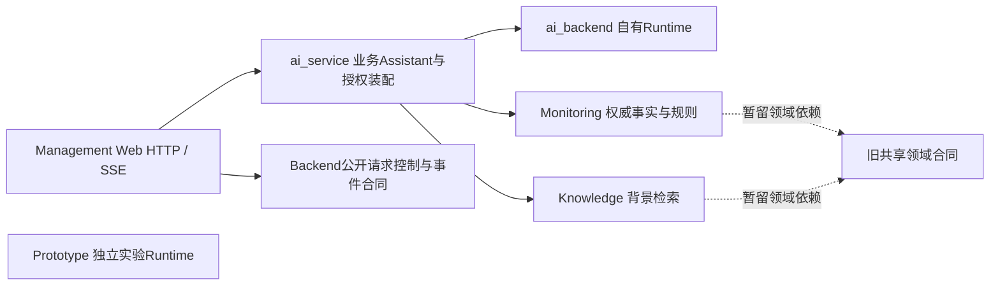
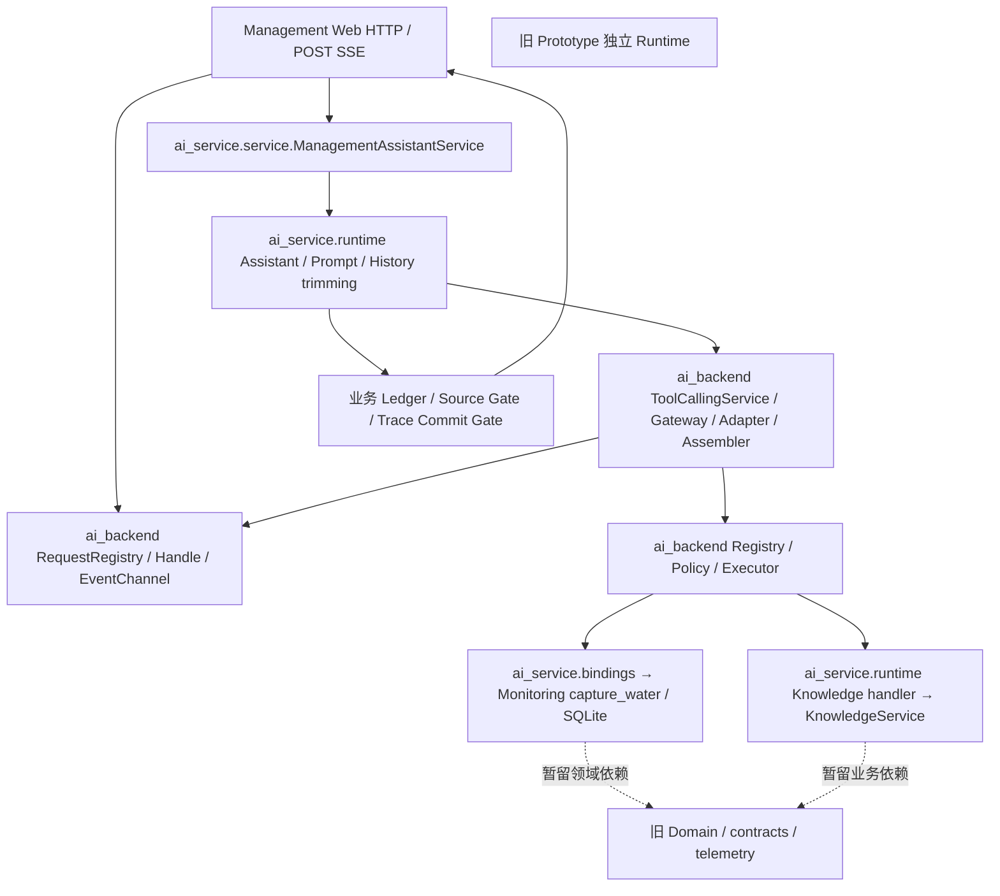

# R2C-1B：独立 AI Backend 整体迁移方案

日期：2026-10-16。**R2C-1 主要迁移已结束：Phase I 实施见 §13，Phase II 整体切换见 §14，最终工程收尾与用户基本网页验收见 §15。** §1–12 为原获批评估基线，依据源码、测试定义、安装清单和 [R2C-1A 审计](R2C1A_LLM_BACKEND_AUDIT.md)，当时未执行代码迁移或真实请求；原设计保留其阶段语境。

## 1. 推荐结论与新的项目边界

**推荐“选择性复制现有实现 → 在新侧完成依赖闭包与离线等价验证 → 管理端一次性切换”的受控分叉方案。** 不再以新旧模块长期共享类型或兼容别名为目标。

- 管理平台是主产品，只有一套实际使用的 Gateway、Tool 循环、Streaming、History 和请求控制。
- Prototype 保留自己的实现和资源，供后续实验；允许与管理平台有意分化，不建立自动同步机制。
- 复制是一项有来源基线、清单和验收条件的一次性工程操作；不把旧包作为新 Runtime 的底层，也不另写执行算法。
- 新侧的业务 Prompt、Preset/发布配置、来源认证与业务 Tool 由 ai_service 负责；Backend 不导入 Monitoring、Knowledge、Flask 或 `fishery_ai`。
- 当前15个已有未提交/新增文件属于 R2C-1A，不能清掉或假设已提交。本文取代其“逐模块单一共享实现”迁移建议，**不改写 R2C-1A 的历史事实**。

这项新用户决定与现有 [apps/AGENTS.md](../../../AGENTS.md)、[Backend README](../../../ai_backend/README.md) 中“不复制 Runtime、旧包指向新包”的旧迁移规则不同。获批实施的第一阶段需同步修订这些规则为“允许一次性分叉；新管理系统内部仍禁止双 Runtime/双循环”。本轮保持原文件不动。

## 2. 源码核对带来的重要修正

当前管理路径确实经 `ManagementAssistantService → AssistantService → ToolCallingService → Adapter/Executor`；Normal 与 Streaming 共用同一循环。与复制目录相比，以下接缝更重要：

| 实际位置 | 发现及迁移含义 |
|---|---|
| [model_gateway.py](../../../../src/fishery_ai/model_gateway.py) | ModelProfile、ProfileRegistry、消息、错误、RuntimeSnapshot 同文件；Preset loader 实际使用 `ModelProfile.from_dict`，不能误删。`ProfileRegistry.from_json` 才会延迟引入 Managed Evidence Resolver |
| [tool_conversation.py](../../../../src/fishery_ai/tool_conversation.py) | 正式循环在 `run_request/_run_request`；前部还包含水质专用 Mock、关键词选择和 `converse` 的默认 Prompt。这些不应复制成通用 Backend 产品行为 |
| [assistant.py](../../../../src/fishery_ai/assistant.py) | 同时包含渔业 Prompt、Preset allowlist、History pair 裁剪、来源满足检查和最终提交。推荐作为管理业务 Assistant 复制到 ai_service，内部调用新 Backend；不为此新写一套 generic Assistant 框架 |
| [assistant_activity.py](../../../../src/fishery_ai/assistant_activity.py) / [execution.py](../../../../src/fishery_ai/execution.py) | RequestHandle 延迟调用 Activity；Activity 又读领域 Catalog/Registry。只改相对 import 会把业务反向带入 Backend，需把业务摘要函数留服务层 |
| [assistant_sources.py](../../../../src/fishery_ai/assistant_sources.py) | Receipt/Requirement/Ledger 包含特定三工具、WaterQualityReading、Evidence 字段验证，不是天然通用模块。整体业务语义留 ai_service；不在 Backend 再造一份来源 Ledger |
| [tools/registry.py](../../../../src/fishery_ai/tools/registry.py) | Definition、description/schema 和水质/评分/Knowledge Handler 绑定混合；应提取原 Definition 到业务层，新 Backend Registry 只接收静态绑定 |
| [tools/policy.py](../../../../src/fishery_ai/tools/policy.py) | 用户存储会经 Registry/Catalog 校验两个模式的选择。不能换成只认识两工具的 Registry 后，让已有评分选择导致整个 Policy 文件失效；也不能造一个可执行评分 Handler 来兼容存储 |
| [openai_compatible_adapter.py](../../../../src/fishery_ai/openai_compatible_adapter.py) | 包含普通文本流、Tool assembler 与 Raw transport；`_kwargs` 区分普通 Streaming 和完整 Tool Streaming，不能因通用 `validate_tool_request(...streaming=True)` 拒绝而误判后者未实现 |
| [presets.py](../../../../src/fishery_ai/presets.py) / [presets.json](../../../../src/fishery_ai/resources/profiles/presets.json) | 当前三个模板连接均为 inline，合同均1.0.2；不需要为了装配这些 Preset 再复制旧 experimental connection JSON |
| [Monitoring service](../../../monitoring/service.py) / [领域合同](../../../../src/fishery_ai/contracts.py) | Monitoring 依赖旧 CurrentWaterQualityReader/Domain；领域合同又导入旧 model_options。它与“管理端调用旧 LLM Runtime”必须分别验收，不能承诺整个进程立即没有任何 `fishery_ai` 模块 |

静态检查覆盖74份旧包 Python 文件及新侧相关源码/测试；未把测试中的 Fake 响应视为真实模型证据。未读取输出报告正文、凭据或数据库。

## 3. 推荐目录：保留 apps/ai_backend

继续使用当前位置。它与现有 apps 工程规则、开发启动和测试路径一致；此时改成第二个 src 布局或新仓库会同时增加打包、资源和相对路径变量，没有必要。

目标代码依赖如下；注入Handler的调用不代表Backend反向import业务。旧实验Runtime与新Backend没有代码依赖箭头：



以下是**实施目标**。只有真正迁入实现时才创建文件，不先建立空目录；尽量沿用旧名以减小 import/test 适配成本。

```text
apps/
├─ ai_backend/                       # 自有通用 Runtime；禁止 import fishery_ai/业务/Web
│  ├─ __init__.py                    # 无副作用的包入口
│  ├─ README.md                      # 公共模块与维护边界
│  ├─ contracts.py                   # Usage、SessionUsage、RuntimeInfo、Mode/Status、时间辅助
│  ├─ model_options.py               # 生成选项、能力类型与确定性校验
│  ├─ model_gateway.py               # 模型消息/Tool协议、Profile/Snapshot、Gateway与错误
│  ├─ providers.py                   # Auth与Provider协议元数据；不授予模型发布资格
│  ├─ protocol_specs.py              # Qwen/DeepSeek/Ollama等已有编码规则
│  ├─ openai_compatible_adapter.py   # 现有SDK传输、错误归一化、Streaming assembler
│  ├─ manual.py                      # 原Adapter需要的Raw传输合同；不开放管理Manual UI
│  ├─ execution.py                   # 唯一ContextVar、RequestHandle/Registry、Stop/Deadline
│  ├─ tool_conversation.py           # 原有Steps、预算、Usage、有界单/多轮循环
│  ├─ history_projection.py          # 现有投影；接收已裁剪pair，不读业务或存储
│  ├─ assistant_activity.py          # 通用安全Steps投影，业务摘要由服务明确提供
│  ├─ assistant_events.py            # 从原assistant_streaming提取事件通道，不带发布文件加载
│  ├─ observability.py               # 安全执行Trace与写入；不引入旧AnalysisResult
│  ├─ tool_argument_diagnostics.py   # 已有有界诊断实现
│  ├─ credentials.py                # 正式Store/Snapshot，保留来源/快照与安全读取逻辑
│  ├─ credential_paths.py           # PrivateCredentialLocation/错误等底层路径合同
│  ├─ secure_files.py               # 已有文件/链接/ACL/锁安全实现
│  ├─ tools/
│  │  ├─ __init__.py                # 显式导出，不自动装配业务Handler
│  │  ├─ contracts.py               # ToolDefinition/ExecutionResult/安全错误
│  │  ├─ registry.py                # 调用方静态提供的绑定；无扫描或动态发现
│  │  ├─ executor.py                # 原参数、授权、去重、大小、取消门禁
│  │  └─ policy.py                  # ToolPolicy值合同；无旧默认资源/用户目录依赖
│  └─ tests/                        # 原协议/Runtime安全测试的管理分叉版本与Fake SDK
├─ ai_service/                       # 自有业务协调及授权装配
│  ├─ service.py                     # 现有ManagementAssistantService，统一使用新Backend
│  ├─ contracts.py                   # 设备/PreparedTurn/业务服务合同
│  ├─ assistant.py                   # 原业务Assistant、Prompt、History裁剪与Commit Gate
│  ├─ sources.py                     # 原SourceRequirement/Receipt/Ledger与领域认证
│  ├─ activity.py                    # 当前水质/Knowledge的安全摘要与展示metadata
│  ├─ tools.py                       # 唯一业务Definition/schema/description及Knowledge validator
│  ├─ bindings.py                    # Monitoring/Knowledge Handler绑定，保持权威来源
│  ├─ policy.py                      # 用户Policy/默认装配与旧格式兼容
│  ├─ presets.py                     # 固定Preset构造；不读取Prototype发布资源
│  ├─ locations.py                   # 应用私有路径组合；保持已有root identity/位置
│  ├─ execution.py                   # 管理Normal发布与Scope纯计算，不再调用旧模块
│  ├─ streaming.py                   # 管理Streaming发布与Scope纯计算，不放SSE循环
│  ├─ resources/
│  │  ├─ presets.json               # 一次性引入的固定模型合同，之后独立维护
│  │  ├─ tool_policies.json          # 原默认授权值；不覆盖用户文件
│  │  ├─ assistant_execution.json    # 保留现有管理Normal发布配置
│  │  └─ assistant_streaming.json    # 保留Qwen精确两工具实验配置，默认关闭
│  ├─ development/                  # 管理专用资格观察/报告，引用新Backend
│  └─ tests/                        # 业务来源、发布Scope、Commit Gate与装配测试
├─ monitoring/                       # 权威监测/领域分析；不迁入Backend
└─ management_web/                   # 原HTTP、POST SSE、UI；不复制执行逻辑
```

本布局没有通用 Agent/插件、Provider SDK wrapper 层或多套发布文件。单个 Adapter 继续处理既有 OpenAI-compatible 方言。`manual.py` 只是维持已验证传输的代码闭包，不表示管理端允许 Manual、自定义连接或新权限。

### Ledger 与 Commit Gate 的归属

为减少迁移中的语义重写，第一版将当前 `assistant_sources.py` 的 Receipt、Ledger、Requirement 满足关系一起保留在 `ai_service/sources.py`，而不是立刻创造泛型 Ledger 框架。它只从新 Backend 的真实 ToolExecutionStep 派生，仍是一份本轮来源证明。

Backend 保存有序执行 Steps、预算、结果和取消/终态；业务 Assistant 执行来源 Gate、完整Final/Trace Gate；Handle 的 `finalize_result` 仍负责 Stop与提交的互斥。**移动归属不削弱任何 Gate，也不让模型或浏览器生成 Receipt。** 以后确有第二个业务消费者，再讨论提取通用来源容器。

## 4. 旧模块 → 新模块的具体映射

下表以 `src/fishery_ai/` 为旧相对路径。原文件大多保留在实验平台；“提取”指新侧选择性取用，非本轮移动。

| 旧模块/成员 | 新侧位置 | 处理原则 |
|---|---|---|
| `contracts.py` 的Mode/Status/UsageSource/Usage/SessionUsage/UsageAccumulator/RuntimeInfo及时间辅助 | `ai_backend/contracts.py` | 原校验、枚举值与JSON保持；WaterQualityReading、Finding、Evidence、AnalysisResult不进入Backend |
| `model_options.py` | `ai_backend/model_options.py` | 复制选项/能力校验；不变更任何Provider支持结论 |
| `providers.py`、`protocol_specs.py` | Backend同名模块 | 保留当前编码与Auth；发布授权仍由业务配置决定 |
| `model_gateway.py` | Backend同名模块 | 同迁ModelProfile、ModelMessage/Request/Response/ToolCall、错误、RuntimeSnapshot、ProfileRegistry；保留Preset需要的`from_dict`。不带无消费者的Managed JSON/Evidence装配路径，不以延迟import旧resolver补洞 |
| `openai_compatible_adapter.py`、`manual.py` | Backend同名模块 | 按现有方法保留传输、assembler、清理与错误归一化；Raw方法无管理入口，不复制Manual UI/Experiment存储 |
| `credentials.py`、`secure_files.py` | Backend同名模块 | 复制安全行为与快照类型；不桥接旧CredentialStore/返回旧Snapshot |
| `credential_paths.py` | Backend底层Location类型 + `ai_service/locations.py`应用定位 | 私有目录前缀、project root归一/hash保持；不因Backend目录变化重新定位或搬凭据 |
| `tool_conversation.py` 的Steps/Result/Budget及ToolCallingService | Backend同名模块 | 保留`run_request/_run_request`与状态转换；不带水质Mock选择器/renderer和默认业务Prompt；不另写循环 |
| `tools/contracts.py`、`tools/executor.py` | Backend同名模块 | 一起迁，避免新ModelToolCall交给旧Executor或旧ToolError被新catch漏接 |
| `tools/registry.py` | Backend通用静态Registry + `ai_service/tools.py`/`bindings.py` | 执行绑定显式提供；两工具Definition/description/schema原样保留在业务层，不调用旧Registry构造器 |
| `tools/policy.py` | Backend ToolPolicy + `ai_service/policy.py` | 权限计算不变；默认文件/用户存储留业务层；不保留隐式旧loader |
| `assistant.py` | `ai_service/assistant.py` | 沿用请求、History pair、Prompt原文、上下文、最终门禁和结果序列化；依赖全部改为新Runtime或新业务模块 |
| `history_projection.py` | `ai_backend/history_projection.py` | 原JSON transcript、Notice、EMPTY/native兼容及顺序不变；不二次裁剪 |
| `assistant_sources.py` | `ai_service/sources.py` | 保留来源枚举和业务验证；Step/ToolStatus来自新Backend，领域Reading只在业务侧使用 |
| `assistant_activity.py` | Backend通用Steps投影 + `ai_service/activity.py`业务摘要 | 保留既有安全字段及限制；不接受任意metadata透传，不扩大UI原始数据 |
| `assistant_streaming.py` 的AssistantEventChannel | `ai_backend/assistant_events.py` | 原有序事件/Preview/断线行为；不带Preset发布配置 |
| `assistant_execution.py`、`assistant_streaming.py` 的发布类型/计算 | 管理已有`execution.py`/`streaming.py` | 并入现有管理配置解析/决策，不新增第二套release JSON；保留canonical JSON、dataclass输入形状以核对指纹 |
| `observability.py` | Backend执行Trace/安全写入，业务层提供限定名称/摘要 | 移除旧Analysis专用入口依赖；保留Tool/Assistant记录、错误安全与Trace失败禁止提交 |
| `presets.py` + 固定`profiles/presets.json` | `ai_service/presets.py` + 自有资源 | 三个模板可保留为编码合同；管理UI allowlist和Scope不扩大，DeepSeek不因此开放 |
| `tools/handlers/knowledge_search.py` | 既有逻辑选择性引入`ai_service/tools.py`/`bindings.py` | 原query validator、TOP_K、长度、NO_MATCH映射；检索仍委托KnowledgeService，不实现新RAG |
| `tools/handlers/current_water_quality.py` | **不复制旧Snapshot Handler** | 管理侧已有`project_water_tool(capture_water)`，继续用同一Monitoring数据 |
| `knowledge.py`及知识资源 | 暂仍为业务依赖，之后独立Knowledge层 | 不进入Backend；只传detached业务结果给新Tool Result，保持source_id/version/backend与检索语义 |
| 原qualification Adapter/observer/report helper | 管理`ai_service/development/`中所需成员 | 资格入口也必须调用新Runtime；不通过旧qualification Adapter子类暗中继续使用旧SDK/Handle |
| `web.py`、`application.py`、Mock/Scenario、Managed Probe/Evidence存储、Manual V2 UI | 不迁 | 继续归Prototype；未来新增管理能力另行设计，不当作本次闭包内容 |

Mock/测试替身仅把必要的假SDK、chunk fixture、Scripted responses复制到新侧测试支持。原Prototype测试继续使用旧类型，不要求全部改成新Backend类型。

## 5. 必须成组完成的闭包及最少接缝

### 5.1 不能逐请求混用的三组

1. **模型组**：ModelProfile/RuntimeSnapshot、CredentialSnapshot、Auth/Options/Protocol、ModelMessage/ToolCall/GatewayError、Adapter/assembler与Usage。同名新旧class不同，不跨边界传对象。
2. **执行组**：Handle/Registry/ContextVar/deadline、ToolDefinition/Executor/Policy、Steps/Budget/协调器、Activity与EventChannel。同一Turn只用新组；不能只替换Adapter，却沿用旧ContextVar或cancel API中的旧Handle。
3. **业务提交组**：管理Assistant、History pair trimming/Projection、Receipt/Ledger、Trace和Commit Gate，以及Web错误处理/资格入口。所有`isinstance`、catch、Enum和patch目标一起切换。

新旧两个实验/产品平台可以各有这些class；**同一管理请求内部不可以各用一半**。HTTP DTO保持原样，业务Handler返回普通受限JSON数据；不把旧ModelResponse/ToolExecutionResult包装给新循环。

### 5.2 只需要少量有真实消费者的接缝

- Backend Registry接受服务明确装配的Definition；Executor仍执行原参数校验与allowlist，不读业务默认文件。
- 通用Activity保留原allowlist；业务只提供原有字段的摘要函数/数据。可在Handle/Registry构造时固定一次摘要回调，不为它引入插件系统。未知字段、query、raw payload不得因回调进入UI。
- Scope/Prompt/Preset和领域Receipt完全由管理业务装配；Backend不反向导入它们。Trace的已知Tool名称也由静态装配提供，不读取旧Catalog。

不做Facade统一旧/新模块，不建Runtime选择器，不把每个请求转成旧类型再调用旧Runtime。删除或显式不发布新侧没有消费者的旧便利入口时，需列清单并补拒绝测试；不能留下运行到一半才触发旧延迟import的“未实现”路径。

## 6. 资源、Policy与Monitoring的切换前置条件

### 6.1 固定资源与私有数据

- 新Preset资源只在ai_service有一个权威副本；与Prototype各自独立维护是有意分叉，不是管理端运行时两处择一读取。初始内容按当前固定合同复制，禁止从旧文件兜底。
- Backend不含`files('fishery_ai')`、指向`src`的parents层级推算或旧资源路径；ai_service用自己的资源anchor。原Knowledge资源暂通过明确业务依赖读取，不能伪装成Backend资源已独立。
- 原`assistant_execution.json`与`assistant_streaming.json`继续作为管理发布真相；不读取Prototype同名文件，不扩授权。Prompt和Tool description/schema逐字冻结，不能顺便改名或调整语气。
- 凭据仍走正式Store → Snapshot，原project root和私有路径算法保持。读取权限、来源、锁和快照行为不变；不迁Secret、不改ACL、不新建.env。为本轮设计没有读取任何真实凭据。
- Trace、SQLite、Policy、报告的现有位置与格式先保持；切换不做数据迁移，不重置History数据库（当前History本来也不入DB）。

### 6.2 Policy需要一个明确兼容决定

原用户文件包含analysis/assistant两组选择，可能保存评分Tool；当前管理正式Registry能验证它们，但执行Registry只绑定水质/Knowledge。新侧不能直接把默认校验Registry缩成两项后拒绝整个旧文件。

推荐：业务Policy loader保留原存储格式、完整选择及已知名称校验；明确把“可保留的配置名称”与“实际装配/可执行Definition”分开。评分可以是已知旧配置项，**没有Handler就绝不能成为可执行Tool**。有效执行Policy仍与实际两工具求交，完整用户选择仍纳入revision。未知名称、坏类型/重复工具名、损坏文件继续拒绝；用旧/新Policy固定输入矩阵验证，不静默删项或自动保存用户文件。

第一轮保留原共享Policy文件位置，避免顺手迁移用户授权。原Tool Manager的配置操作仍可能影响管理下一次确认，这是配置共享而非Runtime调用依赖；管理设置UI/独立Policy命名空间应另立任务。不得把此处兼容改动解释为放开评分或三工具Scope。

### 6.3 Monitoring与Knowledge：单列业务债务

Monitoring目前调用旧`DiagnosisService`、canonical水质合同和Current Reader；Knowledge也用旧Evidence合同。这些可在业务边界暂留，水质Tool继续只执行一次`capture_water(device_id)`，不得为迁移重复诊断、另读Snapshot或改规则。

需要诚实区分两个验收：

1. **LLM Backend闭合**：在禁止导入全部`fishery_ai`的环境中，新Backend可以完成Fake Normal/Streaming/Tool流程。
2. **管理业务仍有旧领域依赖**：真实Monitoring/Knowledge装配仍可加载旧领域合同，连带载入旧`model_options`。这不是调用旧Gateway/ContextVar，但也不是“进程里完全没有旧包”。应列明白名单及路径，不靠宽泛名称豁免旧Runtime调用。

业务Receipt validator暂可使用旧领域Reading/Quality，输入输出通过业务JSON；新Backend不接收这些对象。彻底卸载fishery_ai是后续共享Domain/Knowledge独立化任务，不阻塞本次LLM Runtime切换，也不应借机复制阈值或开发新RAG。

## 7. R2C-1A最小迁移与打包处理

### 7.1 诊断模块：保留新实现，撤销旧包长期alias

获批实施时：保留当前`apps.ai_backend.tool_argument_diagnostics`；把旧`fishery_ai.tool_argument_diagnostics`恢复为实验平台自己的原实现。两侧起点内容相同，之后独立维护；不新增第三个shared包。

R2C-1A的“新旧class必须is同一个”测试不再是目标，应改为：两侧分别满足原诊断/脱敏/预算合同，旧包不依赖Backend，新管理Turn只使用新class；已有独立安全断言全部保留。不要为保留旧测试而继续用alias把两个平台绑在一起。**本轮不撤销alias或修改测试。**

### 7.2 包位置与安装

继续使用`apps/ai_backend`，正常import为`apps.ai_backend.*`，不操纵sys.path去调用旧包。根pyproject当前只纳入`apps.ai_backend`顶层，新增`tools`等子包时必须扩大到明确的`apps.ai_backend.*`，并排除测试/临时资源；不能用`apps.*`把所有Web/Simulator意外装进Backend。

当前管理平台是仓库根目录启动，不声称它已是独立可安装服务器。迁移验收至少要用项目要求的setuptools>=68实际构建wheel、检查内容并在隔离布局导入全部Backend子包；R2C-1A的手工安装形状/build_py检查不能替代此项。缺构建工具时应记录阻塞，不能因设计而自行联网安装。

同仓库、同虚拟环境或同wheel分发不等于共享Runtime实现。暂不新增第二个项目/复杂构建系统；将来要单独发布Backend再决定独立distribution与通用包名。管理业务资源若将来一并安装，需另明确ai_service/Monitoring/Web/static的安装清单，不只验证仓库cwd下可用。

## 8. 三个实施阶段：减少过渡架构

| 阶段 | 明确交付 | 可验收停止点 |
|---|---|---|
| **I：完整新侧闭包** | 一次性复制上述必要Runtime与业务成员、整理实际接缝、自有Preset/默认资源、新侧Fake/合同测试；调整工程规则与诊断alias；原管理Web暂不切换 | Backend无旧包/业务/Web反向依赖；Normal/Streaming/1/1/2及2/2/3独立Fake通过；原Prototype仍能独立运行；不存在新侧调用旧Runtime的未闭合入口 |
| **II：管理端原子切换** | service、contracts、Web ai_adapter/app/streaming/CLI及管理qualification同时改用新类型；冻结Scope对比、安装/HTTP SSE/前端回归；不保留双后端选择 | 所有管理Turn来自新Handle/Adapter/Executor，双Tool与唯一Final通过真实HTTP Fake路径；发布/预算/History/Stop/Source/Trace门禁保持；默认Normal、Streaming默认关闭 |
| **III：批准后的本地验收与收口** | 用户单独批准必要真实/网页smoke；记录新实现来源与parity证据、修正当前文档、确认回滚可用 | 只在精确既有范围试用，未认证组合拒绝；质量审核与技术验收分别记录；无自动补跑，不要求长期逐模块同步Prototype |

前两阶段是两次可审阅的工程交付；第三阶段不是新一轮Runtime开发。阶段I的新目录暂时没有Web消费者是有限准备期，不建立长期实验runtime flag。阶段II是**整个应用启动装配**切换，不能在同一Session中按模型/请求/错误切换旧新后端；禁止自动fallback。

阶段III是否需要新增Provider样本取决于阶段II的语义差异与人工决定；没有任何当前/旧实验授权可自动沿用。可先全部离线达标，再由用户选择有限验收，不在本方案预先授予网络权限。

## 9. 验证：复用行为证据，不盲目复用旧对象

以下为**未来实施验收计划，本轮没有运行**：

| 测试层 | 可复用来源 | 必须证明 |
|---|---|---|
| 消息/参数/协议 | `tests/providers/test_gateway_tool_contract.py`、`test_protocol_specs.py`、`test_output_parity.py` | 新类型贯穿，编码相同，非法JSON/额外参数拒绝；未知能力不绕过 |
| Streaming assembler | `tests/providers/test_streaming_tool_assembler.py` | 分片/UTF-8/转义/id/name/Usage一致；完整收流和清理后才执行；断流/length/异常/取消无Tool和成功提交 |
| 预算/循环 | `tests/tools/test_bounded_multi_round.py`、`test_streaming_multi_round.py`、`test_tool_conversation.py` | Direct Final、水质→Final、水质→Knowledge→Final；Tool B由Result A后的响应决定；最多2/2/3，同轮多call整批拒绝、无第四请求 |
| 业务来源/History | `tests/assistant/test_assistant_sources.py`、`test_history_projection.py`及管理tests | NO_DATA/NO_MATCH/INVALID/PARTIAL/STALE不误认证；文本模仿不产Receipt；完整pair6轮/6KiB与JSON Notice不变，Tool/raw结果不入History |
| 控制与提交 | `tests/security/test_execution.py`、现有Assistant多轮测试 | 一个ContextVar/Registry/Handle；每阶段Stop、整Turn超时、claim防重放、Trace失败/跨deadline更正、迟到响应均不提交半成品 |
| 管理真实HTTP/SSE | `apps/management_web/tests/test_streaming.py`、`test_multi_round.py`及bridge | 使用新Fake SDK/新class发起实际POST，512实际编码、两Result传递、Ledger/SourceGate、Preview→Final/断线与唯一终态；不只是新后端单元测试 |
| 前端行为 | 现有52项Node及HTTP→parser/Workspace桥接 | 模式仅影响下一条、History连续、Stop撤销、无重复Final、滚动/导航不回归；DTO不泄露参数/Prompt/reasoning/凭据 |
| Scope/Policy/安装隔离 | 管理test_execution/test_streaming_config、R2C-1A边界测试的有效安全部分 | 固定epoch下revision等价、全部错配联网前拒绝；Backend禁止旧import；同进程新旧可各自运行但不能互收ToolCall/Handle；安装不依赖仓库cwd |
| 管理资格工具 | 现有管理qualification的三个dry-run与Fake报告测试 | Adapter/observer/writer已使用新执行类型；旧报告只读，不能以旧private helper继续执行旧Runtime；默认无网络 |

Fake SDK chunk与安全虚构夹具可一次性复制为新侧测试支持；管理测试目前大量从旧tests导入class、patch旧`fishery_ai.*`，必须同步改写。仅更换被测import、仍用旧MockGateway/旧异常的测试可能验证错对象。旧Prototype整套测试保留，新Backend测试之后独立演进；不要求永久跑跨实现差分。

迁移阶段应做一次确定性旧/新差分：以同一夹具和响应序列分别运行、比较ModelRequest编码、Tool JSON、步骤/错误/Usage、Receipt/Gate和安全DTO；过滤request/trace ID、真实耗时及新epoch。固定时钟可比来源时间，**不能过滤掉实际观测身份或安全字段差异**。差分期间是两个独立离线Turn，不把旧对象喂给新Runtime。

阶段II完成后运行新Backend+管理相关targeted、FAST与一次完整产品/前端回归；qualification仅跑受影响离线基础设施，不重演历史批次。检查测试发现不重复继承收集，新增测试纳入明确入口。未获明确授权不运行任何真实Provider/NPU。

## 10. Qwen发布边界与资格证据

当前真实磁盘配置：Normal管理发布开关false，Qwen/Ollama各有独立local_experimental；Streaming开关false，仅Qwen OFF、精确水质+Knowledge、512/2/2/3/120秒/retry=0的local_experimental。管理UI默认Normal，DeepSeek及评分/三工具Streaming未开放。

迁移不能只比较Preset显示名：

1. 冻结模型Identity、Preset/variant/contract、完整ProtocolSpec、Prompt文本/hash、History ID/version与framing、Tool description/schema及顺序、数据绑定/source/version/backend、预算、Timeout/retry。
2. 保留原canonical JSON/hash算法和当前`asdict`输入形状；在相同epoch/设备/Policy/运行选项下比较revision。实际重启后的新epoch应使旧确认失效，不能为了revision相同复用旧epoch。
3. 资源位置可以变化，语义不得隐性变化。当前Scope不包含整个源码：assembler version是显式值，Web History Scope主要绑定ID/version。因此Scope相同不是复制正确的充分证据，必须同时通过协议、来源、事件及提交差分。
4. 保留旧安全报告的原Scope、run_id、Previewed/人工待审状态；不要改文件或填造新qualification_id。新增迁移记录应注明“代码来自哪一基线、哪些行为离线等价”，不能把旧Provider运行改写成在新Backend运行。
5. 若确认仅位置/依赖整理且所有合同等价，可在获批切换范围内保留原local_experimental用户授权，仍称历史技术证据和新侧离线验证，**不升级released**；真实新侧smoke另获批准。
6. 任何Prompt/framing/Schema、Provider编码、Tool选择/预算、来源认证、资源清理或提交语义变化，先停止对应新侧试用。更新相关版本/Scope/计划并提交新的最小qualification方案，等待人工授权；不能为“保持绿灯”沿用旧指纹或自动请求Provider。

回答质量研究不随搬迁解决，不能趁机改Prompt、检索权重或风险建议。Ollama/DeepSeek的传输代码复制不授予它们Qwen Streaming范围。

## 11. 回滚与长期维护成本

### 回滚

- 实施前先由用户确认可恢复的代码基线/迁移补丁；当前尚有R2C-1A未提交成果。不要以`git reset --hard`或整目录覆盖来保存/撤销它们，不自动commit。
- 管理切换失败：Stop并停止自己启动的管理Web，整体恢复切换前的ai_service/Web装配、相关安装与资格入口补丁，再重启；不得只恢复HTTP Handler却保留新Handle/异常。按原命令/默认开关启动，新epoch撤销旧确认，失败消息不自动重发。
- 不改SQLite、Policy、凭据、知识数据或历史安全报告。新Backend代码可以留待修正但不被旧装配调用，不通过每请求fallback维持“看似可用”。
- 阶段I恢复旧诊断自身实现后，Prototype不再依赖新Backend。管理回滚和未来改造都不修改它的Prompt/Provider/Loop；两个平台可独立启动，不共享RequestRegistry或ContextVar。

### 方案比较

| 方案 | 初次工作量 | 过渡/长期成本 | 当前适配性 |
|---|---|---|---|
| 原逐模块共享迁移 | 每轮小，但多轮兼容、alias和发布检查累积 | 长期维持新旧类型身份/monkeypatch、双方同时回归；实验改动影响产品 | 不符合已调整的独立演进目标 |
| **选择性复制闭包后统一切换** | 首轮集中处理类型、资源和少量业务接缝 | 一次建立新侧测试与归属，随后各自演进；需承担有意重复的安全维护 | **推荐**，不重写循环，也不长期混用 |
| 全包复制再改名 | 看似最快 | 把Scenario/Analysis/旧Web/Managed/领域耦合全部带入；反向依赖和资源问题留到运行时 | 不推荐 |
| 重新设计/重写Runtime | 最高 | 丢失既有并发/流/取消安全证据，资格验证范围扩大 | 不推荐 |

分叉后Adapter、Credential、安全修复可能需要维护者判断是否分别修两侧；这是独立产品选择的真实成本。可在维护记录保留初始来源和关键安全差异，但不建立自动同步脚本、跨包alias或长期双实现对拍门禁。新管理内部继续保持一份执行实现、一套业务Definition和一份来源Ledger。

## 12. 最终建议与本轮验证

批准后先执行阶段I的完整新侧闭包，不再继续R2C-1A逐个搬类。**先完成闭包再切管理端，少做过渡层，多复用已经验证的方法体与测试场景。** 阶段I若不能在禁止旧Runtime导入下完成Fake路径，就不进入Web切换。

本轮只做源码/测试定义/资源元数据的静态核对，未执行Python/Browser回归或qualification dry-run。新增文档16条本地Markdown链接无损坏，新增文件空白检查和`git diff --check`通过；哈希核对确认此前15个已有改动文件均未改变。未修改产品代码、测试、配置、发布范围或数据。旧方案文档、AGENTS和README暂保持原状，待用户批准实施时一并更新。


## 13. R2C-1C Phase I 实施结果

新 Backend 已建立闭包；新业务成员先放 `apps/ai_service/runtime/`，避免覆盖仍在工作的顶层 service/contracts/execution/streaming。这是一次性切换前的实际新实现，不是 facade、旧类型桥接或运行时选择器；Phase II 可直接切到这组模块。新侧公共入口及冻结合同指纹见 [Backend README](../../../ai_backend/README.md)，业务文件职责见 [业务装配入口](../../../ai_service/runtime/README.md)。

已迁入 Gateway/Provider/Protocol/Normal/Streaming assembler、1/1/2 与2/2/3循环、请求控制、通用 Activity/EventChannel、安全 Trace/Credential；复制方法体，移除未迁的业务 Mock/converse/Managed JSON loader/Analysis Trace。新静态 Registry 接收 Definition；Policy 必须显式提供；摘要回调固定在 Handle/Registry，不透传任意 metadata。新旧参数诊断已分叉，无 Alias。

Prompt、History、Tool Schema/description、Preset 初始资源均保持语义及指纹；管理两份发布文件未改。已知评分 Policy 仍可合法保存，完整选择进入 revision；执行只与实际两工具相交，没有评分 Handler。Source Ledger/Receipt、History裁剪、最终提交位于业务侧，仍只消费新执行 Steps。

**未切换现有 Web/ManagementAssistantService、CLI 或资格执行入口。** 它们仍使用旧实现。新侧业务仅保留明确的旧领域债务：Monitoring的Diagnosis/telemetry/Reading，KnowledgeService/Evidence及固定知识资源，sources的canonical Reading/Quality/Freshness；连带旧model_options。阻断全部旧 LLM执行模块的独立进程仍能完成新侧六条Normal/Streaming Fake路径；Backend本身在阻断全部fishery_ai时可完成Fake执行。没有读取或修改真实凭据、SQLite、Policy和安全报告。

### 离线验收

- 新侧115项：独立Assembler/编码、凭据、请求/取消/Deadline、Fake全路径、Scope、Policy、来源/提交和差分。
- 新旧18条模式/路径差分及8条负向业务结果差分：协议编码、Result、Steps、Usage、Ledger、Activity/安全DTO和Commit一致；只排除随机ID及执行耗时。固定epoch/完整Policy的Scope/revision一致。
- FAST164项、FULL PRODUCT1180项通过；1180个唯一测试ID，无重复收集。现有管理AI Service32项、管理HTTP/Web92项、管理Node52项、原Prototype Node219项通过。
- 离线FULL QUALIFICATION167项（1项因当前Windows目录symlink不可用而skip）通过；不把Fake作为Provider证据，未执行真实请求。
- pyproject包含Backend子包、排除测试；build_py安装布局118文件，其中23个Backend Python模块/包；全部独立导入及Fake执行通过。
- 正式wheel尚未通过：虚拟环境缺setuptools/wheel/build，离线wheel失败于缺构建backend；系统65.5只能辅助验证build_py，未降低>=68要求或联网安装。
- Python语法55文件、本地Markdown文件链接463条/锚点30处、71个改动/新增文件敏感模式扫描及diff/空白检查通过。24份既有管理入口、Prompt/History/Schema及发布配置基线文件hash未变；旧Prototype阻断新Backend导入仍可独立Fake执行。

### Phase II 前置与回滚

1. 获批后将Web/ai_service顶层合同、Handle/Registry、异常/ContextVar、SSE和管理qualification一起切换；不得先局部混用，也不保留双后端选择器。
2. 补齐正式wheel构建；若要安装管理业务，明确Monitoring/ai_service/resources的安装清单，当前清单只承诺Backend与原Prototype。
3. 使用新Fake对象重新运行真正管理HTTP/SSE和浏览器桥接，核对资源路径、固定Scope/revision、重启epoch、Stop/断线/Trace失败和唯一Final。Prompt/发布语义若不等价，停止新侧试用并另行资格设计。
4. 旧报告保持其原运行归属和人工待审状态；不伪造新qualification_id，不将现有Qwen local_experimental升级released；新侧真实smoke须新授权。

Phase I生产装配未动，无需数据回滚。若撤销，仅按本轮文件差异恢复工程规则/测试/诊断，新增新侧文件不被原入口引用即可；不reset工作树、不覆盖用户数据、不复用旧会话自动发请求。Phase II以后回滚仍是整应用停止后恢复原装配并重启新epoch。


## 14. R2C-1D Phase II 管理端整体切换

阶段II已实施；起点Git干净，基线`0cf64f6bef2b150c28aa265c6bbf8b7dab118223`。未使用旧授权调用Provider/NPU，未读取或修改真实凭据、SQLite、用户Policy和既有报告；该轮助手未commit/push。阶段II结束时真实网页验收待人工批准；Phase II 后续已提交为`a256569`，基本验收记录见§15。

### 当前实际依赖



单个管理Turn使用唯一新ContextVar/Handle、Gateway、Tool循环、Registry/Executor，Normal和Streaming复用。不存在逐请求新旧选择器、失败fallback、自动重跑或双维护Facade。源码静态扫描与独立进程阻断旧LLM模块均通过。

### 模块归属及最小改动

| 位置 | 切换结果 |
|---|---|
| ai_service/service.py | Phase I的assembly实际实现成为唯一ManagementAssistantService，非转发/别名 |
| 顶层contracts/bindings/execution/streaming | 新PreparedTurn/类型、同设备Monitoring绑定、原管理Scope/revision；资源仍是原管理发布JSON |
| ai_service/runtime | 保留业务Assistant/Prompt、来源/History裁剪、Policy/Preset、摘要及发布纯计算；移除assembly及4个重复装配模块 |
| management_web | RequestRegistry、Handle、异常、SSE/worker都使用新Backend；UI JS及网络确认合同不变 |
| ai_service/development | 资格Adapter/Assembler Observer、有限Gateway观察和安全报告辅助独立使用新Backend；不导入旧资格执行实现 |
| tests | 原管理测试换新Fake SDK/类型；3份重复准备期测试合并回顶层；新增HTTP前后哈希、旧执行阻断、旧Prototype独立和旧授权拒绝测试 |
| pyproject | 明确纳入Backend及管理应用子包/JSON/静态资源，排除全部apps测试及生成数据；build-system要求未降低 |

每轮冻结设备与Policy；实际Registry只绑定水质和Knowledge。保留合法存储的评分项、完整选择进入revision，但无评分Handler。formal Registry作为Definition唯一所有者，按设备只重绑水质读取，Knowledge共享同一服务实例。原Schema/description/query validator未改变。

安装入口增加必要的root确认：源码启动保持原模块root；wheel安装从有效项目工作区定位，相同root得到相同私有目录身份；未知工作区在创建DB/凭据前拒绝WORKSPACE_REQUIRED。不把site-packages误当应用数据目录，不迁移数据。

### 正式Wheel验收

- 现有.venv没有setuptools/wheel/build。只读检查本机pip缓存找到setuptools84.0.0软件wheel，CRC/元数据通过；没有读取HTTP鉴权缓存头。
- 在工作区`outputs/r2c1d-build/env`建立隔离venv，使用缓存离线安装setuptools84.0.0，通过PEP517的setuptools.build_meta构建；未联网、未改变运行.venv，仍满足setuptools>=68。
- 最终wheel：`fishery_ai_prototype-0.1.0-py3-none-any.whl`，SHA256 `ea08d4dd85b62544646c39ca26351f525b4b51ab3ebe650767db73f45e631e30`；175条zip内容、23个Backend Python模块/包，CRC通过。无apps测试、旧重复装配、outputs、.env或SQLite。
- 新wheel在隔离环境实际安装；第三方SDK/Flask等依赖从现有.venv只读提供，没有重新下载安装。全部应用模块位置断言来自安装环境；实际HTTP/SSE六条Fake路径、资格plan/资源、工作区身份通过。Backend禁止旧包的独立安装Fake亦通过。这是正式wheel验证，不使用build_py替代。

### 差分、指纹与资格

切换前在六条实际管理HTTP路径捕获安全哈希基线，切换后逐项相同：Normal/Streaming各自Direct Final、水质→Final、水质→Knowledge→Final。比较实际SDK编码、步骤/Tool Result、Ledger、Usage、DTO、revision与最终提交；只剔除随机request/trace ID及运行耗时/完成时刻，保留设备/批次/观测与评估时间。fixture只存哈希/计数，不存Prompt、query、答案、Raw Result或凭据。

Phase I的18条模式/路径和8条负向结果差分仍通过。Prompt/Schema/History/Provider编码、数据绑定、规则、预算未变，保护文件hash未改变。Qwen完整Streaming Scope仍为：

`fc476b2e9ac19046b0127e65d70dc1488016c04f9dde29698d681c6047708e90`

管理两个发布JSON字节hash与[Backend基线表](../../../ai_backend/README.md#合同基线)相同。Qwen仍精确两工具local_experimental、默认关闭，512/请求、2/2/3、120秒、retry=0；Ollama保持独立Normal实验，不授予新Streaming/DeepSeek/评分/三工具范围。

管理资格计划升级`management-streaming-qualification@2`，新增`backend_implementation=apps.ai_backend@1`。三案例只有experiment_version/backend_implementation/plan_sha256变化；Scope、配置、问题、History framing及预算均相同。旧plan授权在读取凭据/模型I/O前拒绝QUALIFICATION_PLAN_CHANGED。旧真实报告继续属于旧Runtime，不改记录，不伪造新qualification_id，不升级released；本轮Fake不替代新侧真实验收或回答质量审核。

### 离线测试

- FULL PRODUCT1186项通过，FAST164项通过；backend121项纳入product一次。
- FULL QUALIFICATION184项通过（含管理新资格17项；1项Windows目录symlink不可用跳过）。
- 管理HTTP/Web93项、管理前端52项、原Prototype前端219项通过；HTTP/SSE→实际前端parser/Workspace桥接仍只提交一条最终回答。
- Direct Final/单Tool/双Tool、Stop/断流/Timeout/截断/重复claim、Preview撤销/History、Source/Ledger/Trace/Commit、Policy/Scope/revision/设备/默认关闭与回滚均由Fake覆盖。
- 独立进程阻断旧Gateway/Adapter/Tool循环/Handle/ContextVar/资格实现后，真实管理HTTP/SSE及资格Fake均通过；旧Prototype阻断新Backend仍可独立Fake执行。
- Python语法30文件、JSON2文件、TOML1文件；60份Markdown中466条本地链接/35处锚点、敏感模式扫描及diff/空白检查通过。7份核心Runtime/Prompt/History/Source/Tool实现与Phase I基线相同；src旧Prototype无代码修改，现有.venv构建工具/SDK版本未改变。

### 剩余依赖与下一阶段

管理LLM执行不再依赖旧Runtime。仍保留的业务依赖是`fishery_ai.knowledge`及固定Knowledge资源、`contracts`中的Reading/Quality/Freshness/Evidence、Monitoring的DiagnosisService/telemetry，连带旧model_options。它们不向新Backend传旧模型/请求/Handle类型；完全卸载旧distribution需要单独领域/Knowledge独立化，不能把这些业务塞进Backend。

Phase III前由用户重启自己的Web，刷新取得新epoch/确认，核对Policy两工具、Preset及Scope；先Normal，再明确启用QwenStreaming。新真实请求须单独明确授权/新dry-run计划。验收直答、单/双Tool、数据来源/质量、History跨模式、Stop/断线/截断和本地实验标签；回答质量与技术资格分开，失败不自动重试。没有自动进入Phase III。

整体代码回滚：先保存当前补丁/新增文件清单、停止自己启动的Web，再按本轮文件范围恢复Phase I基线的服务/合同/绑定/发布装配、Web请求控制/SSE、管理资格和打包；不只恢复Adapter/Handle，不reset整个工作树，不改数据/Policy/凭据/报告。新Backend可保留未被旧装配引用；重启生成新epoch，旧确认及失败请求不可自动复用。只关闭实验时去掉两个trial参数重启即可保持Normal1/1/2，此操作不会回退Backend代码。

## 15. R2C-1E 工程收尾与人工验收

日期：2026-10-16。本轮起点工作树干净，HEAD 为 `a256569f08766b73820e49c9809bc9399cb047db`（R2C-1D）；Phase I 为 `0cf64f6bef2b150c28aa265c6bbf8b7dab118223`。用户明确批准结束主要迁移工作。本轮仅修改工程规则与 Markdown，未修改代码、测试、配置、Prompt、Tool、发布范围、用户 Policy 或真实数据，未请求 Provider/NPU，未提交或推送。

### 15.1 最终职责与依赖核对

| 区域 | 当前职责 | 核对结果 |
|---|---|---|
| `management_web` | HTTP / SSE、浏览器访问控制、请求注册与取消、页面 | 使用新 Backend 的 Handle、Registry、EventChannel、错误类型；不装配另一套执行循环 |
| `ai_service` 顶层 | 唯一 ManagementAssistantService、冻结设备 / Policy / Scope、业务 Tool 绑定 | `service.py` 是唯一业务装配实现；contracts / bindings / execution / streaming 分工明确 |
| `ai_service/runtime` | 业务 Assistant、Prompt、Preset / Policy、Receipt / Ledger、Source / Commit Gate、发布计算 | 不再保留准备期 assembly / contracts / bindings / execution / streaming 重复实现 |
| `ai_backend` | Gateway / Provider / Transport / Assembler、Tool 循环、执行上下文、取消 / Deadline、安全 Trace / 事件 | 23 个运行 Python 文件；无 fishery_ai、Monitoring、Knowledge、Flask、SQLite 或业务反向导入 |
| `ai_service/development` | 单案例资格计划、安全观察与脱敏报告 | 只由显式开发入口 / 测试加载，不是正式请求的依赖 |
| `src/fishery_ai` | 独立 Prototype 与后续实验 | 保留自身 Runtime；管理 Turn 不混入旧 Gateway / Adapter / Handle / ContextVar / Tool 循环 |

实际执行依赖图沿用 §14。AST / 导入检查及独立进程 Fake 测试均未发现临时新旧 Runtime 选择器、动态 Alias、自动 fallback 或重复执行 Owner。`legacy-demo` 是 R1 展示入口，旧字段兼容和单轮结果投影是既有合同兼容；它们不选择旧 LLM Runtime，故保留。新旧平台分别存在实现是获批分叉的结果，不要求自动同步。

仍存在的旧领域依赖：

- Monitoring 的 `contracts.py` / `analysis.py` / `rules.py` 使用旧 Reading、Quality / Freshness 与 DiagnosisService；`service.py` 使用旧 `telemetry.current.CurrentWaterQualityReader`。
- AI Service 的 `service.py`、`runtime/tools.py` 和开发资格入口使用旧 KnowledgeService / 固定知识资源；`runtime/sources.py` 使用旧领域 Reading / Quality / Freshness / 时间解析。旧领域导入还会连带加载旧 model_options，但它不作为管理执行类型使用。
- 后续应独立设计 Domain / Knowledge 归属，再消除这些依赖；当前不能直接卸载整个 fishery_ai 分发包，也不应将这些业务放进通用 Backend。本轮不迁移。

### 15.2 用户真实网页观察与证据边界

以下来自本轮用户说明，未由助手重新执行，也未补造报告或 Run ID：

| 人工场景 | 用户观察 |
|---|---|
| Qwen Normal | 当前水质 Tool 成功，Final 正常 |
| Qwen Streaming | 水质 + Knowledge 两工具成功，Final 正常提交 |
| 来源和规则 | 模拟监测来源与 PROTOTYPE 规则状态显示正常 |

结论：独立 Backend 的基本管理网页人工验收通过，R2C-1 主要迁移可收口。它与 §14 的 Fake SDK 协议 / HTTP / SSE 差分证据分别记录；历史资格报告仍归属当时 Runtime，当前人工观察不转写为新 CLI 资格，不生成 qualification_id，不标记 released。回答质量、全部异常路径的人工验证与长期稳定性不由这三项观察推导。

原发布边界保持：Qwen 精确两工具 Streaming 为默认关闭的 local_experimental，512 tokens / request、2 Calls / 2 Rounds / 3 Requests、retry=0、120 秒；Scope 仍为 `fc476b2e9ac19046b0127e65d70dc1488016c04f9dde29698d681c6047708e90`。不扩展到其他 Provider、评分或三工具。Normal 默认及独立实验开关保持不变。

### 15.3 本轮快速验证与产物检查

- FAST：164 项通过，1.478 秒。
- 迁移 / 管理 Web 边界 / Backend 闭包：17 项通过，8.897 秒；包含六条实际管理 HTTP/SSE Fake 路径差分、旧执行模块阻断、新类型所有权、旧计划授权拒绝及旧 Prototype 独立执行。独立子进程还执行 17 项管理资格离线测试，不计为外层用例数；不是历史真实样本补跑。
- 管理前端：52 项通过，771.8965 毫秒，覆盖 SSE、History、Stop / 迟到事件、模式与确认，以及其余页面回归。
- 本轮不重复 FULL PRODUCT / FULL QUALIFICATION；§14 的 1186 项产品回归及 184 项资格回归（1 项环境跳过）属于 Phase II 的既有结果，不冒充本轮运行。
- 已有正式 Wheel 仅核对元数据 / CRC / SHA-256，未重建或安装：175 项、CRC 正常，SHA 与 §14 一致；不含 tests、outputs、pyc 或数据库。正式隔离构建 / 安装与 Fake 导入证据仍见 §14。
- `build/`、`outputs/`（含既有 Wheel / 安全报告）和 `__pycache__/` 被忽略；Git 未跟踪构建缓存、测试输出、Wheel、SQLite 或 .env。两份已跟踪 ZIP 是既有文档历史档案。本轮未删除这些有用产物，也未读取凭据或真实数据库。
- Markdown：60 份文件、472 条本地引用、40 处锚点，损坏链接 0；13 份改动文档的敏感模式 / 行尾空白扫描与 `git diff --check` 通过。只存在本节清单中的已跟踪 Markdown 修改，无新增、删除或未跟踪文件。

### 15.4 本轮完整文件清单

共 13 份已跟踪 Markdown 修改；新增 0，删除 0，无业务源码 / 配置 / 测试改动。

| 状态 | 文件 | 修改内容 |
|---|---|---|
| M | `README.md` | 管理平台当前 AI 状态与旧 Prototype 定位 |
| M | `apps/AGENTS.md` | 新旧文档 / Runtime 归属及独立演进规则 |
| M | `apps/ai_backend/README.md` | 最终职责、真实基本验收与整体回滚 |
| M | `apps/ai_service/runtime/README.md` | 业务层收尾状态与残余领域依赖 |
| M | `apps/docs/README.md` | 当前入口、验收状态与证据边界 |
| M | `apps/docs/STRUCTURE.md` | 依赖状态和 Monitoring / Simulator 职责注释 |
| M | `apps/docs/BUILD_RUN.md` | 当前启动、试用 / 代码回滚与人工验收 |
| M | `apps/docs/INTEGRATION.md` | 当前 capture_water 链路及独立 Backend 归属 |
| M | `apps/docs/ROADMAP.md` | 迁移已结束、后续业务与领域独立化任务 |
| M | `apps/docs/deep-dive/STREAMING_QUALIFICATION.md` | 基本网页观察与正式资格分开记录 |
| M | `apps/docs/deep-dive/research/R2B5_MANAGEMENT_ASSISTANT_STREAMING_INTEGRATION.md` | 更新实施状态尾注，保留原研究阶段语境 |
| M | `apps/docs/deep-dive/research/R2C1B_AI_BACKEND_FORK_MIGRATION_PLAN.md` | 本节收尾、验收、核对与提交建议 |
| M | `docs/STRUCTURE.md` | 根地图职责注释与新旧 Runtime 定位 |

### 15.5 提交、回滚与下一阶段

R2C-1C / R2C-1D 已分别提交为 `0cf64f6` / `a256569`，不建议为收尾拆改既有 Runtime 切换提交。本轮只有相互引用的文档，建议作为一个提交：

`docs(ai): close R2C-1 migration and record management web acceptance`

提交前审阅本节 13 文件清单；不使用 git add . 纳入无关资产。本轮不执行 commit、tag、push 或回滚。

- 工程收尾前基线：`a256569`；撤销本轮文档提交即可返回，运行代码不会变化。
- 仅关闭试用：Stop / 停止本人 Web，移除两个 trial 参数重启；保留独立 Backend 和 Normal 1/1/2，新 epoch 撤销旧确认，不自动重发。
- 必须退回旧管理装配时：先保存后续成果，停止服务，由用户批准完整反向提交 Phase II `a256569`（如有后续改动需审查冲突），参考 Phase I `0cf64f6`；不逐文件混用新旧执行类型，不 reset 工作树，不动数据库 / Policy / 凭据 / 历史报告。

已具备进入下一阶段管理业务开发的基础。下一项功能由用户另行选择；Domain / Knowledge 独立化、回答质量、真实设备与生产权限仍是独立任务，不影响本轮迁移主线结项，也不意味着生产发布。
