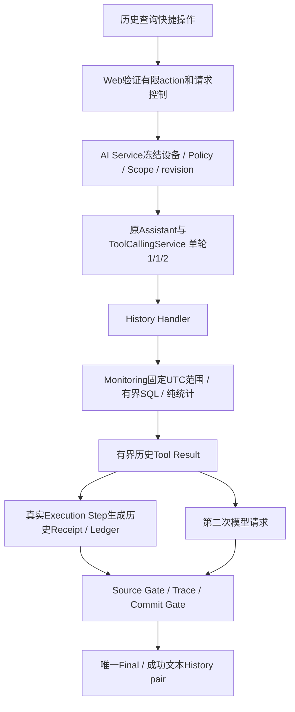

# R2D-1：历史 Tool 工程复盘、架构审计与测试流程简化

审计日期：2026-10-18。代码基线：`1fe20ea`（水质历史 tool）。本轮开始时工作树干净。结论：**保留现有实现，先修明确的问题，不重写历史 Tool。** 发现一项可复现的并发错误分类问题和一项测试编排缺口；未发现历史越权、伪造当前来源或必须重做执行链的证据。本轮不修改产品代码、Scope、Policy或数据。

## 1. 证据与统计口径

- `git log d72420c..1fe20ea`只有一个提交。R2D-1A～1H在工作树连续实施后一起提交；不能从Git伪造每轮独立行数或总编辑次数。
- 以下使用`git diff --name-status --find-renames d72420c..1fe20ea`和`--numstat`，是**整个R2D-1最终端点差分**，不是历次临时编辑量的总和。重命名按一项计算，不把整份文档当删除后重建。
- 源码、隔离测试、本提交文档为本轮可复核证据。此前15样本/30请求的技术结果来自[阶段记录](../HISTORY_QUALIFICATION.md#9-r2d-1g真实批次通过与本地实验开放)，本轮没有读取`outputs`、真实数据库、凭据或用户Policy。
- 用户本轮确认真实管理网页已成功调用历史Tool、返回实际统计、通过Source Gate并提交Final，且可通过设置和开关禁用。这是**用户人工可用性观察**，不是新增Provider资格、长期稳定性或回答质量认证。
- 本轮R2D-1I另有8份已跟踪文件修改、4份新增：文档/链接、人工薄入口及其mock测试。它们不计入上述R2D-1提交成本；运行时产品源码、Scope、Policy、Prompt、原资格CLI均无本轮diff。

## 2. 完整工程成本

**55项：新增23、修改31、重命名1、独立删除0；+5353/-160，净增5193行。** 旧`apps/docs/AI_BACKEND_DEVELOPMENT_GUIDE.md`移至`deep-dive/`，不是删除功能。物理行包含空行、注释和JSON，不等于可执行语句。

按文件主要职责互斥归类；一个文件不重复归类：

| 主职责 | 文件 | 新增行 | 删除行 |
| --- | ---: | ---: | ---: |
| Monitoring领域查询与统计 | 3 | 323 | 1 |
| 业务Tool Definition / Handler / Registry | 2 | 158 | 4 |
| Backend预算接缝 / 业务协调合同 | 3 | 100 | 22 |
| 权限 / 来源 / 发布 / 安全展示 | 8 | 529 | 6 |
| Web / 前端 | 8 | 174 | 42 |
| 资格CLI / 观察与批次编排 | 5 | 671 | 6 |
| 测试 / fixture / 测试入口 | 16 | 2402 | 14 |
| 文档 | 10 | 996 | 65 |
| **合计** | **55** | **5353** | **160** |

- 产品侧前五类共24文件、+1284/-75，含两份候选JSON的128新增行；不是5353行运行时逻辑。测试占新增行44.9%，文档18.6%，合计63.5%；资格开发代码另占12.5%。
- `water_quality_history.py`共138行，但Handler只有一次领域服务委托；大部分是Definition、严格参数校验和供Receipt/Activity复用的有限DTO认证。
- 领域服务323新增行补了原来不存在的按真实时间范围查询、完整窗口、歧义/质量/覆盖统计，不能归为“包装现成API”的成本。
- 管理Policy、设置入口、资格计划/报告、1024预算接缝是首次设施；后续Tool不能再次按同样规模建设一遍。
- 开发指南移动、差分测试修正、聊天确认修复、三工具candidate都随同提交，但并非历史Handler的内在需求。附录逐文件列出，避免把全部变化归责于新增一个Tool。
- [1F成本报告](R2D1F_TOOL_INTEGRATION_COST_AUDIT.md)的39文件/+3575/-98是1B～1E当时快照，且排除先行1A研究；55文件是最终含1A～1H及文档移动的口径，二者不能直接当作单轮增量相减。

## 3. 当前执行链与质量检查



| 检查点 | 当前事实与源码入口 | 判断 |
| --- | --- | --- |
| Definition / 参数 / Handler | [water_quality_history.py](../../../ai_service/business_tools/water_quality_history.py)：`HISTORY_DEFINITION`、`validate_arguments()`、`history_payload()`；10/30/60、受限metrics、模型不能指定设备 | Definition唯一；Handler不重算统计，无第二套Executor |
| 时间查询 | [service.py](../../../monitoring/service.py) `query_water_history()`固定一次时钟；[repository.py](../../../monitoring/repository.py)参数化SQL、720+1哨兵、只读事务及单行大小上限 | 不用N条冒充时间范围；不写Current/Event/History |
| 统计 | [history.py](../../../monitoring/history.py)完整窗口、有效均值、极值、区间并集、缺口、Session/重叠歧义、最多12明细/缺口、24KiB | 缺失不填零；partial/歧义不进入可靠统计；不判持续异常或恢复 |
| formal / per-Turn | [registry.py](../../../ai_service/business_tools/registry.py) `bind_tools()`；默认formal仍W+K，历史装配独立，per-Turn重绑冻结设备，Knowledge共享entry | 定义一致；评分只为合法存储名称，没有Handler |
| 用户授权 | [management_policy.py](../../../ai_service/management_policy.py)缺省只读继承、独立覆盖文件、generation/revision、原子替换、CAS与OS锁 | 不自动迁移旧Policy；发现下节并发初始化错误，未见越权 |
| 来源 | [sources.py](../../../ai_service/runtime/sources.py) `_receipt_from_step()`关联真实Step，历史还要求handler_started、请求已开始及合法DTO | NO_DATA/合法PARTIAL可完成查询，可靠观测另行认证；不能满足CURRENT_OBSERVATION |
| 发布隔离 | [history_execution.py](../../../ai_service/history_execution.py)精确Qwen OFF/Normal/1024/1/1/2/120秒；[normal_selection.py](../../../ai_service/normal_selection.py)三工具恒为candidate/禁止产品准入 | 未继承W+K或Streaming资格；浏览器不能指定内部Scope/预算 |
| 页面/确认 | [ai_adapter.py](../../../management_web/ai_adapter.py)有限业务action映射；[assistant.js](../../../management_web/static/assistant.js)快捷操作、confirmation binding、取消与唯一提交 | 历史成功后恢复普通提问；失败不自动换模式；外部改授权仍需刷新，后端先拒绝过期确认 |
| Preview/Final/Stop | 复用既有Normal/SSE、RequestHandle和提交门禁；本历史Scope只走Normal，不开放History Streaming | 失败不进入成功History；Source证明不由正文/历史生成 |
| 资格入口 | [history_qualification.py](../../../ai_service/development/history_qualification.py) `plan()` / `run()`；原单案例CLI；临时SQLite/Policy、原Service、开发观察Adapter | 不复制执行循环，但资格本身`http_exercised=false`；由独立Fake HTTP及用户真实网页观察补证据 |

Repository默认每设备/通道保留360窗口；默认10秒约覆盖一小时，但变更上报频率、迟到或Session后不能保证完整一小时。720是查询上限，不是实际留存承诺。`retention_completeness=UNKNOWN`合理，不应从缺口推断设备离线。

冻结的是设备、Policy与Runtime，不是整Turn数据库内容。以后Current→History仍须保留各自实际查询/观测时间，不能把两个顺序查询声称为同一原子快照。

## 4. 风险分级

Critical指权限/来源/数据安全破坏；Major指应优先修复的可靠性或回归保障缺口；Minor指局部维护和体验债务。复杂度或测试数量本身不构成问题。

### Critical

**本轮未发现可确认的Critical。** 未发现未授权历史Handler执行、历史冒充当前Receipt、自动模型重跑、旧Runtime fallback或将预览提前成功提交的证据。这不是对所有故障情形的形式化证明。

### Major

1. **Windows首次并发保存可能返回错误的存储故障分类（已复现，未修）。**
   - 95项专项中`test_concurrent_stores_cannot_overwrite_same_revision`失败一次：期望另一个写者得到BUSY或REVISION_MISMATCH，实际出现STORAGE_ERROR。
   - 再用20个隔离临时目录/双写者调度定位：17组为`saved + TOOL_POLICY_BUSY`，3组为`saved + TOOL_POLICY_STORAGE_ERROR`。后者异常发生于`management_policy.py`第51行：空锁文件的`stream.write(b'0')`位于`msvcrt.locking()`取得锁之前。一个写者已锁住该字节时，另一个初始化写触发PermissionError/errno13，被外层映射为存储错误。
   - 20组均恰好一个保存成功，最终generation=1、选择正确；**未观察到丢失更新或授权扩大**。这是有限调度证据，不能推断所有并发都安全。
   - 建议下一小修：令首次锁文件初始化与锁竞争有明确顺序，并仅将确认为竞争的错误归为BUSY。补可控交错的空锁文件测试；不得把所有PermissionError当BUSY、放宽CAS或自动重试。禁止通过放宽测试允许任意STORAGE_ERROR掩盖原因。本轮按限制不修改Policy。

2. **FULL PRODUCT并非整个新管理平台回归（编排缺口，不等于没有测试）。**
   - [run_tests.py](../../../../scripts/dev/run_tests.py)的product包含旧六类与backend，但不收集`apps.monitoring.tests`、`apps.management_web.tests`或Node；实测发现结果均为false。BUILD_RUN原“验证”章节虽有分列命令，名称仍易让后续开发者误以为单一product已覆盖管理链。
   - backend静态发现176个唯一test ID，未重现原先重复收集问题。缺口在入口范围，不在“测试太多”。
   - 本轮已把层级边界和一行命令放到BUILD_RUN主入口；以后可小幅增加`management`离线分组，收集Monitoring/管理HTTP且去重。当前不为审计重写runner。

### Minor

| 问题 | 影响 / 建议 | 本轮处理 |
| --- | --- | --- |
| 显示名单仍重复维护 | 产品代码中字面量历史Tool名在owner、assistant.js、tool-policy.js共3文件；设置前端还要求恰好4项。Catalog/参数说明与UI标签需多点维护。建议未来由已有Catalog给出有界name/label，前端只验证结构；权限/来源不能自动推断 | 仅建议，不改产品 |
| 开发指南迁移后的路径漂移 | 本提交移动指南后留下62处相对链接失效，文件树仍列旧位置 | 修复6份apps文档的链接及STRUCTURE，不改变历史研究结论 |
| 授权文档仍引导旧Tool Manager | 管理覆盖文件已存在时，改旧共享Policy不会改变管理授权，容易出现“已勾选却未生效” | BUILD_RUN改为管理设置授权，并解释只读继承/独立覆盖 |
| 文档/注释仍有过期状态 | owner的“Offline candidate”注释、CATALOG中的旧Snapshot/评分说明及“尚未真实网页验收”记录与当前层次不完全一致。前两项不进入本次System Prompt/实际授权，也不是历史Tool回退旧数据的证据 | 更新当前文档与用户验收；源码注释/旧Catalog待后续小修，不改Prompt/描述 |
| 测试fixture依赖具体TestCase方法 | history_candidate复用water_history_tool的构造方法，normal_selection再复用前者setUp；资格模块从Streaming借`_workspace`，改变一个测试可能牵动其他层 | 下次实际修改时抽无test方法的共享helper，不以迁移目录触发全量重写 |
| 多份预算/版本快照 | Monitoring常量、history_scope、固定JSON、资格plan、测试expected都出现相同边界；其中发布/测试快照是有意防漂移 | 业务常量继续单一owner；别删精确快照来减少行数。三工具1024是另一个未发布Scope，不影响已开放两工具 |
| 外部窗口授权变化前端不即时可见 | 页面自身保存授权会刷新；另一窗口改Policy时旧显示可能持续到刷新/发送。服务器revision复核会联网前拒绝，因此是可见性延迟而非可绕过权限 | 保留“刷新可用状态”；以后按需加低频revision检查，不再造授权系统 |

静态扫描61个产品Python模块、213条内部import边：Backend未导入fishery_ai/Monitoring/AI service/Web，产品未导入development。保守图显示3条回边：model_gateway/manual属于TYPE_CHECKING，另外两组为Activity/Trace与ToolConversation之间的函数内延迟导入；当前可正常导入与执行，不能把这些直接认定为运行时循环导入错误。这是已有Backend技术债，不由历史Tool新增；本轮不重构。

## 5. 必需成本、首次设施与可避免成本

**保留：**真实时间SQL/统计、严格validator、冻结设备、明确历史来源、Policy/Registry/发布分离、Stop/Deadline/Trace/Commit、HTTP路径及原两工具差分。`result_metadata()`由Receipt/Activity共享，虽重复验证≤24KiB DTO，但不是第二套统计；无性能证据支持先加缓存。

**首次设施复用：**管理Policy文件/保存API/设置UI、资格单案例/安全报告、1024产品预算接缝、history审计夹具与原六路径基线。新Tool不得新建Policy Store、Credential来源或Executor。

**本可减少：**每个阶段重复跑相同测试层、逐轮重复操作文档、通用计划收尾代码复制、UI名单双写、对只有薄Handler的工作重复设计大资格框架。批次203行和144行测试是可选人工设施，不在产品启动路径；有固定15样本消费者，不能仅凭长度说是死代码。

三工具candidate有7个明确离线测试，但没有产品启用入口或真实资格，不能当作已开放能力。可继续保留到用户决定是否验证；不为“代码干净”删除已获批的候选研究，也不自动授予资格。未发现长期Alias/双Runtime或无实际消费者的第二套Tool执行实现。

## 6. A保留优化 vs B重新实现

| 维度 | A：保留并小修 | B：按现架构重写历史Tool |
| --- | --- | --- |
| 工作量 | 锁初始化专项、文档/测试入口、未来显示名单小修 | 重做查询边界、来源、装配、发布和对照，薄Handler本身只省很少 |
| 维护成本 | 可复用已有Policy/资格/统计；显式维护点仍需逐步减少 | 只有真正删除重复流程才降成本；换文件名不会消除跨层合同 |
| 回归风险 | 范围小，已有基线可复核 | 需重新证明时间/质量/Source/Commit及原W+K不变，风险更大 |
| 可读性 | 保持单Tool单模块，改进入口说明及helper即可 | 可能更短，也可能把校验挤进Service，形成更隐蔽耦合 |
| 可测试性 | 40项领域、21项业务、15项HTTP等已有合同可继续用 | 不能为减测试数量删除独有边界；旧证据不能替新实现背书 |
| 原两工具 | 当前已有六路径/Scope基线隔离 | 重新装配可能改变定义/预算/指纹，增加复验成本 |
| 新Tool扩展 | 直接复用授权、Source框架与人工入口 | 不值得为第三个工具重建平台 |

**推荐A。** 没有证据支持重写Monitoring统计或历史Handler。并发锁错误需要局部修复，不需要重做整个Tool。没有可靠工时日志，不给虚构的人日或提速百分比；上述文件/行数与本轮测试耗时才是可测量依据。

## 7. 下一个简单只读Tool的标准流程

先区分两类：

- **已有领域API的薄Tool：**不增加SQL、统计或设备状态。先定义有限输入/输出、复用领域入口，然后补装配、认证、授权/发布、专项/一条HTTP链路。
- **新领域分析能力：**先在Monitoring/对应领域服务建立纯计算与只读查询、数据质量和边界测试；再包薄Tool。持续低氧、恢复、视觉推断属于这一类，不能算作简单工具接入。

当前最小离线证明可集中为4个文件：新`business_tools/<tool>.py`、`registry.py`、`runtime/sources.py`（确需独立来源时）、一个专项测试。**这不等于4文件就能安全开放网页。** 当前完整管理接入还需：

| 修改位置 | 何时需要 |
| --- | --- |
| `management_policy.py` | 扩现有管理已知名字，默认不授权；不增加Store/格式/路由 |
| `runtime/catalog.py` | 安全名称/说明；不作为权限来源 |
| `runtime/activity.py` | 只有通用状态不足、确需有界业务摘要时修改 |
| `service.py` | 显式装配和冻结业务上下文，保持旧组合隔离；不复制循环 |
| 既有发布模块/资源JSON | 新精确工具组合、绑定、预算；从candidate开始，复用已有matcher/合同 |
| `static/tool-policy.js` | 现状需扩有限名单/数量校验；建议下一项小优化去掉前端逐Tool硬编码 |
| `static/assistant.js` | 仅新业务动作/专门摘要确有需要时；已有通用Tool卡片优先 |
| 专项/HTTP/必要前端测试与指南 | 复用临时fixtures与Fake SDK，不复制三套同样的参数边界 |

因此当前通常是约8～12个实现触点，加少量专项/集成测试和文档；具体取决于新来源、摘要和预算，不应承诺所有新Tool只改一个文件。原则是**一模块定义、一处显式装配、复用一套授权/来源/执行、精确组合独立批准**。

建议验收指标：下一薄Tool新增Policy Store、Executor、Provider循环、Credential格式均为0；UI名单集中后无需改前端名字表；每个独有不变量只在所属层穷尽测试；一组HTTP测试覆盖真实装配而非再次罗列全部统计样例。

## 8. Tool成熟度与模型发布应分开

| 状态 | 含义 |
| --- | --- |
| 已实现 | Definition、Handler、领域API及参数/来源合同存在 |
| 可用 | 某个实际设备/数据源和冻结授权下能完成操作；NO_DATA也是合法业务结果 |
| 可长期维护的业务模块 | 可读、边界清楚、有测试和维护者；不要求默认启用或所有模型都能选择 |
| 默认启用 | 启动/授权策略的默认值；不是技术成熟度或真实资格 |
| local_experimental | 特定模型+Prompt+History+工具+数据绑定+Transport+预算的本地试用许可 |
| released | 维护者正式发布决定与对应证据；不能由一次技术PASS或勾选Policy自动产生 |

历史Tool可以按“已实现、可长期维护的业务模块”管理；当前模型组合继续local_experimental、默认关闭。暂在文档表达，不为没有消费者的“成熟度”增加一套配置状态机。基础水质规则仍PROTOTYPE；这不是生产养殖判断资格。

禁用有两条现成路径：管理设置撤销历史授权，或关闭`--assistant-history-trial`后重启/刷新。已领取Turn冻结原授权，需终止时用Stop；撤销影响新的预检/领取，不保证撤销已经发生的云端计算或费用。独立资格CLI在用户重新明确批准时仍可运行隔离案例，这是人工测试入口，不是Web开关绕过。

本地开发可集中批准稳定精确范围与有限样本数量，日常只做离线分层回归；真实执行由用户亲自进行。回答质量独立抽样，不把它变成每次薄Tool开发的新研究阶段。Source Gate认证“做了哪种来源操作”，不认证模型是否查询了自然语言所需的全部时间/指标或最终解释正确；这些不能假借技术PASS省略。

## 9. 人工真实测试与一行启动

统一入口为[scripts/manual_real_tests](../../../../scripts/manual_real_tests/README.md)。新增薄`run_qualification.py`仅委托原管理history/streaming CLI一次，默认Dry-run；真实执行需用户亲自提供确认和本次hash。原Prototype各Provider、批次、单manifest、Preset/Local入口统一索引，保留原参数/实现；没有Dry-run的旧入口明确标注。NPU目前没有资格程序，不创建空框架。

```powershell
.\.venv\Scripts\python.exe scripts/manual_real_tests/run_qualification.py --target management-history --case valid-history --dry-run
```

报告仍在Git ignored的outputs中，终端预览可选且不自动记录；不接受Key参数，不永久写批准hash，不自动重试或批量。新入口测试只mock子进程；真实请求不进入FAST/PRODUCT/discovery/应用启动。

管理服务器、模拟器、停止/回滚和分层测试的一行式命令统一见[BUILD_RUN](../../BUILD_RUN.md#一行式常用命令)，不在此复制另一套启动清单。使用端口占用检查、同一PowerShell环境传递临时开发令牌、Hidden子进程；已有8766服务时拒绝重复启动，不停止未知进程，不打印令牌。没有新增启动框架；不自动调用Provider。

## 10. 本轮验证、处理顺序与边界

- 专项95项：94通过、1失败（上述Policy首次并发问题）；保留失败结论，不用重复全量测试刷成绿。20组临时并发调度为诊断证据，不作稳定性比例。
- 新人工入口5项mock测试通过；实际委托history valid-history和streaming current-water Dry-run，均`actual_network_requests=0`。
- 管理前端Node 60项通过。静态发现backend 176项、无重复ID。未重跑无关FULL PRODUCT或历史真实实验，没有真实时间等待、Provider/NPU或用户数据访问。
- 启动参数/管理Web边界7项通过（0.139秒）；新入口5项独立mock测试通过（0.010秒，包含在上述95项中，不能重复相加）。
- Markdown检查18份文档、298个本地引用（其中45个锚点），无损坏；新Python语法、27段PowerShell示例、12个变更文件的常见敏感模式及git diff检查通过。受保护产品源码/原资格CLI差分为0。没有通过修改测试预期掩盖并发失败。

**立即做：**单独批准并修复Policy空锁文件初始化竞争及确定性交错测试；使用现有分层命令覆盖管理链，不声称product已全覆盖。文档死链/旧授权说明与人工入口已在本轮处理。

**随后做：**Catalog驱动安全展示，去掉前端固定4项；抽无TestCase依赖的fixture；第三个资格用例类型真正出现时再提炼plan/report公共步骤。可增加简单management测试分组，无需新框架。

**以后再做：**工具组合明显增多时评估静态配置表代替Service分支；真实设备/RAG/长期留存另立领域任务。三工具candidate是否真实验证由用户决定。

**无需做：**重写历史Tool、合并权限/Registry/来源门禁、删重要边界测试、复制第二套Runtime、为减文件数放宽Schema或Scope。旧Prototype/生产工程、本轮Prompt/数据/发布权限均不变。

## 附录：最终提交逐文件差分

以下自动取自`d72420c..1fe20ea`，不含本轮R2D-1I新增文档/入口。A新增、M修改、R重命名；行数均为端点物理文本差分。

```text
M +   8 / -  4  apps/ai_backend/openai_compatible_adapter.py
M +  22 / -  0  apps/ai_backend/tests/test_protocol_specs.py
M +  20 / -  4  apps/ai_service/business_tools/registry.py
A + 138 / -  0  apps/ai_service/business_tools/water_quality_history.py
M +   4 / -  0  apps/ai_service/contracts.py
A + 398 / -  0  apps/ai_service/development/history_qualification.py
M +   6 / -  4  apps/ai_service/development/qualification_adapter.py
M +   2 / -  2  apps/ai_service/development/qualification_support.py
A +  94 / -  0  apps/ai_service/history_execution.py
A + 167 / -  0  apps/ai_service/management_policy.py
A +  59 / -  0  apps/ai_service/normal_selection.py
A +  68 / -  0  apps/ai_service/resources/assistant_normal_candidate.json
A +  60 / -  0  apps/ai_service/resources/water_history_candidate.json
M +   3 / -  1  apps/ai_service/runtime/README.md
M +  17 / -  2  apps/ai_service/runtime/activity.py
M +   6 / -  0  apps/ai_service/runtime/catalog.py
M +  58 / -  4  apps/ai_service/runtime/sources.py
M +   6 / -  1  apps/ai_service/runtime/tests/test_differential.py
M +  88 / - 18  apps/ai_service/service.py
A + 156 / -  0  apps/ai_service/tests/fixtures/r2d1c_two_tools.json
A + 144 / -  0  apps/ai_service/tests/test_history_batch.py
A + 396 / -  0  apps/ai_service/tests/test_history_candidate.py
A + 364 / -  0  apps/ai_service/tests/test_history_qualification.py
A +  97 / -  0  apps/ai_service/tests/test_management_policy.py
A + 148 / -  0  apps/ai_service/tests/test_normal_selection.py
A + 389 / -  0  apps/ai_service/tests/test_water_history_tool.py
M +  82 / -  0  apps/docs/BUILD_RUN.md
M + 104 / -  1  apps/docs/INTEGRATION.md
M +   3 / -  1  apps/docs/README.md
M +  34 / -  7  apps/docs/STRUCTURE.md
R +  43 / - 54  apps/docs/{ => deep-dive}/AI_BACKEND_DEVELOPMENT_GUIDE.md
A + 208 / -  0  apps/docs/deep-dive/HISTORY_QUALIFICATION.md
A + 312 / -  0  apps/docs/deep-dive/research/R2D1A_WATER_HISTORY_TOOL_DESIGN.md
A + 206 / -  0  apps/docs/deep-dive/research/R2D1F_TOOL_INTEGRATION_COST_AUDIT.md
M +   5 / -  1  apps/management_web/__main__.py
M +  21 / -  4  apps/management_web/ai_adapter.py
M +   9 / -  0  apps/management_web/app.py
M +   4 / -  2  apps/management_web/static/app.js
M +  82 / - 35  apps/management_web/static/assistant.js
M +   2 / -  0  apps/management_web/static/services.js
M +   5 / -  0  apps/management_web/static/styles.css
A +  46 / -  0  apps/management_web/static/tool-policy.js
M +   5 / -  5  apps/management_web/tests/assistant-stream-ui.test.mjs
M + 108 / -  2  apps/management_web/tests/assistant-ui.test.mjs
M +   4 / -  1  apps/management_web/tests/monitoring-ui.test.mjs
M +  10 / -  4  apps/management_web/tests/test_ai_boundary.py
A +  63 / -  0  apps/management_web/tests/tool-policy.test.mjs
A + 279 / -  0  apps/monitoring/history.py
M +  35 / -  1  apps/monitoring/repository.py
M +   9 / -  0  apps/monitoring/service.py
A + 486 / -  0  apps/monitoring/tests/test_water_history.py
M +   1 / -  1  docs/STRUCTURE.md
M +   4 / -  1  scripts/dev/run_tests.py
A +  62 / -  0  scripts/qualification/qualify_management_history.py
A + 203 / -  0  scripts/qualification/qualify_management_history_batch.py
```
