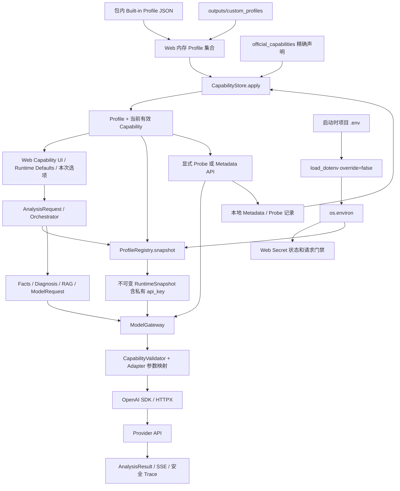
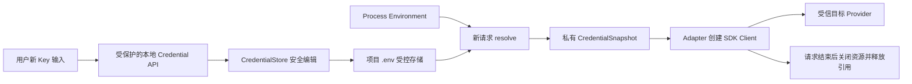

# Provider、Credential 与 Capability 重构研究

- 日期：2026-10-01（Asia/Shanghai）
- 阶段基线：当前 A3.2.1 源码
- 性质：代码审查、官方资料研究和迁移建议；**不是实施报告**。

## 阅读说明与核心结论

本轮只新增本报告并更新文档导航。未修改程序、测试、Profile、Capability 文件或 `.env`，未读取真实 Secret，未执行模型请求，未安装依赖，未 commit 或 push。正式项目 `D:\Fishery_Project` 未修改。

文中的结论分为：

- **CODE-CONFIRMED**：本轮从当前源码或已安装依赖源码确认。
- **OFFICIAL-DOCS-CONFIRMED**：本轮从官方资料确认，并附链接。
- **INFERENCE**：从实现推导的风险或限制，尚未通过真实请求验证。
- **RECOMMENDATION**：下一阶段建议，尚未实现。
- **DECISION NEEDED**：实施前需要审阅的取舍。

优先结论：

1. Provider 当前并不是由 `.env` 定义。Profile 和预设独立存在；Secret 缺失影响请求可执行性，不删除 Provider 或 Capability。
2. 真正的热更新问题是：启动时把 `.env` 导入 `os.environ`，随后每次请求读取这个进程环境；修改磁盘文件不会自动更新进程中的旧值。
3. 建议先建立一个小型 `CredentialStore`：直接解析进程环境和项目 `.env`，不把文件内容反复导入全局环境。新请求获取新的凭据快照，进行中的请求保持不变。
4. Thinking 协议映射与精确模型白名单目前混在 Adapter 中。必须区分“知道怎样发送参数”和“有证据证明模型支持参数”。
5. Evidence 目前保留来源名称，但不完整保留每个来源的状态、时间和历次结果。需要可见的冲突上下文。
6. 取消必须覆盖后端 I/O。只加入浏览器 `AbortController` 或线程 `Event`，不能保证中断正在阻塞的同步 SDK 调用，更不能保证 Provider 停止计算。
7. 采用渐进迁移。RAG、Grounding、Domain Rule、结构化结果解析和最终输出展示继续保持稳定。

## 当前代码依据索引

以下路径均相对于项目根目录，行号是本轮审查时的位置。后续以实际源码为准。

| 文件 / 位置 | 本轮核对内容 |
| --- | --- |
| `src/fishery_ai/model_gateway.py:28` | ModelProfile、旧字段兼容、连接与能力绑定 |
| `src/fishery_ai/model_gateway.py:178` | Runtime Defaults 的安全回退 |
| `src/fishery_ai/model_gateway.py:205` | RuntimeSnapshot、私有 API Key、public_info |
| `src/fishery_ai/model_gateway.py:246` | 每次创建 snapshot 时读取环境变量 |
| `src/fishery_ai/model_options.py:11` | Base URL normalization |
| `src/fishery_ai/model_options.py:67` | Capability 状态、来源、来源列表与 Identity |
| `src/fishery_ai/model_options.py:164` | 运行选项校验与组合门禁 |
| `src/fishery_ai/official_capabilities.py:15` | 精确 service、URL、model 的官方声明表 |
| `src/fishery_ai/capability_store.py:87` | 官方、Metadata、实机证据的加载顺序 |
| `src/fishery_ai/capability_store.py:152` | 单项 Probe 记录、指标白名单与临时文件替换 |
| `src/fishery_ai/capability_probe.py:15` | 一次最小 Probe、临时 gate bypass、结果分类 |
| `src/fishery_ai/openai_compatible_adapter.py:47` | SDK 初始化、Secret 检查、HTTPX timeout、SDK retry=0 |
| `src/fishery_ai/openai_compatible_adapter.py:79` | Thinking mapping 精确模型白名单 |
| `src/fishery_ai/openai_compatible_adapter.py:90` | Ollama `/api/show` 查询及字段解析 |
| `src/fishery_ai/openai_compatible_adapter.py:124` | 语义选项到 Provider 参数的翻译 |
| `src/fishery_ai/openai_compatible_adapter.py:280` | 同步 Normal 调用及资源关闭 |
| `src/fishery_ai/openai_compatible_adapter.py:320` | Streaming、输出后的重试禁令及资源关闭 |
| `src/fishery_ai/custom_profiles.py:62` | Custom 字段校验、Cloud/Local 与 Secret 的现有关系 |
| `src/fishery_ai/web.py:125` | Web 组合、Profile 内存集合、16 KiB 请求体限制 |
| `src/fishery_ai/web.py:298` | Secret 状态查询，没有 Secret 值查询或编辑接口 |
| `src/fishery_ai/web.py:402` | Probe API 门禁、精确 Identity 检查与保存 |
| `src/fishery_ai/web.py:458` | Metadata API 与 Profile 刷新 |
| `src/fishery_ai/web.py:553` | Flask SSE 外层生成器 |
| `src/fishery_ai/web.py:596` | 启动时 load_dotenv；仅监听 127.0.0.1 |
| `src/fishery_ai/application.py:125`、`:162` | Normal/Streaming 共用的固定分析流程 |
| `src/fishery_ai/application.py:254` | 公共合同序列化，调用方不得传 RuntimeSnapshot |
| `src/fishery_ai/observability.py:19` | JSONL Trace 字段白名单 |
| `src/fishery_ai/resources/web/app.js:502`、`:833` | Probe、fetch 与 SSE reader；没有取消链路 |

依赖行为还核对了本地已安装的 `openai 2.54.0`、`httpx 0.28.1`、`python-dotenv 1.2.3`、`Flask 3.1.3`。这些是审查环境中的版本，不等同于已经锁定的可复现依赖清单。

## 1. 当前真实架构图

**CODE-CONFIRMED**：当前流程如下。`.env` 是启动输入，不是 Provider Registry。



### 已经正确分离的部分

- Orchestrator 不负责 Provider 参数翻译；SDK 只在 Adapter 层。
- Facts、Rule Results、Evidence 与 LLM 生成内容保持合同边界。
- Profile 的运行偏好与 Capability 证据分离；不能使用的偏好临时回退。
- USER_VERIFIED 绑定 `service_id + adapter_id + normalized base_url + exact model`，不按显示名称继承。
- Probe 是显式最小请求，不执行 Fishery 分析；SDK 重试关闭，Probe Gateway retry=0。
- 普通请求不能用 UNKNOWN 高级能力；基础 Normal + AUTO/UNSET 可运行。

### 容易误解的现状

| 审查问题 | 当前代码结论 |
| --- | --- |
| `.env` 是否定义 Provider？ | 否。Provider 预设来自包内 Profile，Custom 来自单独文件 |
| Provider 是否主要由字符串表示？ | 是。service_id/provider_id、Adapter 条件和 Web 预设组合表达，没有正式 ProviderRegistry |
| Secret Env 是什么？ | Profile 中经过名称校验的字符串引用，不是 Secret 本身 |
| Credential 只读取一次吗？ | 文件在启动时导入一次；实际 Key 在每次 snapshot 时从 os.environ 获取 |
| API Key 是否进入 RuntimeSnapshot？ | 是。api_key 隐藏 repr，但仍是内存中的原始字符串 |
| Adapter 是否直接读 os.environ？ | 否。Adapter 消费 RuntimeSnapshot；Web 和 ProfileRegistry 分别访问环境 |
| Web 是否知道 Secret 名称？ | 是。用于字段展示与 PRESENT/MISSING 查询；不返回值 |
| Capability 是否依赖 Secret 存在？ | 加载不依赖；真实 Probe 和业务请求的执行依赖必要凭据 |
| 修改 `.env` 是否热更新？ | 没有文件热加载机制 |

## 2. 当前主要技术债

| 优先级 | CODE-CONFIRMED 的现状 | INFERENCE：为什么需要处理 |
| --- | --- | --- |
| 高 | 启动导入 `.env`；Web 多处预检查 os.environ，snapshot 再取值 | 文件热更新无效；未来轮换 Key 会有重复读取与检查后变化的问题 |
| 高 | 没有 Credential 编辑 API；只有状态查询 | 用户必须手工编辑文件；后续直接加表单容易遗漏写入和 Web 安全边界 |
| 高 | RuntimeSnapshot.api_key 只有 repr=False；公共序列化内部使用 asdict | 隐藏 repr 不会阻止误用 asdict 导出 Secret；当前正常返回路径安全，潜在误用需防护 |
| 高 | Thinking mapping 被精确模型白名单限制 | 已知协议、未登记模型不能进入专用 Thinking Probe |
| 高 | evidence_sources 保存来源名称，不保存每条来源的完整状态 | 官方支持与本机拒绝的矛盾不能完整还原 |
| 高 | 没有 Stop API、CancelToken、浏览器 AbortController | 长时间同步或流式读取只能等返回、错误或 timeout |
| 中 | Secret 必需性部分依赖 cloud/local 分类 | 无鉴权 Ollama 与需要 token 的 LAN/vLLM 无法由 locality 准确区分 |
| 中 | CapabilityStore 每项覆盖最新记录；固定 `.tmp` 文件名 | 丢失验证历史；并发操作可能竞争同一个临时文件 |
| 中 | Metadata 只针对 Ollama qwen3.5:4b，且直接调用 HTTPX | 功能范围窄；未来认证和取消容易形成第二套传输控制 |
| 中 | models/test 缓存只绑定连接字段和 Secret 名称 | 同名 Key 更新后，旧连接测试记录可能仍被认为有效 |
| 中 | 当前 total deadline 主要在调用前和 chunk 之间检查 | 同步阻塞期间没有主动定时中断，不是严格的全程硬期限 |
| 中 | 原始 SDK 异常作为安全 GatewayError 的 cause | 页面目前不返回原异常；未来完整 traceback/logger 可能暴露 request 信息 |
| 中 | 本地 Web 没有用于 Credential 写入的 Host/Origin/CSRF 防护 | 仅绑定 loopback 不足以作为未来 Secret 编辑接口的完整访问保护 |

本轮不把潜在风险描述为已发生的 Secret 泄漏，也不假定当前页面已经发出了真实请求。

## 3. Provider Registry 设计

**RECOMMENDATION**：增加一个小型静态注册表，表示“系统知道哪些服务和协议”。可在同一个模块中用简单不可变数据结构和字典实现，不引入插件、动态加载或 DI 框架。

以当前 `service_id` 为规范名称，避免再次新增意义重复的 `provider_id`：

| service_id | 含义 | 初始认证建议 | 默认协议 |
| --- | --- | --- | --- |
| dashscope | Alibaba Model Studio API 服务 | REQUIRED_BEARER | OpenAI-compatible Chat + DashScope 受控扩展 |
| deepseek_api | DeepSeek 官方 API 服务 | REQUIRED_BEARER | OpenAI-compatible Chat + DeepSeek 受控扩展 |
| ollama | Ollama Runtime | Built-in loopback 连接为 NONE | OpenAI-compatible Chat + Ollama 扩展 |
| generic_openai | 未知但声明兼容 Chat Completions 的服务 | 连接中显式选择 | 仅基础 Chat / Streaming 编码知识 |

当前 `service_id=custom` 兼容映射到 generic 处理；第一阶段不重写已有 JSON。`provider_id=qwen/deepseek` 继续接受旧文件，内部逐步只使用 service_id。`model_family` 是说明信息，不能用来决定认证或能力。

ProviderSpec 最小内容：

- service_id、display_name、adapter_id、protocol_spec_id。
- default_base_url（提示；区域或租户服务可以没有一个通用默认地址）。
- default_auth、expected_credential_name。
- metadata_method（NONE / OLLAMA_SHOW / 将来明确定义的方法）。
- default_deployment（仅表单初始建议，不决定鉴权）。

Built-in 是 Profile 的管理属性，不是 Provider 的全部连接永久只读；同一已知 Provider 可以有多个 User Profile。暂不增加 online discovery、注册插件或独立 registry 服务。

## 4. ProviderProtocolSpec 设计

**RECOMMENDATION**：ProtocolSpec 描述参数编码和响应解码，**不赋予模型 SUPPORTED 状态**。先抽取当前 Adapter 中已有映射，不改变现有请求载荷。

| 协议知识 | 应由 ProtocolSpec / Adapter 表达 | 仍由模型证据表达 |
| --- | --- | --- |
| Streaming | stream=true、SSE/SDK 解码方式 | 精确连接和模型是否支持 |
| Thinking ON/OFF/AUTO | 参数路径、开关值、AUTO 不注入 | 哪种模式可用、默认模式 |
| Effort | 字段位置和已明确的语义映射 | 精确值集合、与 OFF 的冲突 |
| Usage | 可用字段解析；怎样请求 include_usage | 当前模型/API 是否支持该请求或返回字段 |
| 输出长度 | max_tokens / max_completion_tokens 的协议变体 | 模型允许的上限或例外 |
| Metadata | endpoint、method、认证、解析器 | 返回的实际模型属性 |
| Tools / Structured Output | 未来协议格式的位置 | 支持状态及限制；本轮不实施 |

不能把一个 service_id 当作一种永远相同的 Thinking 开关。当前 DashScope 普通混合思考模型与 Omni 就使用不同变体：

- `dashscope_enable_thinking`：ON/OFF → enable_thinking=true/false。
- `dashscope_omni_effort_switch`：保留当前精确模型的 effort 开关变体。
- `deepseek_thinking_type`：ON/OFF → thinking.type=enabled/disabled。
- `ollama_reasoning_effort`：布尔模式按受控兼容映射发送；命名 effort 模式需要其 Metadata 或明确记录。
- `generic_openai_chat`：知道基础消息与 Streaming 传输；默认不知道 Thinking 编码。

**OFFICIAL-DOCS-CONFIRMED**：Alibaba 文档明确说明思考开关因模型而异，普通 enable_thinking 与 Omni effort 控制不能合并成一个通用规则。[深度思考](https://help.aliyun.com/zh/model-studio/deep-thinking)

DeepSeek 的 Chat Completions 指南给出了 thinking.type 与 reasoning_effort 的发送方式；这不同于 DashScope 托管模型的接口身份。[Thinking Mode](https://api-docs.deepseek.com/guides/thinking_mode/)

Ollama 兼容接口说明 thinking 的命名值与默认值来自模型，部分不支持的命名值会落到默认值，因此“HTTP 成功”不等于参数确实按预期生效。[OpenAI compatibility](https://docs.ollama.com/api/openai-compatibility)

未知模型可以选择已知 Provider 的默认协议变体做**显式探索性 Probe**；如果该 Provider 存在多个可能变体，页面必须说明正在尝试哪一种，不能自动轮询多种编码。模型例外仍由小型精确表选择，业务层不出现厂商参数。

## 5. CredentialStore 设计

**RECOMMENDATION**：一个 CredentialStore 同时负责受控读取、状态查询和将来的项目文件编辑。实现阶段可以将编辑助手保留为内部函数，不需要再建立多个 Secret 管理框架。

最小操作语义：

| 操作 | 输入 | 输出边界 |
| --- | --- | --- |
| resolve | 明确的 credential_ref / env 名称与连接 AuthSpec | 仅服务端使用的不可变 CredentialSnapshot |
| status | 已登记的 credential_ref | PRESENT/MISSING/NONE_REQUIRED、source、是否可编辑；无 Secret |
| set_project | credential_ref、新值、预期文件 revision | 更新结果和新的状态；不返回值 |
| remove_project | credential_ref、预期 revision | 只移除项目文件中的对应条目 |

CredentialSnapshot 的建议语义：

- 私有 Secret，仅 Adapter 建立请求时可访问。
- source：PROCESS_ENV / PROJECT_ENV；未来可增加 SESSION。
- opaque revision：内部变更编号，不向浏览器发送 Secret 的 hash 或片段。
- 禁止通用 JSON/asdict 序列化；repr/str 只显示固定脱敏文本。

RuntimeSnapshot 继续保持不可变，公共 RuntimeInfo 仍只含运行元数据。迁移时可让 RuntimeSnapshot 持有私有凭据对象，或让同一请求执行上下文持有它；**不得把 Key 放入公共 DTO**。旧 api_key 访问只作为内部兼容桥接，逐步收窄到 Adapter。

Web 的“是否缺 Key”和 Adapter 的“使用 Key”应消费同一份已解析快照，避免先读一次环境、执行时再读一次的差异。离线 composition 注入无凭据实现/显式环境映射，不能因为新增 Store 而读取真实 `.env`。

不新增 Secret 数据库、加密服务或云 Vault。.env 的明文存储风险仍存在，需要依靠本机权限与 Git 忽略保护。

## 6. `.env` 安全写入设计

### 6.1 python-dotenv 能做什么、不能保证什么

**CODE-CONFIRMED**：本地 python-dotenv 1.2.3 的 set_key/unset_key 使用解析器，非目标条目通过原始文本写回；rewrite 使用同目录临时文件及 os.replace，也尝试保留文件 mode。

不能直接把它等同于完整的 Web Credential 存储事务：

- 没有本项目需要的写入锁、并发 revision 检查或 fsync。
- Windows 的 mode 不等于 NTFS DACL 保留。
- 目标行的内联注释、重复键及换行策略需要额外定义。
- set_key 返回值包含新 Secret，封装层必须丢弃，不能记录返回 tuple。
- 当前实现内部临时文件前缀为 `.tmp_`；它不会自动被项目现有 `.env.*` 规则覆盖。
- pyproject 允许多个 python-dotenv 版本，不能假设所有版本内部行为完全相同。

**RECOMMENDATION**：保留 python-dotenv 的解析/引用能力，外面增加小型安全编辑层；不要重新用 dict dump 重写整个 `.env`，也不要直接对真实文件裸调用 set_key。

### 6.2 推荐提交步骤

1. 应用启动时固定项目 `.env` 的绝对路径；写入 API 不接受用户提供文件路径。确认路径留在 workspace，拒绝 symlink/reparse point 指向外部位置。
2. 写入前确认 `.env` 与暂存目录被 Git 忽略。确认文件编码、格式及权限可安全处理；失败返回安全错误，不打印原行。
3. 取得应用内 RLock。单进程是首轮支持范围；若允许第二个写入进程，必须增加合作式文件锁，而不是仅靠线程锁。
4. 读取当前原始字节，在内存中建立内部 revision；不把文件内容或凭据 hash 返回页面。
5. 在同一磁盘卷、受限制且被忽略的唯一暂存目录创建副本，例如 `.env.stage-<随机ID>/`。必须先建立安全目录/权限，再写入 Secret。dotenv 内部临时文件也留在此目录。
6. 对副本执行受控 set_key/unset_key；保留非目标行，检查差异只涉及目标 Credential。目标键重复、无法无损保留的格式等返回明确错误。
7. 保留原 CRLF/LF 与 UTF-8/BOM 策略。新文件使用 UTF-8；旧文件不是可识别 UTF-8 时拒绝自动转换。支持不含换行、NUL 的新 Key；复杂多行 Credential 暂不支持编辑。
8. flush + fsync 暂存结果，关闭文件句柄，重新解析并校验目标条目。再次核对原文件 revision，发现外部修改返回 ENV_CONFLICT，不能覆盖他人编辑。
9. 确认最终替换不会扩大 ACL 后，再执行同卷原子替换；写入成功后 resolve 新状态。失败保留原文件，返回 ENV_WRITE_FAILED / ENV_PERMISSION_ERROR 等安全错误。
10. 清理本次已确认路径的暂存文件；异常或崩溃残留也必须继续受 ACL/Git ignore 保护。不得自动生成包含 Key 的普通备份文件。

外部编辑器若不参与文件锁，revision 复查仍有很小的检查到替换竞态。文档要明确首轮为单应用写入，外部同时编辑不受完全事务保证；不宣称存在通用文件数据库事务。

### 6.3 Windows 权限和 crash safety

os.replace 是最终提交的候选，但不应据此声称 NTFS 权限已经正确继承。Python 的 flush/fsync 可以减少未落盘风险，也不能单独保证断电时全部目录更新持久化。[os.replace](https://docs.python.org/3/library/os.html#os.replace)、[os.fsync](https://docs.python.org/3/library/os.html#os.fsync)

**DECISION NEEDED**：首轮 Windows Writer 采用“小型权限保留助手 + os.replace”，还是经过异常恢复测试的 ReplaceFileW 封装。Microsoft 的 ReplaceFileW 可以保留 DACL，但忽略 ACL 错误的 flags 会破坏这一保证；部分失败码还需要检查替换后的文件状态。不能只包装一次调用就声称任何失败都保持原文件不变。[ReplaceFileW](https://learn.microsoft.com/en-us/windows/win32/api/winbase/nf-winbase-replacefilew)

推荐先实现并验证权限保留与失败恢复；若运行环境无法提供该保证，Credential 页面保持只读并给出安全原因，不能悄悄退回不安全的直接覆盖。

## 7. `.env` 热加载设计

| 方案 | 性能 | 一致性与线程安全 | 复杂度 | 结论 |
| --- | --- | --- | --- | --- |
| A：每次 resolve 解析文件 | 小文件、低并发成本低 | 使用同一读写锁；每次请求得到一个快照 | 最低 | **首轮推荐** |
| B：mtime/size 缓存 | 减少读取 | 粗粒度时间戳、同大小修改和外部替换需处理 | 较高 | 暂缓 |
| C：只有 UI 写入后 reload | 快 | 能处理 UI 修改，无法完整覆盖手工编辑 | 中 | 不能作为唯一机制 |
| D：watcher 自动监控 | 快 | 事件遗漏、线程退出和替换事件需处理 | 最高 | 当前不需要 |

**RECOMMENDATION**：A + UI 写入后立即重新查询状态。使用 dotenv_values 类似的无环境污染解析方式，并显式关闭 Credential 值的插值，避免 `${...}` 让 Key 值依赖其他配置。其他非 Credential 变量的原始文件行继续保留，不在此阶段扩展通用配置热加载。

读取正常完成后，只将当前请求所需 Credential 捕获到私有 snapshot，不长期缓存全部 Key。PRESENT/MISSING 只说明必要值是否存在，不自动检查 Key 有效性，也不触发网络。

进行中的请求持有旧 snapshot；新请求读到新 Key；删除 Key 不应使已经开始的请求在中途改用另一把 Key。需要立即撤销已有请求时，用显式取消或 Provider 端 revoke，不靠修改请求的快照。

## 8. Process Environment 与 `.env` 优先级

**RECOMMENDATION**：默认顺序为：

```text
Process Environment（由启动进程继承/注入）
    > Project .env
    > MISSING
```

理由：CI、IDE、容器或系统注入的凭据具有明确外部管理来源，不应被开发者页面偷偷覆盖。

| 情况 | 有效来源 | Web 行为 |
| --- | --- | --- |
| 进程环境中有非空值 | PROCESS_ENV | PRESENT；READ_ONLY_EXTERNAL；不允许用文件保存假装替换 |
| 进程环境含该名称但值为空 | PROCESS_ENV | MISSING；提示外部来源为空；不自动改用文件中的另一把 Key |
| 进程环境没有该名称，文件有非空值 | PROJECT_ENV | PRESENT；允许受控替换/删除 |
| 两者都没有 | 无 | MISSING；允许新增项目凭据 |
| auth=NONE | 无需解析 | NONE_REQUIRED；不显示 Secret Env |

READ_ONLY_EXTERNAL 是**管理权限**，不应与 AVAILABLE/MISSING 混在同一个互斥状态枚举。建议分别返回 availability、source、editable。

修改 Windows 系统环境变量不会自动改变已经启动的 Python 进程所继承的环境。文件热加载解决的是 Project `.env`，不是承诺操作系统外部变量也能无条件热更新。

### 已被 load_dotenv 污染的进程如何迁移

**CODE-CONFIRMED**：load_dotenv(override=False) 会填入 os.environ；dotenv_values 则返回字典，不修改环境。[python-dotenv](https://saurabh-kumar.com/python-dotenv/)

已经导入的 Key 与真正外部注入的 Key 难以事后可靠区分。不要通过名称或值比较猜测并删除环境变量。升级后的启动入口停止导入 Credential 到 os.environ，允许**这次升级进行一次正常重启**；此后 `.env` 编辑不再需要重启。

Optional Session Secret 暂不实施。若后续确有“不落盘临时测试”的需求，采用明确的当前请求/session 覆盖来源，而不是修改全局环境；隔离范围、过期和优先级单独审阅。

当前 AGENTS.md 只允许启动边界加载 `.env`。真正实施运行期 Store 前，应明确更新这条项目规则为“仅 CredentialStore 可解析凭据；禁止全局环境污染”，本轮不修改该规则。

## 9. Web Credential Manager 设计

**RECOMMENDATION**：独立的“凭据管理”区域，不把真实 Key 塞回 Profile 表单。

展示内容：

- Provider、Credential 名称、PRESENT/MISSING/NONE_REQUIRED。
- 有效来源：PROJECT_ENV / PROCESS_ENV。
- 管理权限：可编辑 / 外部只读。
- 固定占位符 `••••••••`，不映射 Key 的长度或任何片段。
- 显式的“设置新 Key”“替换项目 Key”“移除项目 Key”。没有“查看已存 Key”。

设置 API 仅接收用户新输入的值；返回状态与 opaque revision，不回显值。页面使用 password 输入框，提交后清空，不保存在 LocalStorage、SessionStorage、URL、DOM data 属性或参数模板中。

Browser 在输入时必然短暂持有**用户刚输入的新 Key**；“浏览器不拥有 Secret”应准确解释为：不能从服务端读取已有 Key、不能长期保存或回显新 Key，而不是浏览器从未接触输入字符。

删除仅删除项目 `.env` 中目标条目；不删除 Provider、Profile、Capability、Runtime Defaults。若有效来源是 PROCESS_ENV，删除项目条目不能让 Provider 变成 MISSING，页面必须准确说明。

### 写入 API 的必要安全条件

- 固定 loopback 监听；远程开放需 HTTPS 和认证，超出首轮范围。
- 严格 Host/Origin 校验、同源策略和写操作 CSRF 防护；不能把“127.0.0.1”当作全部安全措施。
- 不开放 CORS，不开启 Flask debug，不打印请求体，不加载第三方页面脚本。
- 只管理注册或明确用户授权的 Credential 名称，不提供任意系统环境变量查询/修改接口。
- 限制输入大小、控制字符和请求频率；安全错误不引用值、原始文件行或 SDK request。
- 自定义 Base URL 与 Credential 关联必须显示并确认目标服务；不能通过任意 URL 自动借用已有 Cloud Key。

Secret CRUD 本身不调用 LLM，不运行连接测试。连接测试继续需要独立 REAL NETWORK REQUEST 确认。

## 10. Secret 生命周期



| 环节 | 必须保留的限制 |
| --- | --- |
| 输入与写入 | 不做 request body logging；不回显；暂存也按 Secret 文件保护 |
| Profile | 只存 credential_ref / secret_env 名称 |
| RuntimeSnapshot | 私有凭据不可通用序列化；public_info 不含值 |
| Adapter | 仅按 AuthSpec 将凭据加入服务端认证；禁止转发到不同 origin 或不受控 redirect |
| Capability Evidence | 不保存 Key、headers、完整 raw request 或异常体 |
| Trace | 继续字段白名单；只允许安全 Credential 来源/状态，通常不需要变量名 |
| 错误 | 异常对象及日志不附带原始 SDK 异常字符串；避免完整链式 traceback 输出 request |
| Browser response | 只有状态、安全错误、必要运行元数据 |
| 测试和记录 | 只用虚构占位 Secret；不读本机真实 `.env` |

**INFERENCE**：当前正常 AnalysisResult/Trace 路径使用 public_info，未确认存在实际泄漏；但 RuntimeSnapshot 的 dataclass 通用序列化和 raw exception cause 是需要加测试的薄弱点。MockGateway.calls 也保存请求快照，不能将调试调用集合直接 dump。

Python 字符串、SDK 和 HTTPX 会产生内存副本，无法在该设计中保证密码学意义的内存清零。目标是减少驻留和引用、严格禁止对外导出；不要声称 Key 从未存在于 Python 内存或进程诊断中。

## 11. Local Auth 设计

**RECOMMENDATION**：独立 Connection AuthSpec，首轮只需：

- NONE：不读取任何 Credential。
- REQUIRED_BEARER：无 Key 立即返回 SECRET_MISSING。
- OPTIONAL_BEARER：存在则使用，缺失仍允许请求；由连接配置明确选择。

ENV_SECRET 是凭据**来源**，不是认证协议。CUSTOM auth/header 暂缓，避免现阶段形成第二个任意 Secret 注入入口。

Built-in loopback Ollama：auth=NONE；Secret Env 全部隐藏，不再显示“Local 可选”，配置只读。Local vLLM、学校服务、LAN 或代理后的 Ollama 可以显式选择 REQUIRED_BEARER，不能从 deployment=local 推导无鉴权。

**OFFICIAL-DOCS-CONFIRMED**：Ollama 本地 API 不要求认证；其官方 Cloud 接口要求 API Key。这进一步说明 runtime 名称与具体连接认证不能合并。[Authentication](https://docs.ollama.com/api/authentication)

当前 OpenAI SDK 通过 `local-no-key` 占位满足客户端参数要求；该常量不是 Secret。首轮可以保留这一 Adapter 内部兼容行为，保证 auth=NONE 不解析真实 Key。若未来需要完全不发送 Authorization，再通过受支持的客户端配置处理并测试，不为此改写业务层。

## 12. Provider Availability 设计

将下面三个问题分开：

1. **Registered**：系统是否知道该 service/protocol？
2. **Credential Available**：当前连接的必要凭据是否存在？
3. **Reachable/Verified**：是否有对应连接测试记录，当前网络是否可用？

`.env` 可以参与第 2 项，不能定义第 1 项，也不能证明第 3 项。

| 连接 | Registered | 凭据结果 | 是否可发基础请求 |
| --- | --- | --- | --- |
| DashScope、Key 存在 | 是 | PRESENT | 是，仍需显式网络确认；不保证 Key 有效 |
| DashScope、Key 缺失 | 是 | MISSING | 否，SECRET_MISSING |
| Built-in Ollama | 是 | NONE_REQUIRED | 是，网络可达性另测 |
| Generic、required auth、Key 缺失 | 是 | MISSING | 否 |
| Generic、optional auth、Key 缺失 | 是 | MISSING（可选） | 可以 |

Web 可优先显示可执行连接，同时保留“全部 Provider / 缺少凭据”入口，便于新增 Key。删除 Key 后仍可查看官方/用户 Capability 证据。

## 13. Known Provider + Unknown Model Probe

**CODE-CONFIRMED**：当前 supports_thinking_mapping 使用模型名单。service=dashscope + 未登记 model 不具备 Thinking Probe 入口，即使参数编码可研究确认。

**RECOMMENDATION**：

```text
Protocol mapping KNOWN + Model Capability UNKNOWN
    普通高级请求：继续 OPTION_UNKNOWN
    用户显式 Probe：允许一次专用最小请求
```

Probe 必须捕获：精确 Identity、所选协议变体、ON/OFF/组合项、请求快照与 Credential revision。完成后再次确认目标 Identity 没有被编辑。不能把返回记录写到用户后来切换的另一个 Profile。

| Probe 结果 | Capability 处理 |
| --- | --- |
| 成功且满足该项验证判据 | 只对该精确 Identity 写 USER_VERIFIED + SUPPORTED |
| Provider 明确拒绝该参数或模式 | 只对该项写 USER_VERIFIED + UNSUPPORTED |
| 网络/TLS/Proxy/Timeout/限流/认证失败 | 不写负面 Capability；原 UNKNOWN 保持 UNKNOWN，原已知状态保持原状态 |
| 用户取消 | 不写 Capability |
| 没有确认协议映射 | 不盲试厂商字段；提示 Protocol mapping UNKNOWN，未来使用 Manual |

Alibaba 当前文档给出了百炼 kimi-k2.5 的混合思考与开关说明，说明“没有写入项目名单”与“平台协议不知道”是两回事；但这不能自动证明任意历史 endpoint、租户权限或其他 Kimi 模型支持。[Kimi API](https://help.aliyun.com/en/model-studio/kimi-api)

### Probe 成功的证据强度

当前代码主要用“返回了正文”判定 Thinking Probe 成功。Provider 可能忽略未知参数，尤其短问题可能不给推理文本。

**RECOMMENDATION**：Evidence 增加 verification_scope：parameter_acceptance / observed_output / streaming_transport。对于 Thinking，成功正文可记录“参数请求被接受”，不能声称数学上证明内部推理开启或关闭。reasoning_content 缺失也不能自动记 UNSUPPORTED。

**DECISION NEEDED**：是否沿用“请求接受 → SUPPORTED，但明确显示验证范围”，还是在必须证明开关生效的场景保持 UNKNOWN，等待 Metadata/官方声明/针对性实测。建议首轮保留现有成功语义并补充范围说明，避免无依据扩大结论。

## 14. CapabilityResolver

**RECOMMENDATION**：先用一个纯解析/合并函数实现，不需要独立服务框架。输入：

- 精确 Identity。
- 已选 ProtocolSpec（决定能否编码和 Probe，不自动赋予能力）。
- 官方、Metadata、用户验证 Evidence。
- 必要的版本/观测时间信息。

输出继续兼容现有 ModelCapabilities，并增加每项解析说明：

- 当前 status、default/allowed_values。
- effective_source。
- evidence 列表与 conflict 标志。
- 是否有已知协议可供 Probe。

推荐关系：

```text
Identity + Protocol Knowledge + Evidence
    → resolve_capabilities
    → immutable ResolvedCapabilities
    → Runtime Default 安全回退
    → 本次 Runtime Options
    → CapabilityValidator
    → Adapter
```

Resolver 不读取 Key、不启动请求、不改 Runtime Defaults。UNKNOWN 仍是一种证据不足状态；UNSET 是没有发送本次高级选项，二者不能合并。

## 15. Evidence 冲突处理

当前来源列表还不足以回答“谁在什么时候说支持/不支持”。建议每条 Evidence 最小包含：

- identity、capability_name、status。
- source：OFFICIAL_DOCS / MODEL_METADATA / USER_VERIFIED。
- observed_at/reviewed_at。
- 官方 reference URL/标题，或 Probe 类型、协议版本和验证范围。
- 默认值/支持值（相关时）、安全指标。
- record_version；Provider/model version 或 digest **只有实际获得才存**。

采用现有本地文件结构的版本化列表或小型 ledger，不引入数据库。保存保留旧记录，使用唯一暂存文件和锁；禁止写 Secret、完整 model raw output 或 request headers。

### 建议合并政策

1. 精确 Identity 不一致的记录直接排除。
2. 同一来源取当前有效的最新记录，但历史仍可查看。
3. 有有效 USER_VERIFIED 的明确结果时，作为当前运行状态；没有时参考 Metadata，再参考官方声明。这个顺序是项目运行政策，不是宣称任何来源永远更可靠。
4. 若来源状态矛盾，conflict=true；同时展示原始证据的状态、时间和范围。
5. 网络失败和取消记录属于 Probe attempt，不成为 UNSUPPORTED Evidence。
6. 不同 Probe 范围不足以否定别的范围；Streaming 独立成功不证明组合成功。

示例：

| 来源 | 状态 | UI |
| --- | --- | --- |
| OFFICIAL_DOCS | SUPPORTED | 保留官方链接和日期 |
| USER_VERIFIED（当前精确连接） | UNSUPPORTED | 保留参数拒绝的安全结果 |
| Resolver | UNSUPPORTED + conflict | 普通请求禁用；显示“官方声明与本机结果冲突”，允许显式重新验证 |

Runtime Default 回退只是偏好使用策略，不能删除冲突证据或篡改用户保存的选择。

## 16. Metadata 当前真实作用

**CODE-CONFIRMED**：不是一个已经覆盖所有模型的自动发现系统。

| 项目 | 当前实际实现 |
| --- | --- |
| 主要来源 | 用户显式请求 Ollama POST `/api/show` |
| 支持对象 | Adapter 与存储均限制为 service=ollama、qwen3.5:4b；Adapter 接受对应两种 Chat adapter |
| endpoint | 从同 origin 的 `/v1` 连接构造 `/api/show`；不是任意地址猜测 |
| 查询策略 | 独立 HTTPX，timeout 10s、connect 最大 5s、trust_env=False；不生成文本 |
| 使用字段 | thinking.values（当前只接受布尔列表）、thinking.default（布尔且必须在 values 中） |
| 形成状态 | True 在完整支持列表中 → ON supported；False 在列表中 → OFF supported；未列出的布尔模式 unsupported |
| Evidence | MODEL_METADATA，写入精确 Identity 的 thinking 记录 |
| Runtime Defaults | 不被改写 |
| 其他诊断数据 | models.list 可能提取 context_length、max_output_tokens、reasoning_effort_levels；Web 当前主要显示模型 ID，不将它们解析为能力 |

| 模型属性 | 当前 Metadata 能否决定 |
| --- | --- |
| Thinking ON/OFF | 能，在上述精确对象和布尔结构内 |
| Default Thinking | 能，在上述结构内 |
| Effort values | 不能；命名列表未实现 |
| Context size | 未进入 Capability/属性解析流程 |
| Modalities | 未实现 |
| Streaming | 未实现 |
| Tools | 未实现 |
| Structured Output | 未实现 |

**OFFICIAL-DOCS-CONFIRMED**：Ollama `/api/show` 文档包含 thinking、capabilities、model_info 等字段；**官方接口有字段，不代表当前代码已经使用这些字段**。[Show model details](https://docs.ollama.com/api-reference/show-model-details)

## 17. Metadata 推荐边界

Metadata 只表示 Provider/Runtime 自己声明的属性。按清晰 schema 和版本解析，生成 MODEL_METADATA Evidence 或模型属性记录。

- thinking.values/default 可以形成 ON/OFF/default/命名值信息，但字段缺失是 UNKNOWN，不是 UNSUPPORTED。
- context_length 是模型属性，不必硬塞进三态能力枚举。
- capabilities 包含 thinking，不足以推导 OFF、effort 或具体开关字段。
- runtime native tools 声明不自动证明其 OpenAI-compatible Chat 路径可用；记录声明范围并保持边界。
- Metadata 不修改 Runtime Defaults、不删除 USER_VERIFIED、不取代 ProtocolSpec、不按模型家族补全字段。
- 认证、timeout、取消和同 origin 规则应复用连接执行控制，避免现有 Metadata 查询永久成为特例。
- 异步/耗时查询完成后重查 Profile Identity，避免编辑连接后把旧响应写入新身份。

首轮只扩展已需要的 Thinking 元数据；不建立自动周期发现、Capability 全字段猜测或在线同步服务。

## 18. Manual Passthrough Mode

**RECOMMENDATION**：作为独立开发者请求路径，复用凭据、Adapter 安全传输和取消控制，不走 Fishery Orchestrator，不构造貌似可信的 AnalysisResult。

页面仅保留连接、模型、Credential 状态、Raw JSON Request、Send、Stop、结果和安全运行指标。隐藏 Capability、语义 Thinking/Effort、Runtime Defaults、自动 Tools/Structured Output 和 Probe 控件。

### 请求语义

- 用户提供完整允许范围内的 Chat 请求体，包括 model/messages/stream；不注入 Profile generation/reasoning 默认值。
- 不自动加 enable_thinking、reasoning_effort、tools、include_usage，不删除未知业务参数，不修复 JSON。
- model 与页面连接选择不一致时明确拒绝并要求用户确认/改正，不静默替换；不能把一个模型的结果归到另一个 Identity。
- 保留 JSON 字段和值的语义，不承诺空白、字段顺序或数字文本的逐字节透传。
- SDK 的 Python kwargs 不是任意 wire 参数字典；实现阶段需选择受控 extra_body 或 SDK 的请求接口保存未知 body 字段，避免 SDK 参数签名成为无提示丢弃点。
- 凭据、URL、HTTP method、重试和 timeout 是连接/安全控制，不允许 raw body 覆盖。
- raw 请求出现明显凭据字段或敏感 headers 时拒绝；完整 raw body 不落日志/Trace/模板。
- 默认 retry=0，显式 REAL NETWORK REQUEST，限制请求体和输出大小、并发数与总时间。
- 请求成功不写 USER_VERIFIED，不更新 Runtime Defaults，不自动保存模板。

raw tools 可作为 API payload 发送，但系统绝不执行返回的 tool call。该模式不构成 Tool Calling/Agent 实现。返回内容是开发调试结果，不进入 Fishery 事实合同。

**DECISION NEEDED**：首轮是否只允许 Chat body、不允许自由 headers。建议先限制到 Chat body，待取消与 Credential 安全测试通过后再开放；Parameter Template 暂缓。

## 19. Custom Header 安全

**RECOMMENDATION**：首轮不开放任意 header 编辑。如果确有需求，采用很小的 allowlist，而不是只列几个黑名单名称。

| 分类 | 建议 |
| --- | --- |
| 可考虑允许 | X-Request-ID 等明确的非 Secret 诊断字段；校验长度与字符 |
| 禁止用户 raw 覆盖 | Authorization、Proxy-Authorization、API Key 类 header、Cookie、Set-Cookie |
| 禁止协议/路由控制 | Host、Content-Length、Transfer-Encoding、Connection、Upgrade、TE、Trailer、Forwarded、X-Forwarded-* |
| 由 Adapter 设置 | Content-Type、Accept、认证、必要协议 header |
| 格式限制 | 禁止 CR/LF/NUL，字段名按 HTTP token 校验，不允许重复冲突字段 |

不提供“显示现有 Authorization”的 API。将来确需 X-API-Key 等认证，应从 CredentialStore 按 server-side AuthSpec 注入，不能把已有 Key 返回给浏览器拼装 header。

Credential 与目标 origin 必须有明确关联；跨 origin redirect 不携带凭据。Custom URL 更改后需重新确认关联，不能复用旧连接测试的授权范围。

## 20. Stop / Cancellation

### 20.1 当前实现能做什么

**CODE-CONFIRMED**：

- 浏览器没有 AbortController、Stop 按钮或 cancel API 调用。
- Normal 使用同步 SDK Chat completion，调用结束或异常后关闭 client。
- Streaming 使用同步 SDK iterator；Adapter finally 关闭 stream/client，Orchestrator finally 关闭 Gateway iterator。
- Flask SSE 外层生成器没有明确的子 iterator close/finally 委托；目前没有请求取消注册表。
- 请求 ID 由 Orchestrator 生成；Normal 完成前页面不能获得用于取消的 ID。
- Status 只有 completed/failed，没有 cancelled。

**INFERENCE**：当前 finally 是正常清理机制，不能在 SDK 正在阻塞等网络 chunk 时主动运行。浏览器关闭连接也可能等到下一次 yield 才被服务端发现。

### 20.2 三个不同的完成标准

| 层次 | 取消需要证明什么 |
| --- | --- |
| Browser | 停止显示/消费当前响应，不再接受旧请求更新 |
| Backend / SDK | 已向该请求发出取消；SDK I/O 结束、连接关闭、资源释放 |
| Provider / Model | 模型是否停止计算、GPU 是否下降、是否仍计费；只有 Provider 保证或实际验证才能下结论 |

浏览器 abort 可以取消 fetch 和响应读取，但没有通用的 Provider 作业取消语义。[AbortController.abort](https://developer.mozilla.org/en-US/docs/Web/API/AbortController/abort)

本地 SDK 源码确认 Stream.close 调用 response.close，AsyncStream.close 调用 response.aclose；这能关闭客户端响应，不自动证明远端计算已经停止。

### 20.3 统一最小请求控制

建议一个受限、单进程的 RequestHandle 注册表，而不是通用任务系统：

- 服务端生成 request_id；与本地 session/不可猜测的所有权 token 绑定。
- 请求开始时捕获 Profile/Capability/Runtime Options/CredentialSnapshot。
- CancelToken/状态机、当前 transport cancel hook、开始/结束时间。
- 有限并发、结果保留 TTL、清理规则；请求结束不保留 Secret 引用。

为 Normal 在生成开始前返回 ID，可使用一个很小的 prepare/start 协议：prepare 校验并登记 → 浏览器拿到 ID → execute Normal/SSE → 独立 cancel/status。ID 不能等到最终正文回来才获得；待执行条目必须自动过期。

Stop 应先使用**独立请求**发送 cancel，再终止原 fetch/reader；原连接被 abort 后，cancel 请求仍需能发送并收到确认。页面立即显示“正在停止”，收到后端取消完成状态再显示“已停止”；不要只把本地 abort 伪装成后端已结束。

### 20.4 Streaming 最小可靠方案

1. CancelToken 在请求建立前、发送前、收到 chunk 后和发事件前检查。
2. Stop 调用 Gateway 的该请求取消 hook，实际中断 SDK I/O。
3. Adapter、Orchestrator、Flask SSE 外层都显式关闭自己拥有的 iterator/response。
4. 取消后不发 completed、不自动重新生成、不写 Capability；保留已经展示的部分内容并标为取消。
5. Browser 不再接纳该 request_id 的迟到 delta；状态从独立 cancel/status 响应确认。

仅第 1 项的线程 Event 不够，等待第一个 chunk 时也必须能触发第 2 项。

### 20.5 Normal 的选择与推荐

| 方案 | 优点 | 限制 | 建议 |
| --- | --- | --- | --- |
| 只加 AbortController | 改动小 | 只能保证浏览器停止等待 | 不能作为验收方案 |
| Thread Event / Future.cancel | 易接入 | Event 是合作式；运行中的 Future 不能据此强制停止 | 只用于状态和调度 |
| 在另一个线程 close 同步 client | 可尝试关闭连接 | SDK/HTTPX 未提供该项目所需的跨线程立即中断保证 | 只能称 best effort，需测试 |
| Normal 内部强制 stream=true 后聚合 | 可共用 chunk 处理 | 改变 wire 行为；UNKNOWN Streaming 的 Custom 基础请求被破坏 | 不作为默认迁移 |
| Adapter 内部 AsyncOpenAI + 可取消 Task | await 中可取消；Normal 仍 stream=false | 需要受控事件循环/线程桥接与清理测试 | **可靠后端取消的推荐候选** |

Python 的 Future.cancel 对正在执行的调用不能保证取消；asyncio Task 取消仍需正确传播取消异常并在 finally 清理资源。[Future.cancel](https://docs.python.org/3/library/concurrent.futures.html#concurrent.futures.Future.cancel)、[Task cancellation](https://docs.python.org/3/library/asyncio-task.html#task-cancellation)

建议保留 Flask 和外部 ModelGateway 合同，先在 Adapter 执行层做小型 AsyncOpenAI 验证：使用由应用生命周期管理的事件循环，Normal 仍是非流式 API；Streaming 通过有界队列向现有迭代接口桥接。cancel 从其他线程安全提交到该 loop，取消 Task，并等待 aclose/finally 完成。使用明确 deadline，保持 SDK retry=0 及已有 Gateway 重试政策。

不能直接在一个 Flask async view 中 create_task 后返回：该 view 的事件循环结束时，未完成任务会被取消。独立的持续 loop 必须由应用生命周期持有。[Flask async/await](https://flask.palletsprojects.com/en/stable/async-await/)

这部分是一个单独实施阶段，不在本轮顺手重构 Gateway。先证明 mock transport 的阻塞读取可被结束，再迁移现有路径；若选择保留同步 best-effort 方案，必须明确降低 Stop 的保证。

### 20.6 Probe、Metadata 与 Manual

- Probe 共用 RequestHandle，单次生成 retry=0；取消不进入 unsupported/failure 写证据分支。
- Metadata 查询和模型列表也可复用相同取消和限时控制，避免另一个不受控 HTTPX 路径。
- Manual 使用同一执行控制；不重新实现一套 Stop。
- 本地停 GPU 与 Cloud 端取消/收费需由后续用户显式验证，开发阶段不自动生成。
- OpenAI 文档中的 responses.cancel 是特定 Background Responses API 能力，不能套到当前 Chat Completions 或任意兼容服务。[Background mode](https://developers.openai.com/api/docs/guides/background)

## 21. USER_CANCELLED 语义

**RECOMMENDATION**：增加 cancelled 终态与 USER_CANCELLED 安全错误/原因码。最小状态机：

```text
PREPARED → RUNNING → COMPLETED / FAILED
                 ↘ CANCEL_REQUESTED → CANCELLED
```

- 完成先提交，则 cancel 返回 already_completed，不改写成功结果。
- 取消先被接受，则迟到结果不提交为完成，也不写 Capability。
- 只有明确用户 cancel 导致的请求中断才标 USER_CANCELLED；自然 timeout 仍是 timeout。
- 浏览器意外断线可以记 CLIENT_DISCONNECTED，不伪造用户操作。
- Async cancellation 等内部异常需在边界转换；不能被一般 except Exception 当成网络错误，或被漏掉清理。
- cancelled 结果保留确定性 Facts/Rules/Evidence 和已输出片段，但 structured_parse_ok=false，不将半段 JSON 当最终建议。
- Trace 记录取消状态、原因和安全计时；未返回 Usage 就 unavailable，不能写 0。
- Probe 取消不更新任何 Capability，不自动重试；可保存无 Secret 的尝试记录。

取消属于请求执行结果，不能作为模型不支持 Streaming/Thinking 的证据。

## 22. Provider Tier

建议把 Tier 用作 UI/支持策略说明，不作为新的服务身份或 Capability 状态。

| Tier | 范围 | 行为 |
| --- | --- | --- |
| 1：已知服务 + 已登记模型 | 当前 Built-in DashScope/DeepSeek/Ollama | 已知协议、精确证据、完整已实现控件与 Probe |
| 2：已知服务 + 未登记模型 | 例如 dashscope 新模型 | 基础 Chat；高级默认 UNKNOWN；协议明确时允许显式探索 Probe |
| 3：未知 Generic 服务 | 用户明确选择 generic/custom | 基础 Chat；可做显式 Streaming Probe；Thinking 协议未知时不猜，后续 Manual |

这里的 Tier 1 不表示 Prototype 已成为生产系统。Profile_status 与 Tier 分开；模型名看起来像 qwen/kimi/deepseek，不能改变 service_id、认证或继承 USER_VERIFIED。

## 23. exact model registry 缩减方案

保留真正与模型、API 版本或精确连接有关的声明：

- 默认 Thinking、thinking-only / hybrid。
- ON/OFF 是否支持、命名 effort 值。
- Normal/Streaming/组合的官方支持结论与限制。
- context/output 限制、采样冲突、明确协议例外。
- 模型选择哪个 ProtocolSpec 变体。
- 精确官方来源和 reviewed_at。

移出重复编码：stream=true、enable_thinking 字段路径、工具 schema 的通用发送格式、include_usage 编码。这些放 ProtocolSpec/Adapter。

“stream=true 怎么发”与“这个模型支持 Streaming”仍必须分开。缩表不能顺手把所有未知模型 streaming 标为 SUPPORTED。相同 service 的不同地域/租户 endpoint 也不能通过 URL 相似自动继承实机证据。

URL normalization 保留当前方案：scheme/host 规范化、末尾 slash 去除。`/v1` 与 `/v1/` 可以相同；`/v1` 与根路径、localhost 与 127.0.0.1、不同端口不是自动等价。

## 24. 对 A4 Read-only Tool Calling 的影响

此设计使下面几层各自有位置：

| 问题 | 归属 |
| --- | --- |
| tools/tool_choice 怎样编码 | ProtocolSpec + Adapter |
| 精确模型是否支持、是否与 Thinking 冲突 | Model Capability / 精确模型例外 |
| Runtime 是否声明 tools | Metadata Evidence，注明协议范围 |
| 是否真的返回有效 tool call | 将来的显式 Tool Probe |
| raw tools payload | Manual；只发送和展示，不执行 |
| 哪些工具允许调用、如何获得真实事实 | A4 应用合同、只读执行边界；本轮不设计工具系统 |
| 每轮请求怎样获取 Key/取消 | 当前研究的 CredentialSnapshot 与 RequestHandle |

ON/OFF、tool_choice 及历史 Reasoning 回传要求可能因协议而异，不能假定所有兼容服务的工具回合一样。当前 Research 不新增 Tool Probe、Agent Loop、Memory 或自动工具执行。

## 25. 向后兼容策略

| 现有数据 / 行为 | 迁移策略 |
| --- | --- |
| Profile JSON | 旧 provider_id/service_id、adapter_id、secret_env 继续接受；内部规范化，不强制重建 |
| Custom Profile | 保留 profile_id、Display Name 和存储路径；编辑后按新 schema 写，读旧文件不自动改盘 |
| secret_env | 作为 credential_ref 的旧名称兼容；不往 JSON 加实际 Key |
| auth 缺失的旧 Profile | 先保持旧请求行为，显示迁移解释；Built-in Ollama 显式 NONE；旧 local+secret_env 不被抹掉 |
| service_id=custom | 使用 generic provider 兼容映射；不按 URL/模型名改成已知服务 |
| adapter_id 两种 Chat 值 | 两个都保留；各自精确 Capability Identity 不自动合并 |
| Runtime Defaults | 原偏好保留；有效选项仍临时安全回退 |
| Capability records | 读旧文件并转换为 legacy Evidence；缺少时间/状态历史就 unknown/legacy，不编造历史 |
| bundled USER_VERIFIED | 保留精确证据，不因 Resolver 重构而丢失 |
| `.env` | 不重写未知行；热加载读路径切换后一次正常重启，不要求重新输入所有 Key |
| sdk/gateway | SDK retry=0；已输出内容/Reasoning 后不自动重新生成；Probe retry=0 |
| tests | 继续显式离线注入；旧 environ 参数桥接不能偷偷回读真实文件 |

未来 schema 使用版本号；只在用户明确保存或受控迁移时写入，失败不破坏旧数据。改变 Identity 后旧 Evidence 保留但不应用到新身份；改 Credential 不删除 Capability，但应使旧连接测试授权/缓存失效。

## 26. 分阶段迁移路线

**RECOMMENDATION**：下列为实施路线，不是本轮已完成事项。

| 阶段 | 内容 | 受影响模块 | 完成门槛 |
| --- | --- | --- | --- |
| R0：兼容基线 | 旧 Profile/Evidence/Defaults 虚构 fixtures；定清 Auth、Credential 和取消合同 | 文档、离线测试 | 不访问真实配置；明确保持不变的请求载荷 |
| R1：Registry + 只读 CredentialStore | 静态 ProviderSpec；显式 Auth；统一 resolve；去除启动环境污染与 Web 重复 Key 读取 | model_gateway、composition、web、启动/验证入口 | 新请求文件热读取；旧 environ 注入兼容；Builtin NONE 不读 Key；一次升级重启说明 |
| R2：安全 Writer + Credential UI | Git ignore/权限/原子提交/并发冲突；Host/Origin/CSRF；状态与编辑 | Credential 模块、web、前端 | Windows 失败恢复和 Secret 全通路测试先通过，再开放编辑 |
| R3：协议抽取 | 把已有映射整理为 ProtocolSpec 数据与少量翻译函数 | Adapter、ProviderSpec、模型例外表 | 当前精确 Profile 发送参数保持一致；不增加能力结论 |
| R4：Evidence + Resolver | 保留每来源状态/时间/范围；冲突展示；兼容旧记录 | capability_store、model_options、官方表、Web DTO | 旧 USER_VERIFIED 保留；网络失败不降级；Defaults 不被改写 |
| R5：未知模型显式 Probe | 协议已知即可专用探索；独立 ON/OFF/组合；Identity 防竞态 | Probe、Web、前端 | 普通 UNKNOWN gate 仍有效；一次请求、无自动重试；验证范围清楚 |
| R6：统一取消 | 先验证阻塞 I/O 中断，再接 Normal/Streaming/Probe/Metadata | Adapter 执行控制、Web、application 的少量生命周期接点 | USER_CANCELLED 正确；资源确实关闭；不修改业务分析和 Evidence |
| R7：Manual | 独立调试 UI/请求体；复用 Credential 与取消 | Adapter 内部 passthrough、独立 Web 入口 | 无默认注入、无 Capability 写入、Stop 可用、无 Secret 导出 |

为什么不把 Manual 放在 Cancellation 之前：它会让用户更容易发起长时间未知参数请求，先有可靠停止边界再开放更合理。为什么先做 Credential：这是本轮最高优先级，也能先改善已有正常路径，不需要先改 RAG/Gateway 全架构。

开发中每次只跑相关 targeted tests；阶段合并前一次完整离线回归与 JS 检查。真实联网仅在用户手动确认后逐项验证，不在迁移测试中批量生成。

## 27. 风险与待决策事项

| 风险 | 控制 / 尚需确认 |
| --- | --- |
| `.env` 暂存或失败恢复泄漏 | 私有权限、Git ignored、唯一目录、禁止备份/日志；Windows 权限助手需实测 |
| Process 环境覆盖导致保存无效 | 来源可见；外部只读；不伪装修改生效 |
| Secret 发到用户改过的 URL | Credential/目标显式关联；重新确认；禁止跨 origin 认证转发 |
| Web Secret 编辑被其他网页触发 | 先做同源、Host/Origin、CSRF 和写入请求限制 |
| Provider 静默忽略 Thinking | Evidence 记录 acceptance 范围；不宣称内部行为已证明 |
| Evidence 旧记录缺少历史 | 按 legacy 导入；不补造旧状态/时间 |
| Resolver 优先级不适合所有冲突 | 冲突可见；验证范围先比较；明确拒绝当前连接时安全禁用 |
| Async bridge 增加生命周期复杂度 | 单独阶段、小规模、有界队列、阻塞和取消测试；不扩大框架 |
| Cancel 后远端继续计算/计费 | 明确区分本端连接与 Provider 作业；后续手动实测 |
| Manual 无语义校验造成费用或错误 | 强确认、retry=0、有限大小/时长、不可执行 tools、默认不开放 raw headers |

**DECISION NEEDED**：

1. 是否采用 Process Environment > Project `.env`；外部来源（含空值）保持只读、不自动 fallback？建议采用。
2. 是否首轮只支持单进程 Credential 写入及单行 Key？建议采用，复杂格式明确拒绝并保留原文件。
3. Windows 权限保留采用哪种助手；不能保留时是否保持只读？建议 fail closed。
4. 是否暂缓 Session Secret、raw headers、Parameter Template？建议暂缓。
5. 已知 Provider 的未知模型是否允许选择默认协议做一次探索 Probe？建议允许，说明协议变体，不自动尝试多种载荷。
6. Thinking 的“参数接受”能否作为 SUPPORTED，附 verification_scope？建议保持兼容，但不得宣传为内部推理开关已被完整证明。
7. Evidence 冲突时是否采用最新有效本机结果控制运行，同时保留官方/Metadata？建议采用，并显示冲突。
8. Stop 是否要求后端 I/O 可中断？若要求，建议 R6 先验证 AsyncOpenAI bridge；同步 cross-thread close 只能作为 best effort 备选。
9. 是否接受先取消、后 Manual 的实施顺序？建议接受。

## 28. 未来测试策略

本轮未运行 Python/Browser 测试，因为没有代码行为变更。下表是未来实施阶段的测试，不是本轮验证结果。

所有测试使用临时目录、虚构 Secret、Mock SDK/HTTPX/Metadata，不读工作区 `.env`，不调用真实 Cloud/Ollama。真实取消 GPU、计费和思考行为另行手动验证。

| 范围 | 必测场景 | 预期 |
| --- | --- | --- |
| Credential 读取 | Process 有值、空值、文件有值、两者缺失、格式错误 | 优先级明确；错误不泄漏；空 Process 不偷偷 fallback |
| CRUD | create/update/remove、未知变量/注释/顺序、重复键 | 只修改目标；不删除 Provider/Profile/Evidence；无法无损则拒绝 |
| 热加载 | UI 更新、外部文件替换、在途请求与后续请求 | 新请求新 Key；在途快照不变；不污染 os.environ |
| 原子性 | 暂存写失败、replace 失败、权限拒绝、revision 冲突、崩溃残留 | 原文件可恢复；不部分覆盖；残留仍安全且 ignored |
| 文件格式 | UTF-8、BOM、CRLF/LF、无末尾 newline、非 UTF-8、多行/控制字符 | 支持格式保留；不支持格式安全拒绝 |
| 并发 | 两个线程写同文件、外部编辑、第二进程启动 | 锁或明确拒绝；无静默丢失更新 |
| Auth | NONE、OPTIONAL_BEARER、REQUIRED_BEARER、local required | NONE 不读凭据；deployment 不决定鉴权 |
| Web 安全 | 不合法 Host/Origin、CSRF、任意 env 名、超大 body | 请求被拒绝；无值查询、无请求体日志 |
| Availability | Key 删除/缺失/轮换 | Provider 仍注册；Capability 保留；旧连接测试缓存失效 |
| Protocol | 当前 Qwen/Omni/DeepSeek/Ollama AUTO/ON/OFF 映射 | 与迁移前载荷一致；业务/Web 不出现厂商字段 |
| 未知模型 | 已知协议 UNKNOWN Probe、未知协议、不同行为 gate | 专用路径可试；普通业务仍禁止；不自动猜 Provider |
| Evidence | 官方支持+本机拒绝、Metadata 更新、旧记录 | 来源状态/时间完整；冲突可见；旧证据不丢 |
| Probe | 成功、明确拒绝、超时、认证失败、取消、ON/OFF 独立 | 仅相应项更新；非能力失败不降级 |
| Identity | slash、不同 adapter、service、端口、model、Profile 编辑竞态 | 只更新精确 Identity；不按名字或 family 继承 |
| Runtime Defaults | 当前支持、UNKNOWN、不支持、组合冲突 | 临时回退；原保存偏好不改写 |
| Manual | raw 未知参数、重复/冲突字段、无默认注入、raw tools | 允许 body 语义保持；不写 Capability；不执行工具 |
| Headers | allowlist、Auth/Cookie/Host/CRLF、跨 origin redirect | 危险覆盖被拒绝；Secret 不被转发 |
| Streaming Cancel | 首个 chunk 前、Reasoning 中、正文中、完成竞争、断线 | 真实 mock I/O 结束；资源关闭；无重试；状态准确 |
| Normal Cancel | 同步外部合同、非流式底层阻塞、排队时取消 | 不依赖 Streaming Capability；取消任务和资源可观察 |
| Probe/Metadata/Manual Cancel | 不同操作共用控制、取消后迟到成功 | USER_CANCELLED；无 Evidence 更新/自动保存 |
| Secret 全通路 | DTO/Trace/log/error/repr/asdict/Browser/暂存 | 虚构标记值不能出现在任何公开输出；私有对象序列化被拒绝 |
| 离线防护 | Browser API fake transport、SDK Mock、socket guard | 默认测试零真实网络，零真实 Key |

取消验收不能只检查页面出现“已停止”；测试必须断言 transport close、任务退出和取消后不再提交结果。Windows ACL/crash 行为在目标工作站补充离线故障注入，不用真实 Key。

## 29. 哪些现有代码应保持不动

- Domain Contracts 中的传感器值、Quality/Freshness、DiagnosisService 与 RuleFinding。
- Mock 水质/Detection fixtures 与 repository 行为。
- TF-IDF 检索、类别相关性、Grounding Prompt 和无证据药物建议边界。
- AnalysisResult 的 Facts / Rules / Evidence / Inference / Recommendations / Uncertainty 分离。
- 现有 JSON/fenced JSON 解析逻辑与 Normal/Streaming 最终统一 renderer。
- Reasoning Content 与 Final Content 分离；业务结果不依赖推理文本。
- ModelGateway 的 provider-neutral 边界、MockGateway、不可变 RuntimeSnapshot 原则。
- SDK 在 Adapter 隔离、输出后禁止重试、显式真实网络确认。
- Built-in 只读、Custom 名称唯一且创建后不可改、既有自定义存储和运行偏好。
- Trace 的安全字段白名单、Usage unavailable 表示和现有离线防网络测试。

必要改动只触及凭据解析、协议编码组织、Evidence 解析、请求生命周期，以及相应 Web 控件。取消阶段可能给 application 增加生命周期接点和 cancelled 终态，不改固定诊断/RAG/分析流程。

## 官方资料与本地依赖依据

查询日期均为 **2026-10-01**。资料用于协议/基础设施研究，不表示本轮为任何 Profile 新写入了 OFFICIAL_DOCS 或 USER_VERIFIED。

| 资料 | 发布方 | 本轮用途 |
| --- | --- | --- |
| [python-dotenv](https://saurabh-kumar.com/python-dotenv/) | python-dotenv 项目 | load_dotenv / dotenv_values 的环境污染区别；文件语法与插值 |
| 本地 dotenv/main.py（1.2.3） | 已安装官方包源码 | set_key/unset_key/rewrite、临时文件和返回值行为 |
| [os.replace](https://docs.python.org/3/library/os.html#os.replace)、[os.fsync](https://docs.python.org/3/library/os.html#os.fsync) | Python | 文件替换与落盘边界 |
| [ReplaceFileW](https://learn.microsoft.com/en-us/windows/win32/api/winbase/nf-winbase-replacefilew) | Microsoft | NTFS DACL 保留、flags 与异常恢复限制 |
| [Timeouts](https://www.python-httpx.org/advanced/timeouts/) | HTTPX | read 是接收 chunk 的等待限时；不是整个推理硬期限 |
| [Task cancellation](https://docs.python.org/3/library/asyncio-task.html#task-cancellation)、[Future.cancel](https://docs.python.org/3/library/concurrent.futures.html#concurrent.futures.Future.cancel) | Python | 协作式取消和正在运行线程的限制 |
| [AbortController.abort](https://developer.mozilla.org/en-US/docs/Web/API/AbortController/abort) | MDN | Browser fetch/响应读取的取消范围 |
| [Flask async/await](https://flask.palletsprojects.com/en/stable/async-await/) | Flask | view 生命周期不适合直接留下后台 asyncio Task |
| 本地 openai/_streaming.py、_base_client.py（2.54.0） | 已安装官方包源码 | SDK Stream.close/AsyncStream.close/client.close 行为 |
| [Background mode](https://developers.openai.com/api/docs/guides/background) | OpenAI | Background Responses 的 cancel 不是通用 Chat cancel |
| [深度思考](https://help.aliyun.com/zh/model-studio/deep-thinking)、[Kimi API](https://help.aliyun.com/en/model-studio/kimi-api) | Alibaba Model Studio | 协议变体与模型支持分离；qwen/Omni/Kimi 示例；不在此阶段更新 exact registry |
| [Thinking Mode](https://api-docs.deepseek.com/guides/thinking_mode/) | DeepSeek | thinking.type、effort、reasoning_content 及参数忽略风险 |
| [Authentication](https://docs.ollama.com/api/authentication)、[OpenAI compatibility](https://docs.ollama.com/api/openai-compatibility)、[Show model details](https://docs.ollama.com/api-reference/show-model-details) | Ollama | Local/Cloud 鉴权区别、兼容协议与 Metadata 字段 |

本轮 DeepSeek 指南正文直连抓取有超时，相关参数通过搜索返回的官方文档正文核对；不把该文档抓取问题解释为模型 API 不可用。没有用第三方文章作为能力依据。

## 推荐实施顺序与本轮交付

推荐顺序：

**兼容基线 → ProviderRegistry / 只读 CredentialStore → 安全 `.env` Writer 与 Credential UI → ProtocolSpec → Evidence Resolver → 未知模型专用 Probe → 可取消执行 → Manual Mode → 后续 A4。**

第一份实施任务应聚焦 R1/R2 的凭据生命周期和热更新，而不是同时重写全部 Provider/Capability/Web。先审阅本报告中的优先级、鉴权、Evidence 冲突和取消保证，再开始代码迁移。

本轮检查：当前源码和依赖源码只读审查、官方资料查询、文档差异检查。**未运行自动测试或真实模型请求，未修改真实凭据与 Profile。**本报告不替代 A3.2.1 的既有测试结果，也不声称本轮重新验证了运行能力。
