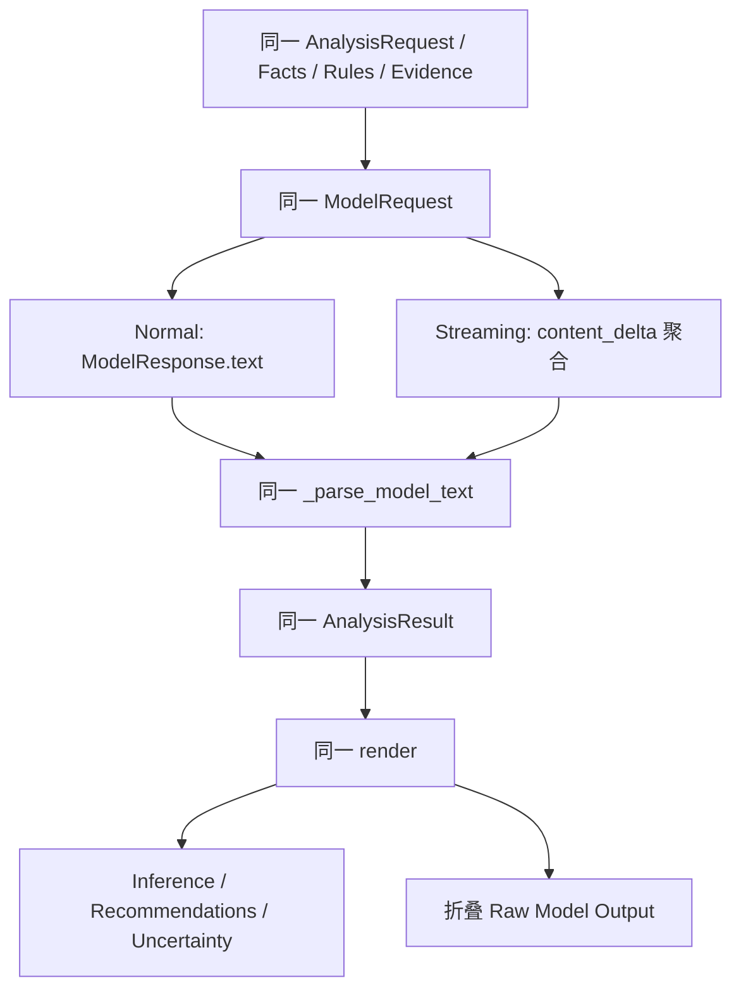

# V0.1.1-A3.2.1：最终输出一致性与 Capability UI 整理

> 文档分类：**HISTORICAL**。历史实施 / 验证记录；数字、限制与能力结论只对应当时版本，不是当前全局状态。 保留输出 parity、单次 Qwen 对照与开发 UI 改进证据。 当前边界见[架构总览](../../architecture/CURRENT_ARCHITECTURE.md)。

日期：2026-10-01。

## 1. 范围与结论

本轮处理 Normal / Streaming 最终展示差异，以及能力面板的证据折叠、状态颜色和 Probe 按钮布局。没有新增 Capability，没有修改 RAG、Grounding、Domain Rules、Capability Identity、官方能力声明或正式项目。

**CODE-CONFIRMED**：后端已经共享 `_build_model_request()`、`_parse_model_text()`、`AnalysisResult` 和 `result_to_dict()`。Streaming 将所有 `content_delta` 聚合后调用同一个解析器；Reasoning 采用单独的缓冲区。不存在两套模型输出解析器。

**CODE-CONFIRMED**：页面也已经共用 `render()`，但它包含 `streaming` 参数。Streaming 的 completed 事件调用 `render(..., true)`，继续显示 `streaming-output`，并把 `generated_text` 写入这个区域。这个 `<pre>` 又位于 Model Inference 面板内，旁边同时存在解析后的 `model-inference`。因此用户看到了原始 JSON 与业务推断同时出现。不是正文聚合后绕过后端解析器，也不是 completed 再次追加到同一个 inference 节点。

另一个防御性问题是：后端解析失败时会把原文保留在 `inference` 中作为兼容回退；旧 UI 会直接展示它。本轮保持后端合同不变，由统一 renderer 在 `structured_parse_ok=false` 时展示明确提示，原文只进入调试区。

## 2. 统一最终输出路径

- 删除最终 renderer 的 Streaming 模式分支；两种传输都使用同一个最终展示函数。
- Streaming 期间，原始正文进入独立的 `Live Raw Stream Preview`；它明确标为生成中的调试预览，不在 Model Inference 面板内。
- completed 或带 result 的 failed 事件到达后，隐藏实时预览并清空其内容；业务区只显示解析后的推断或安全失败提示。
- 原文统一保留在折叠的 `Raw Model Output`。
- 建议和不确定性仍分区显示；没有在浏览器增加模型 JSON 解析器。浏览器只解析 SSE 事件信封。
- `reasoning_delta` / `reasoning_content` 继续只进入折叠的 Reasoning 调试区，不参与正文聚合、结构解析或业务推断。

## 3. Capability UI

- 默认状态列表保留 Streaming、Thinking ON/OFF、Streaming + Thinking ON、Reasoning Effort、Structured Output、Tool Calling 七项。
- 状态使用文字“支持 / 未验证 / 不支持”，并分别使用 `capability-supported`（绿色）、`capability-unknown`（中性灰色）、`capability-unsupported`（红色）。颜色仅作辅助。
- 原有证据来源及来源列表、精确 Identity、支持值和默认 Thinking 放入默认折叠的“查看能力证据详情”。证据采用较弱的文字层级，没有隐藏能力状态。
- 默认 Thinking 仍在运行选择的提示中可见。
- Thinking ON/OFF 按钮改为单列；组合 Probe 及重新验证按钮同样限制为容器宽度，取消最小固定宽度并允许换行。
- 本轮没有添加验证耗时或逐条证据时间的后端字段；当前页面只展示现有公开合同提供的证据信息，不编造缺失数据。

## 4. 受控真实 Qwen 对照

**TESTED**：本轮只调用 DashScope 的精确内置 `qwen-plus-experimental` Profile，模型 `qwen-plus`，场景 `low_oxygen`，问题“当前水质情况怎么样？”。DASHSCOPE_API_KEY 为 PRESENT，Secret 仅在显式验证命令的启动边界加载，没有输出或保存其值。

使用现有 Orchestrator → OpenAICompatibleAdapter → OpenAI SDK，固定四个顺序执行的请求。SDK/Gateway retries 均为 0，每项实测只有 1 次请求。没有追加复测，没有调用 DeepSeek、Ollama 或其他模型。

为保证对照，固定程序时钟，复用同一组 Mock、DiagnosisService、KnowledgeService 和 Profile；Thinking OFF/ON 分别配对。GenerationOptions 均 UNSET，Effort 均 UNSET。同组请求除 `stream=true` 及 `stream_options.include_usage` 外的请求体摘要相同。四组 Observed Facts、Rule Results、RAG Evidence 完全相同，包括证据检索时间。

| 模式 | Thinking | 状态 / 解析 | 总耗时 ms | 正文 TTFT ms | Content delta 数 | Input | Output | Total | Reasoning Tokens |
|---|---|---|---:|---:|---:|---:|---:|---:|---:|
| Normal | OFF | 成功 / 成功 | 11656 | unavailable | 不适用 | 1245 | 468 | 1713 | unavailable |
| Streaming | OFF | 成功 / 成功 | 9563 | 469 | 91 | 1245 | 411 | 1656 | unavailable |
| Normal | ON | 成功 / 成功 | 11953 | unavailable | 不适用 | 1245 | 1405 | 2650 | 1126 |
| Streaming | ON | 成功 / 成功 | 17406 | 13328 | 65 | 1245 | 1402 | 2647 | 1093 |

总计 **4 次真实生成请求**；Input **4980**、Output **3686**、Total **8666 Tokens**。ON 两次返回的 Reasoning Tokens 合计 **2219**；OFF 未返回该字段，不能按 0 补齐，因此完整会话的 Reasoning Tokens 总量保持 unavailable。Cached Input Tokens 四次均为 Provider 返回的 0。

TTFT 是 Orchestrator 到首个 **最终正文** delta 的耗时，不是首个 Reasoning delta 的耗时；ON 的正文首字较晚，与先生成 Reasoning 的观测一致。这四个样本不足以作一般性能结论。

### Parity 判断

- OFF 两项、ON 两项均成功解析合法的 AnalysisResult：inference 为字符串，recommendations / uncertainty 为列表。
- 四项均识别当前溶氧 2.2 mg/L 的低氧问题，程序事实保持水温 28°C、pH 7.5，规则保持 OXYGEN_CRITICAL_LOW。
- 建议以增氧、减少耗氧负担、监测与进一步观察为主；没有在这些业务回答中诊断具体疾病或推荐具体药物剂量。
- 缺少氨氮、亚硝酸盐、鱼体症状、管理信息等进入 Uncertainty。有一次 OFF 输出在 Uncertainty 提及病原背景，但没有将其认定为现场疾病。
- OFF 未返回 Reasoning Content；ON 返回 Reasoning Content，并保持与最终正文分离。
- 语言、建议数量、换水比例等生成内容自然不同；这些都是模型建议，不是程序已经确认的事实。本轮不要求逐字一致，也未修改 Grounding 规则来消除这些内容差异。
- 四份真实结果及 Streaming 的原始 content deltas，已通过离线 Node DOM/SSE 回放进入当前最终 renderer，断言业务区等于解析后的 inference，实时原文预览已隐藏，Raw Model Output 与 Reasoning 只保留在折叠区。没有为页面回放再次调用 API。

UTF-8 原始验证记录（Git ignored）：

- `outputs/qwen-output-parity-20261001T095154Z-d9253bc1.json`：四次结果、正文 deltas、请求摘要、Usage、耗时。
- `outputs/qwen-output-parity-traces-20261001T095154Z-d9253bc1.jsonl`：现有 allowlist Trace，无完整 Prompt、模型正文、Reasoning 或 Secret。

## 5. 测试结果

### Targeted tests

| 命令 | 结果 |
|---|---|
| `.venv\Scripts\python.exe -m unittest discover -s tests -p test_output_parity.py -v` | 5 通过 |
| `.venv\Scripts\python.exe -m unittest discover -s tests -p test_v011_a31_streaming.py` | 13 通过 |
| `.venv\Scripts\python.exe -m unittest discover -s tests -p test_cloud_capability.py` | 21 通过 |
| `node --test tests/test_browser_streaming.cjs` | 28 通过 |

Python targeted 合计 39 通过。新增测试覆盖统一解析器、流式聚合、合法/围栏/损坏 JSON、Reasoning 分离、事实与合同一致、适配器请求体一致以及验证脚本四次预算和 Usage 安全。页面测试覆盖最终收敛、解析失败、证据折叠、状态 class 和单列按钮样式。初次新增测试中模拟 Usage 缺少 PROVIDER source 导致夹具被合同拒绝，修正夹具后通过；没有放宽领域合同。

### 最终完整离线回归

- `.venv\Scripts\python.exe -m unittest discover -s tests`：**139 通过**，测试执行约 5.36 秒。
- `node --test tests/test_browser_streaming.cjs`：默认 **28 通过**；本轮在子进程额外提供 `FISHERY_PARITY_RECORD` 指向上述记录后，包含真实结果离线回放，共 **29 通过**。
- `node --check src/fishery_ai/resources/web/app.js`：通过。
- `git diff --check`：通过。

所有自动测试完全离线；真实调用只来自显式执行的独立验证脚本。脚本不带 `--confirm-four-network-requests` 时返回 NETWORK_CONFIRMATION_REQUIRED，不联网。Secret 没有发送给浏览器，Trace 延续已有 allowlist。

## 6. 修改文件

修改：

- `src/fishery_ai/resources/web/app.js`：统一最终 renderer、分离实时原文、状态摘要与证据详情。
- `src/fishery_ai/resources/web/index.html`：新增独立预览区、证据折叠区和调试区 ID。
- `src/fishery_ai/resources/web/app.css`：三态颜色、证据层级、单列与容器宽度约束。
- `tests/test_browser_streaming.cjs`：新增 5 项默认测试及可选真实记录回放，更新旧 DOM 断言。
- `docs/deep-dive/README.md`：增加本报告导航。

新增：

- `tests/test_output_parity.py`：5 项离线对照测试。
- `scripts/validate_qwen_output_parity.py`：固定四次、显式确认、无重试的手动验证入口。
- 本报告。

## 7. 限制与后续

- 本轮只有一个精确模型、一个场景、四个请求的证据，不泛化到其他 Provider 或所有模型版本。
- 页面回归使用 Node DOM/SSE 行为测试；布局宽度通过 CSS 约束测试，没有进行所有桌面浏览器的像素或几何测量。
- 不增加复杂 JSON repair。解析失败保持原文与失败标记，业务区显示提示。
- UI 保证不将完整 `generated_text` 当作业务 inference；不能保证模型主动写入 inference 字段的每个字都正确。
- 模型给出的管理范围、频率、换水比例等仍需人工核查，未升级为确定性规则。
- Capability 身份、证据与能力状态未修改；本轮对照记录不会自动写入或覆盖 USER_VERIFIED Capability。
- 未实现 Tool Calling、Agent、Memory、Fine-tuning 或新 RAG 架构。
- 未修改 `D:\Fishery_Project`，未安装依赖，未 commit，未 push。

下一步可由用户在页面确认显示收敛体验，再另行定义输出质量评估范围；不自动追加真实请求。
