# 模型接入三模式设计说明

> 文档分类：**REFERENCE**。研究参考；保留当时假设与设计取舍，不是当前运行状态。 三模式产品决策仍有价值；V2 DEFERRED 和 R3 未实施属于原设计时点。 当前边界见[架构总览](../architecture/CURRENT_ARCHITECTURE.md)。

初稿日期：2026-10-02，历史基线为 R0/R1/R2。下方第 1–8 节保留初稿设计过程，不将其中的“尚未实现”视为当前状态。

本次产品定义校正与实际源码审计：2026-10-02；当前 Preset / Cancellation / Manual V1 / 三模式 UI 已实现且用户反馈人工验收基本正常。详细代码依据与 checkpoint 回归见[实施报告第 10 节](../history/implementation/PRESET_CANCELLATION_MANUAL_IMPLEMENTATION.md#10-manual-expert-产品定义校正与架构兼容性审计)。

## 0. 当前产品定位与冻结结论

| 模式 | 产品定位 | 资产及正式流程边界 |
|---|---|---|
| Preset | 项目维护、验证过并发布的固定模型方案 | 项目定义连接及 Variant，按版本化固定合同进入 Fishery Analysis；不承担实验配置。只承诺已发布行为，不扩大高级能力范围 |
| Managed Custom | 用户配置但遵循 Fishery 连接合同的正式 Connection | 使用正式 CredentialStore、Connection / Capability / Adapter 合同，可进入 Normal / Streaming Analysis；CRUD 属于该模式，不是任意 API 调试器 |
| Manual Expert | LLM / Provider API 实验台 | 当前 V1 借用 Saved Connection 发 Raw Request；长期支持独立 Manual Experiment，实验资产不混入正式模型列表 |

当前 V1 保留：

```text
Saved Connection → 独立 ManualRequest → Provider → Raw Response
```

长期方向（DEFERRED，并非近期实施承诺）：

```text
Manual Experiment
→ 独立实验配置（Provider/Protocol、Base URL、Model、Credential reference、Raw Request、必要元数据）
→ 同一安全凭据 / 传输 / Stop 边界
→ Provider
→ best-effort 常见字段展示 + 始终保留安全 Raw Response
```

**Manual Experiment != Managed Custom Connection。实验成功 != Fishery compatibility verified。** 不自动“Save as Managed Connection”，也不强迫实验使用 Managed Custom Profile schema。未来是否提供任一方向的转换机制：**NOT DECIDED**；如提供需独立的兼容性、Adapter 和 Capability 确认，本轮不设计转换。

实验可保存 credential reference / identity，不保存 Key、认证 Headers 或凭据文件路径；继续只用 PROCESS_ENV > user-private PROJECT_ENV > MISSING。不建立第二套 Secret 存储，不恢复源码根 .env。实验名和 ID 不得变成正式 Profile 或 Capability identity。

Response 的长期方向是可选展示 HTTP Status、latency、content、reasoning_content、finish_reason、usage、tool_calls，字段缺失就不显示、不伪造；未知结构保留 Raw。不建 Parser framework 或 canonical response schema，不进入 AnalysisResult，不执行 tool_calls。Raw 保留服从 Secret 脱敏和输出大小限制，不表示自动持久化所有原始响应。

**审计结论：未发现必须现在解除的结构 blocker；当前 V1 可保留，不修改核心实现。** 已保存 Profile 的目标解析、RuntimeSnapshot 的附带 Managed 字段、Chat Completions 专用 SDK cast 和共享前端选择器属于局部的 V1 范围限制，不是实验持久化模型。未来在目标准备边界新增独立来源即可，不需要改 CredentialStore、取消生命周期或 Fishery Analysis。本轮不增加空抽象，不实施 V2、Experiment CRUD、新 Adapter / Provider、R3/R4/R5 或转换机制。

## 1. 历史代码事实（R0/R1/R2 初稿基线）

**CODE-CONFIRMED**：

- `web.py::_builtin_profiles()` 加载 Qwen Plus、DeepSeek Flash、Ollama Qwen3.5 4B 和 Mock。三个真实 Built-in 仍为 EXPERIMENTAL；Built-in 只表示项目提供、配置只读，不等于已完成稳定性验收。
- Web 启动时对 Built-in 和 User Custom 都调用 `CapabilityStore.apply()`，将官方、Metadata、Probe 结果合入同一 `ModelCapabilities`。普通分析并不会每次自动 Discovery 或 Probe；请求开始时冻结 RuntimeSnapshot，再校验本次选项。
- `ProviderSpec.protocol_spec_id` 目前只是引用。Thinking 编码、精确模型白名单仍位于 `OpenAICompatibleAdapter`；`max_tokens_field` 等协议知识仍混在 Capability 中。当前没有独立 ProtocolSpec、Evidence Resolver 或三模式字段。
- `ModelRequest` 只有 messages、GenerationOptions、ReasoningOptions；Adapter 会合并 Profile 默认值，并调用 CapabilityValidator。它目前不能作为“不注入默认值”的 Manual 原始请求通道。
- R1/R2 的 CredentialStore、不可变 CredentialSnapshot、安全 `.env` Writer、Web 安全门禁、热读取与认证缓存失效已经独立于 Capability。

依据：[重构研究](PROVIDER_CREDENTIAL_CAPABILITY_REFACTOR_RESEARCH.md)、[R0/R1](../history/implementation/PROVIDER_CREDENTIAL_REFACTOR_R0_R1.md)、[R2](../history/implementation/PROVIDER_CREDENTIAL_REFACTOR_R2.md)，以及当前 `providers.py`、`model_gateway.py`、`model_options.py`、`openai_compatible_adapter.py`、`capability_store.py`、`capability_probe.py`、`web.py`、`application.py`。

## 2. 三种模式的边界

以下为 **RECOMMENDATION**；三模式方向按本次决定执行。

| 模式 | 请求依据 | 能力依据与门禁 | 适用场景 |
|---|---|---|---|
| Preset | 项目维护的模板 + Variant | 版本化固定 Capability Contract；按合同校验，不依赖运行时 Resolver | 稳定、重复使用的模型接入 |
| Managed Custom | 用户连接配置 + 语义选项 + ProtocolSpec | 精确 Identity 的 Evidence，经未来 Resolver 得到能力；UNKNOWN 高级选项仍需验证 | 已知 Provider 的任意 Model；未知 Generic 服务保守使用基础协议 |
| Manual Expert | 用户控制的允许范围内请求体 | 不运行 Capability 判断，不继承默认选项；只做结构与安全检查 | 专家调试协议和高级参数 |

建议使用独立 `access_mode`，不要复用当前 Chat/Advice 的 `Mode`、Normal/Streaming 的 Response Mode、Built-in/User Custom 的管理来源，或 EXPERIMENTAL/VERIFIED/CUSTOM 状态。凭据来源与三种模式也无绑定关系。

## 3. Built-in 如何演进为 Preset

**建议一个模板 + 多个 Variant，不复制多份连接/Profile 文件。** 模板保存精确 service、adapter、规范化 URL、model、ProtocolSpec 引用、认证引用与 timeout；Variant 只保存选项差异、允许调整范围和合同引用。服务协议不同才拆模板，不按每个 Thinking/Streaming 组合复制文件。

当前 Built-in 是迁移候选，不能直接全部标成稳定 Preset。维护者先审阅现有官方声明与实测记录，形成固定合同和请求体兼容基线，再明确发布哪些 Variant；Mock 保留离线演示身份。旧 profile_id 可保留为默认 Variant 的兼容入口，不重写已有 User Custom、Evidence 或运行偏好。

Variant 要明确语义：例如“普通回答（Thinking OFF）”与“思考回答（Thinking ON）”；只有合同支持 OFF 才提供前者。AUTO 使用服务默认行为，不能当作 OFF。Response Mode 的 Normal 仅表示非流式，不代表无思考；Streaming 是否可选由独立组合合同决定。

### Preset Capability Contract 保存什么

- preset/contract 版本、精确连接与模型范围、适用 ProtocolSpec 版本。
- Streaming、Thinking ON/OFF、默认 Thinking、Effort 精确值、采样选项及边界。
- Streaming + Thinking 的组合支持、选项冲突、Streaming Usage 策略。
- 各 Variant 固定值与可调整值；尚未确认项保持 UNKNOWN，不因为 Preset 名称补成 SUPPORTED。
- 维护依据：官方来源、审阅日期、离线请求体基线、已授权实测说明。Tools/Structured Output 仅保留现有状态位置，不实现功能。

合同是维护者发布的静态承诺，不是伪造 USER_VERIFIED 的捷径。可复用现有 ModelCapabilities 作为有效视图，版本与维护说明单独保存，避免第二套 Capability 枚举。模型别名上游变化仍可能破坏合同，需要重新验收和升级版本。

Preset 固定引用 ProtocolSpec 编码，同样走 Credential、Gateway、Adapter、Streaming。**不再让本地 Evidence 自动覆盖 Preset 合同**；运行失败仍返回安全错误，可提示维护者复核，不自动降级、切换 Variant 或改合同。可人工记录诊断证据，但普通请求不依赖 Discovery/Resolver；每次仍进行固定合同和安全校验。

改变 URL/model/协议范围后，应显式转为 Managed Custom 或 Manual，不能继续继承原 Preset 合同。

## 4. Managed Custom 的链路

```text
Provider + 用户连接/精确 Model → 选择 ProtocolSpec
精确 Identity + Official/Metadata/Probe Evidence → 未来 Evidence Resolver
有效 Capability → 默认偏好安全回退 → 本次语义选项校验 → Adapter 编码
```

ProtocolSpec 只回答“如何编码”，不证明模型支持。Provider 有多种协议变体时使用小型明确选择/例外表，不能按模型家族、名称相似或 URL 关键词猜能力。任意 Model 不意味着所有高级选项可用。

UNKNOWN 时 Normal + AUTO/UNSET 继续可运行；显式高级选项通过 Metadata、官方精确记录或用户确认的 Probe 获得证据。R4 负责证据保留与冲突解释，R5 才扩展未知模型 Probe。Probe 一次最小请求、retry=0、不执行 Fishery 分析；网络失败不写 UNSUPPORTED。

Evidence 继续绑定 `service_id + adapter_id + normalized base_url + exact model`；未来同时记录协议变体/版本，避免旧编码的实测结论无条件授权新编码。静态维护依据可以被 Managed 作为证据输入，但不能借此覆盖 Preset 合同。

## 5. Manual Expert 如何与 Capability 隔离

采用独立开发者请求入口与显式请求类型，**不通过把全部能力标成 SUPPORTED，或给普通请求开放 allow_unknown 来实现**。

- 不调用 CapabilityStore/Resolver/Validator，不做 Metadata/Probe，不写 USER_VERIFIED。
- 不调用当前 `effective_runtime_defaults()` / `effective_options()`；不继承 Profile 的 Thinking、Effort、采样或响应偏好。
- Adapter 使用独立 passthrough 分支，保留用户请求字段语义，不自动加入 Thinking/Effort、include_usage、tools 或结构化输出参数，也不静默删掉未知字段。
- 仍校验 JSON 结构、体积、连接/模型一致性；凭据、目标 URL、headers、timeout、重试和未来 Stop 由安全执行层控制，不能被原始 body 覆盖。不开放任意认证 header，不保存带 Secret 的模板或完整原始请求日志；默认 retry=0，显式真实请求确认。
- 不走任意 Prompt 下的 Fishery Orchestrator，不制造带事实/规则背书的 AnalysisResult。返回开发调试结果，可复用 ModelResponse/ModelEvent、Usage 与安全元数据；返回 tool call 不会执行工具。

“请求字段语义保留”不等于逐字节 HTTP 透传；SDK 对未知字段的承载方式需在 Manual 实施时单独验证。本阶段不设计模板执行语言，也不增加任意代码执行。

## 6. 汇合位置

```mermaid
flowchart TD
    P[Preset 模板与 Variant] --> PC[固定合同校验]
    M[Managed Custom] --> MC[ProtocolSpec + 有效能力校验]
    X[Manual Expert] --> XC[独立原始请求与安全检查]
    PC --> G[ModelGateway 执行边界]
    MC --> G
    XC --> G
    G --> A[Adapter 内分流：语义请求编码 / Manual passthrough]
    A --> T[共享 SDK/传输：CredentialSnapshot、Timeout、Retry、Streaming、未来 Cancellation]
    T --> R[ModelResponse / ModelEvent / Usage / 安全错误]
```



Preset/Managed 可以继续使用当前语义 ModelRequest；未来 Manual 需要明确的独立请求载体，不能直接塞入现有 GenerationOptions 字典。三者在 Gateway 的公共执行边界汇合，模式策略在请求准备与 Adapter 编码处选择，Orchestrator 不出现厂商判断。私有 prepared payload 如确需增加，应留在 Adapter 内部，不把厂商参数搬入业务层。

## 7. R3 应缩小到什么

**R3 只做现有协议映射抽取和兼容接线，主要服务 Managed，并允许未来 Preset 固定引用。**

1. 将当前 DashScope 常规/Omni、DeepSeek、Ollama 与 Generic 的已有编码整理为少量静态 ProtocolSpec/翻译函数，区分“映射存在”与“能力获准”。不扩展厂商或模型能力。
2. 接通现有 ProviderSpec 引用及精确协议例外选择，在请求开始时固定所选协议/版本；旧 Profile 无新字段时由兼容选择得到当前相同编码，无须批量改 JSON。
3. 保持现有默认值、Capability gate、Probe 范围和 Normal/Streaming 请求体一致，沿用 R0 请求体基线保护。
4. 暂不迁移整个 Usage/Metadata/错误处理体系；输出长度等混入 Capability 的编码字段可先保留兼容桥，不要求一次清完技术债。

R3 **不实施**三模式 UI、Preset 发布迁移、Evidence Resolver、未知模型 Probe、Manual passthrough、Cancellation 或 Tool Calling。只预留显式协议选择边界，不搭建通用协议插件框架。

## 8. 保持不动与最小迁移顺序

保持 R0 兼容 fixtures、R1/R2 Credential 及 Writer/Web 安全、Profile 旧字段和 ID、已有 Evidence/Defaults 存储、RAG、Grounding、Diagnosis、Orchestrator 业务流程、结果解析、Streaming 展示与 Trace 白名单。Gateway 的 complete/stream、Usage 和 SDK 执行设施尽量保留；Manual 未来确需扩展请求类型时，增加显式通道而非复制传输栈。

| 顺序 | 最小交付 |
|---|---|
| 1. 本次 | 明确三模式边界；仅文档 |
| 2. R3 | 静态 ProtocolSpec + 兼容 Adapter 编码，旧离线基线不变 |
| 3. Preset 小迁移 | 一个经维护者验收的模板 + 必要 Variant + 固定合同，分开加载策略；不等待 R4 |
| 4. R4 / R5 | 只加强 Managed 的 Evidence Resolver、冲突说明与未知模型显式 Probe |
| 5. R6 | 公共执行层 Cancellation，覆盖现有调用类型 |
| 6. R7 | 在取消保护可用后开放独立 Manual Expert，不改 Managed 门禁 |

未来实施时优先验证：Preset 不被用户 Evidence 覆盖；Managed UNKNOWN gate 保留；Manual 无默认参数注入或能力写入；三模式共用同一凭据安全与输出后禁止重试规则。实施范围分别确认，不在 R3 中一次性引入这些行为。

本轮只新增本文；未运行模型、未读写真实 `.env`、未修改正式项目、代码、测试或现有 Profile，未 commit/push。文档任务未运行自动测试；R2 的测试结果仅是历史基线。
